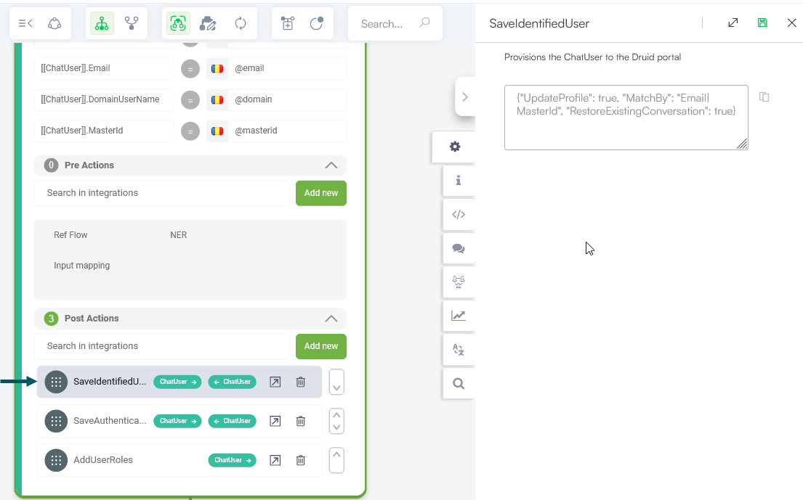

By default, all users who initiate a conversation with a Druid AI Agent are NOT authenticated – they are associated to the generic user **Anonymous**. To authenticate anonymous users, you must configure an authentication flow (dialogue).

You can authenticate the users chatting with your AI Agent asking specific questions and checking the provided information with the Druid back-end systems.

Using the Flow Designer, create and configure an authentication flow, following this sequence of actions:

You can also use authentication for other channels like: Teams, Facebook or WhatsApp when the user is chatting with the AI Agent for the first time.

## Step 1: Ask authentication questions

Ask the user to provide authentication information. It can be: VAT Code, Client ID, Email address, Date of birth, Phone number, Badge (for employees) etc.

## Step 2: Verify user credentials

Based on the information provided by the user, search for the user in linked apps like CRM, ERP etc. For higher security, you might want to use two-factor authentication, sending SMS code, typing DNA, asking security questions from the user profile etc. To verify user credentials, you can use external actions on the authentication flow (step).

## Step 3: Save the user profile

Call the internal action **SaveIdentifiedUser** to match existing profile or provision the user as authenticated user in the Druid AI Platform.


**IMPORTANT!** **DO NOT** use the internal action **SaveIdentifiedUser** to change an authenticated user to another one (e.g., switch the current conversation from Jane to John).


The table below lists the \[\[ChatUser]] attributes expected as input by the SaveIdentifiedUser action. In the Set Variables section of the step where you call the internal action **SaveIdentifiedUser**, provide the variables listed in the table below. While the **DomainUserName** which is optional, you need to provide it as well if you integrate with Active Directory or other user management systems.

| ChatUser Attribute      | Description                                                                                                                                                                                                                                               |
| ----------------------- | --------------------------------------------------------------------------------------------------------------------------------------------------------------------------------------------------------------------------------------------------------- |
| ChatUser.MasterId       | The business unique key for the user. It is the Badge for an HR AI Agent, the Client Id or VAT No or CNP for a Customer Support AI Agent. This is a **mandatory** attribute.                                                                              |
| ChatUser.DomainUserName | Used in AI Agents for employees, like the HR AI Agent or the Help Desk AI Agent. It is used in Active Directory integrated AI Agents (intranet web page) or MS teams AI Agents.                                                                           |
| ChatUser.Email          | The email should be unique across users on your tenant. If an existing user has the same email address as the new one, the **SaveIdentifiedUser** action will raise an error and will not create the new user profile. This is a **mandatory** attribute. |
| ChatUser.FirstName      | The user's first name. This is a **mandatory** attribute.                                                                                                                                                                                                 |
| ChatUser.LastName       | The user's last name. This is a **mandatory** attribute.                                                                                                                                                                                                  |

The **SaveIdentifiedUser** system action searches the list of users on the tenant for an existing user profile by the **MasterId** field. If found, the current user is linked to the respective profile. If not found, a new profile is created.

If a match is found, than the AI Agent impersonates the user and from that moment, the user is no longer anonymous but identified.

If **DomainUserName** exists as well, the pair **MasterID – DomainUserName** is used to identify the user.

The system applies the following criteria for matching the user profile:

* Searches for the **MasterId**. If found, then checks the **DomainUserName**. If there is match, it links it with the existing profile.
* If the **MasterId** exists and the **DomaninUserName** does not match, it updates the existing profile with the new **DomainUserName** and links it with the existing profile. The existing profile is updated with the FirstName, LastName, Email and DomainUserName.
* If the **MasterId** is not found, it creates a new user profile.

## Step 4: Authenticate conversation

Call the internal action **SaveAuthenticatedUser** to set the current conversation as authenticated.


**NOTE:** The messages in chat will be sent by the new \[\[ChatUser]].FirstName of the recently authenticated user. If you want to change the user's name in the chat snippet to a specific name, you can further use a backchannel step and configure it based on your use case. For more information about backchannel event steps and the two use cases available, see [Backchannel Event Steps (Bot Framework v4)](https://druidai.gitbook.io/druid-ai-docs/ai-platform/build-ai-agents/authoring-tools/flows/conversational-flows/flow-steps/backchannel-event-steps-bot-framework-v4).


For the web channels using the Druid webchat snippet, you can also add a second step of type Back Channel to change the user name listed in the conversation.

After the authentication flow completes, you might want to return the user to the initial flow from where the authentication flow was triggered.

To do so, you can configure the user-authenticated step in a step of type trigger flow as follows: from the **Type** field, select **Flow** and in the **Input mapping** field, enter **@AuthOriginalFlow**.

Once the user is authenticated in the conversation context, the AI Agent will return to the flow from which the authentication was triggered.

## Changing the AI Agent name and the user’s name

You can use backchannel events to change the AI Agent and the user’s name in the chat. You can do so by adding a step of type Backchannel Event on the authentication flow. Name the step **ChangeDisplayName** and in the **Input mapping** field, add the entity that stores the AI Agent and user name (the entity has these two entity fields: **BotDisplayName** and the **UserDisplayName**). You can either change both the AI Agent and the user’s name or only one of them based on your needs.

Example:

## Step 5: Assign roles to authenticated user (Optional)

Optionally you can assign specific roles to the authenticated user by calling the internal action **AddUserRole** and entering in the text field the roles to be assigned. Specify the roles between brackets, separated by comma. Example \["User","Admin"]

## Step 6: Select the AI Agent authentication flow

This authentication flow can be set up as special flow on the AI Agent. Click the AI Agent, go to **Special flows** and select the your autehntication flow as **Authentication special flow**. This means that when an unauthenticated user reaches a flow that requires authentication, the special authentication flow will be triggered.

There are various ways in which the user can be sent to the authentication flow.

* You can redirect users in the welcome flow and the welcome flow does not require authentication. This means that you trigger the authentication flow from the welcome flow.
* Or on the welcome flow you trigger a menu flow and the menu flow requires authentication. This means that when the user reaches the menu flow, authentication is triggered.
* Or the welcome flow requires authentication.

## ChatUser information automatically available in the conversation context


**NOTE:** A user can initiate conversations with an AI Agent from different messaging channels (MS Teams, Facebook, WhatsApp, etc.). For each user (authenticated of not), the used channels can be managed in User configuration page / **Channels** tab.


The AI Agent automatically provisions a set of ChatUser parameters in the conversation context. The ChatUser information available within the conversation context is specific per channel, as follows:

### MS Teams

* ChatUser.Email
* ChatUser.FirstName
* ChatUser.Lastname
* ChatUser.DomainUserName
* ChatUser.UserId – the MS Teams user id.
* Chatuser.UserName – the FullName, delivered by MS Teams.

### Facebook

* ChatUser.UserId – the Facebook user id.
* Chatuser.UserName – the FullName, delivered by Facebook.

### WhatsApp (Nexmo)

* ChatUser.UserId – holds the incoming phone number

### Google Chat (available for Druid v1.55 or higher)

* \[\[ChatUSer]].Email - holds the Google user's email.
* \[\[Chatuser]].FirstName - holds the Google user's display name.

### Authenticate user in Telephony

* ChatUser.UserId – holds the incoming phone number.

### Telegram

* ChatUser.UserId – holds the incoming phone number.

### Viber

* ChatUser.UserId – holds the incoming phone number.
