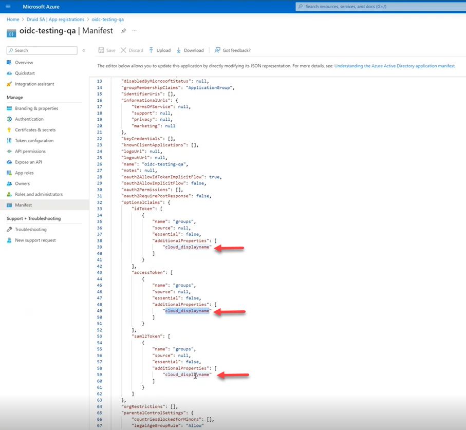

At Druid, we understand that most organizations rely on third-party identity providers to handle authentication while providing their employees to use a single secure means that serves as a universal login to all their accounts (Single Sign-On).

Druid admins can use an external identity management system that is storing users’ electronic identity to authenticate authors in Druid Portal.

Druid provides you with the possibility to leverage the use of a unified authentication system(s) by enabling OpenID Connect authentication with an external Active Directory system.

OpenID Connect is an identity layer (a middleware) that sits on top of OAuth 2 and allows easy verification of the user's identity, as well as the ability to get basic profile information from the identity provider (in this case, an external AD system). It allow authors and business users to log into the Druid Portal with a [certified OpenID Provider](https://openid.net/certification/) configured by their Druid Portal admin.

By using OpenID Connect authentication on your Druid tenant you ensure that all your AD users logging into the Druid Portal with their AD credentials are automatically provisioned in Druid at their first login.


**NOTE:** In Druid 9.8 and higher, when users authenticate via OpenID Connect SSO, Druid automatically handles account provisioning and updates. If an SSO user's email matches an existing manually-created portal account, the system merges them intelligently—updating user properties and roles from the identity provider while preserving critical identifiers like the masterId. This ensures seamless integration between your existing user base and SSO authentication without creating duplicate accounts.


The figure below provides an overview of how Druid Portal authentication with OpenID Connect works.

This section is for Druid Portal administrators in charge of managing Portal users.

## Step 1. Set up roles for automatically provisioned users


**IMPORTANT!** All AD users provisioned in Druid Portal through OpenID Connect will be automatically assigned with the roles set as **Default**. You can map Druid roles to AD groups / roles, so that when provisioning users from a specific AD group they will be assigned with the Druid roles mapped for that AD group.


To set up default role(s) to be assigned to automatically provisioned users, from the **Administration** menu, click **Roles**. Edit the desired role(s) by selecting **Default**.

Whenever new users log in Druid Portal for the first time, they will be assigned with the default role(s).

## Step 2. Set up Druid Portal authentication with OpenID Connect

**Prerequisites**

* You need to have a Druid Portal admin account.
* Register Druid Portal with your OpenID Connect (OIDC) and external Active Directory System.
* In your Active Directory system, configure the OIDC (Authentication area) by adding a web platform and specifying the Druid URL as Redirect URL in the following format:

_https:/_/_.Druidplatform.com/account/login_

Example: Redirect URL in Microsoft Azure

* In your Active Directory system, configure the OIDC API permissions by adding the **User read**, **openid** and **profile** permissions.

Example: API permissions for OIDC in Microsoft Azure

To set up Druid Portal authentication with OpenID Connect, in Druid Portal, from the **Administration** menu, click **Settings** and in the Settings page, click the **External Login Settings** tab.

By default, Druid Portal is not linked to an external AD system. Authors and business users can log into the Druid Portal using the account credentials provided to them by their Druid administrator.

Under OpenIdConnect, uncheck **Use Host Settings**. The OpenIdConnect section expands.

By default, the label of the authentication with OpenId Provider on the login page is OpenId Connect. If you want to change the button label, select **Configure login button** and in the **Login button label** field that appears, enter the desired label (text).

In the **Email for new user authentication** field, enter the email address of your admin(s) who will be in charge of managing user roles and privileges. Every time a new user is automatically provisioned in Druid Portal, the admin will get an email notification and can review that user’s privileges based on business need to know.


**Info:** If you have more than one Portal administrator and you want them all to be notified when new users are provisioned in Druid, enter their email addresses separated by comma with no spaces.


From the **Response Type** field, select the authorization processing flow to be used. You can use one of the two authentication paths for authentication with OpenID Connect based on how you configured your OpenID Connect:

* Authorization Code Flow. All tokens are returned from the Token Endpoint. The access-token never reaches and is never stored on the user’s machine with the browser/app. To use this authorization processing flow, select **code**.
* Implicit flow. The access token is stored on the user’s machine with the browser/app. To use this authorization processing flow, select **id\_token**.

Enter the **Client ID** and **Client secret Value** valid at the Authorization Server. These are the application/ client ID and secret you get when registering Druid Portal with your OpenID Connect provider.

Example: App ID from Microsoft Azure

Example: Client secret Value from Microsoft Azure

OpenID Connect use scope values to specify what access privileges are being requested for Access Tokens. Scopes are also used to request that specific sets of information be made available as Claim Values.

In the **Scope** field, enter the value **openid profile** to request access to the user’s default profile claims: FirstName, LastName, Phone, Email, MasterId and DomainUsername.

In the **Authority** field, enter the authority URL, using the following format:

https:///\<Directory (tenant) ID>/\<OpenID Connect version (e.g., v2.0)>

In the **Login URL** field, enter the full URL to the /authorize endpoint. It has the following format:

https:///\<Directory (tenant) ID>/oauth2/\<OpenID Connect version (e.g., v2.0)>/authorize

You can copy the two URLs for Authority and Login from your OpenID Connect provider configuration. Example: Microsoft Azure AD configuration

If you’re using Request Type **code**, you also need to provide the **Token endpoint url**. Example: Microsoft Azure AD configuration

If the Token endpoint does not provide the full user profile details but your OpenID Connect provider offers the UserInfo endpoint to provide additional user profile information, you might want to provide the **User info endpoint url** to retrieve additional user information.

In the Claims Mapping table, map the claims returned by the Active Directory authorization server (**Claim Keys**) to DRUID entity fields (**Claim values**). You can map claim keys to the following claim values:

* FirstName
* LastName
* Phone
* Email
* MasterId
* DomainUsername

* DRUID claim values are case-sensitive.
* By default, two claims are preset (user ID / unique\_name and the claims schema).


**IMPORTANT!** You cannot currently map two claim keys to the same claim value.


## Step 3. Provision users from Active Directory (Optional)


**NOTE:** Provisioning users from Active Directory is available in DRUID 5.11 and higher.


### Prerequisites

* You have users assigned to AD groups.
* In your OIDC application, configure the token by specifying the claims you want in the tokens sent to DRUID. Based on your OIDC provider, special configurations might be required for OIDC to get the name of the AD groups. To find out more, we recommend you to consult your OIDC provider documentation.

The next section provides as example the prerequisites for Azure AD.

### Azure AD Prerequisites

In Microsoft Azure AD configuration page, under the **Manage** menu, click **Token Configuration** and add a group claim. Configure the group claim as follows:

* Select **Groups assigned to the application**. Due to the group number limit in the token, this option is mandatory for Azure AD.
* For Azure AD, for all token properties (ID, Access, SAML), select **Group ID**.


**NOTE:** To get Azure AD groups in DRUID, in the Druid Portal you need to select **id\_token** (implicit flow) from the **Response type** field.


* For Azure hybrid AD, for all token properties (ID, Access, SAML), select **sAMAccountName**.

The "sam\_account\_name" property is automatically added in the application’s Manifest under the Optional claims schema.

* To get the name of the AD groups for Azure AD, in the Azure AD application, on the **Manage** menu, click on **Manifest** and in the manifest (JSON field) under the Optional claims schema, add the property “cloud\_displayname”.

* Select the groups assigned to the application. In Azure AD, From the Enterprise applications list, select the application. On the **Manage** menu, click **Users and groups** and select the group(s) you want to add to the application. If you have no groups here, add them first and then select the ones you want to send to DRUID.

To learn more about group claims configuration, see [Microsoft documentation](https://learn.microsoft.com/en-us/azure/active-directory/develop/active-directory-optional-claims).

### Provision users from AD

To provision users from AD groups they are members of, in DRUID, you have to map the AD groups to DRUID security roles.

In Druid Portal, from the **Administration** menu, click **Settings** and in the Settings page, click the **External Login Settings** tab. Scroll -down to section Single Sign on group roles mapping.

Enter the name of the AD group (the name of the group as defined in Active Directory) and from the drop down select the DRUID role(s) you want to assign to users who will be provisioned from that AD group. Click the **Add** button.

Map DRUID roles to as many AD groups as you want making sure that you provide the exact name of the group as defined in Active Directory.

A new user provisioned in DRUID will be assigned with the reunion of associated DRUID roles for all AD groups that user is member of. For example, if a user is member of two AD groups (Druid MFA and Druid Microsoft 365) and the two AD groups are mapped to three DRUID roles in the Single Sign on group roles mapping table, the user will be assigned all DRUID roles from the mapping table.

If the user is member of an AD group for which there is no DRUID role mapped, at provisioning, the user will be assigned the role(s) set as **Default**, if there are any defined; otherwise the user will be provisioned without any role associated and the administrator will have to manually assign a DRUID role for that user.


**IMPORTANT!** The mapping of the AD groups to DRUID security roles is validated and updated at every user login and it is updated based on the changes done in Active Directory, if any. For example, if in Active Directory a user has been moved from an AD group to another one, when the user logs in DRUID, the mapping of the AD groups to DRUID security roles is validated and the user will be assigned with the DRUID role(s)mapped for the new AD group the user is member of (if any).


## Step 4. Allow user registration and activate new accounts

DRUID provides built-in functionality to manage user registrations. To allow new users to register themselves to the Druid Portal, on the **Administration** menu, click **Settings**. In the Settings page, click the **User Management** tab, and in the Form-Based Registration area, select **Allow users to register to the system**.

By default, new users are inactive and unable to log in until their DRUID administrator manually activates their accounts.

To activate new self-registered users, select **New registered users are active by default**.


**Info:** If your company policies requires using a captcha on user registration and / or at log in, you can use security image question (captcha).


Save the changes. New users can now register themselves and access the Druid Portal.

## Step 5. Review provisioned users roles and privileges (ongoing task)

New users provisioned in DRUID are automatically assigned with the roles marked as default.

Whenever a new user is provisioned in Druid Portal, you as the Portal admin get an email notification. You might want to review the user’s assigned roles and make the proper changes based on business need to know (roles and privileges).

## Other identity standards and protocols available in Druid

| Protocol/standard      | What it is                                                                                                                                                                                                              | When to enable                                                                                                                                                                             |
| ---------------------- | ----------------------------------------------------------------------------------------------------------------------------------------------------------------------------------------------------------------------- | ------------------------------------------------------------------------------------------------------------------------------------------------------------------------------------------ |
| LDAP                   | An application protocol used for accessing and maintaining distributed directory information services over an IP network. The function of LDAP is to enable access to an existing directory like Active Directory (AD). | Allow AI Agent authors and business users to log in the Druid Portal using their AD account credentials.                                                                                   |
| WS-Federation (WS-Fed) | A Microsoft standard used extensively in their applications. It defines the way security tokens can be transported between different entities to exchange identity and authorization information.                       | Allow authors and business users to log in the Druid Portal with a WS-Federation authentication provider like Active Directory Federation Services (ADFS) or Azure Active Directory (AAD). |
