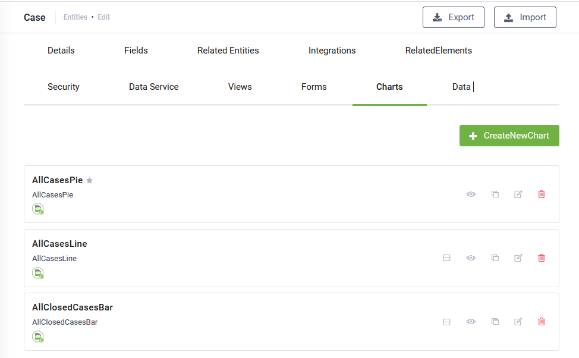
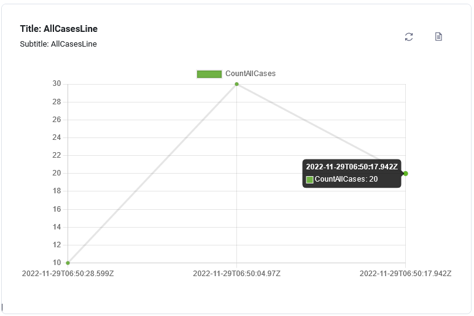
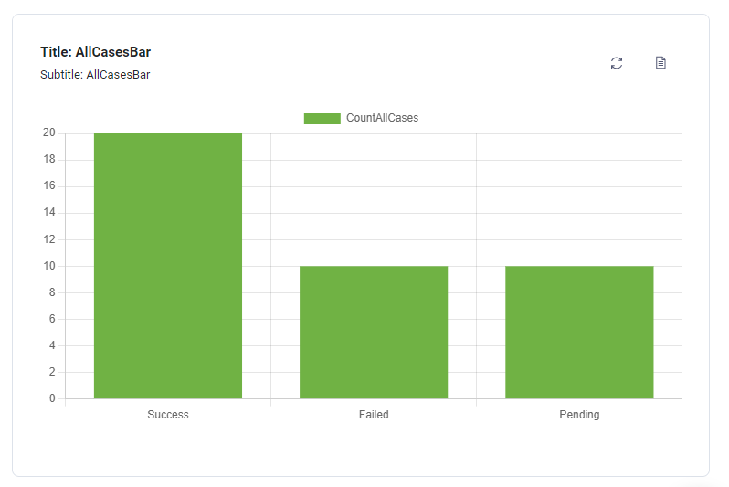
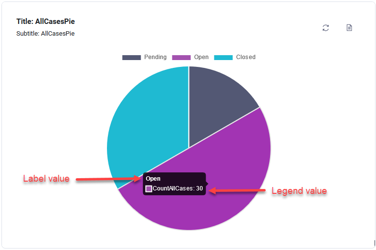
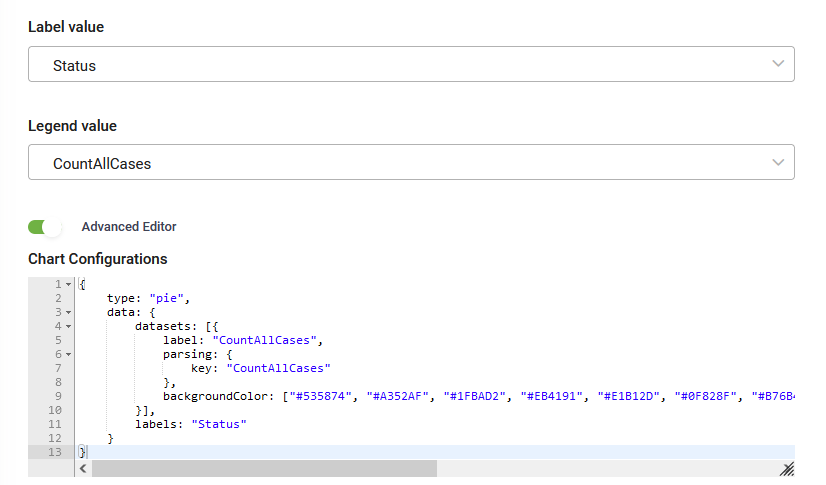

Charts are a powerful tool that allows authors to provide business users with grouped information about entity records. You can define charts on entities, add them to dashboards, and then include those dashboards as workspace links for easy access.

By default, a chart does not group entity records information. You need to have an integration that brings values only in decimal and integer format and show those values in charts.

As a best practice, first get business entity records through an integration and then do an integration another entity to manipulate the business records from the previous integration. For instance, suppose you have a list of cases stored in the \[\[Case]] entity. If you wish to incorporate charts for this entity, you can create an additional entity named \[\[CaseReporting]]. This entity allows you to aggregate or group your data, such as calculating the number of cases per status (open, closed, pending


**Info:** You can use dynamic charts to perform data grouping directly from the user interface. With dynamic charts, there is no longer a need for additional integration to group the data.


## Create Charts

At authoring time, the authors can define multiple charts for an entity. In a future release, charts defined at the entity level can be also added as elements to forms.


**NOTE:** Rather than building charts from scratch, you can leverage AI Authoring Agents. By launching the Workspace Designer from the Page Help icon, you can describe your chart requirements in natural language to automatically create the chart following the Workspace Designer guidance in the chat. For more information, see [AI Authoring Agents](https://druidai.gitbook.io/druid-ai-docs/ai-platform/build-ai-agents/ai-authoring-agents#Create3).


To create a chart, follow these steps:

### Step 1. Create the chart

1. From the solution drop-down, select the desired solution and on the **Solution Contents** menu, click **Entities**. The page displays the list of entities linked to the current solution.

2. Select the entity for which you want to create a chart. The entity configuration page appears on the **Details** tab.
3. Click the **Charts** tab. The list of charts created for the current entity appears. If there haven’t been defined any charts, the page is empty.

4. At the top-right corner of the page, click the **Create new chart** button. The Create new chart pop-up appears.
5. Provide a chart name, add a comment and from the **Chart type** drop-down, select the desired chart type. The following chart types are available:

* **Bar** - Bar charts are one of the most common data visualizations. You can use them to quickly compare data across categories, highlight differences, show trends and outliers, and reveal historical highs and lows at a glance.
* **Line** - The line chart connects several different data points, presenting them as one continuous evolution. Use line charts to view data trends, usually over time.
* **Pie** - A pie chart doesn’t give business users a way to quickly and accurately compare information. Pie charts make sense to show a parts-to-whole relationship for data broken-down into categories.
* **Doughnut** - Similar to a Pie chart, this visualization displays a parts-to-whole relationship but with a hollow center. This design offers a modern aesthetic and improves readability by focusing the user's eye on the length of the outer arcs rather than the central angles. It is ideal for dashboards where you want to emphasize a total value or provide a cleaner, more contemporary look. This type of charts is available starting with Druid 9.21.


**NOTE:** Even if in Druid platform at this moment, only the selected chart types are available as drop-down selection you can use the advanced editor, **Custom query** to add also other chart types. For more information on chart types you can configure using the editor, see [Chart.js samples and documentation](https://www.chartjs.org/docs/latest/samples/information.html). You can copy chart configuration code from Chart.js samples and paste the code in the Advanced data editor .


6. Click the **Save** button.

### Step 2. Configure charts

In the Charts list, click the edit icon displayed in line with the desired chart. The chart configuration page appears. Its content varies based on the chart type. The configuration page contains chart settings on the left and a chart preview at the right.

The following parameters are generic to all charts.

| Parameter            | Description                                                                                                                                                                                                                                                                                                                                                                                                                                                                                                                                                                                          |
| -------------------- | ---------------------------------------------------------------------------------------------------------------------------------------------------------------------------------------------------------------------------------------------------------------------------------------------------------------------------------------------------------------------------------------------------------------------------------------------------------------------------------------------------------------------------------------------------------------------------------------------------- |
| Name                 | The name you provided when creating the chart. It is used by DRUID platform in the backend.                                                                                                                                                                                                                                                                                                                                                                                                                                                                                                          |
| Display Name         | The Title of the chart, localized.                                                                                                                                                                                                                                                                                                                                                                                                                                                                                                                                                                   |
| Details              | The Subtitle of the chart, localized.                                                                                                                                                                                                                                                                                                                                                                                                                                                                                                                                                                |
| Entity               | The current entity. Non-editable.                                                                                                                                                                                                                                                                                                                                                                                                                                                                                                                                                                    |
| Integration          | Select the integration that will populate the chart with data. DRUID will only display integrations where the response entity is a collection.                                                                                                                                                                                                                                                                                                                                                                                                                                                       |
| View drill down      | Select the Chart Drilldown view you created to enable users to click on a chart and explore detailed insights about the displayed data.                                                                                                                                                                                                                                                                                                                                                                                                                                                              |
| Chart type           | The current chart type. You can change the type.                                                                                                                                                                                                                                                                                                                                                                                                                                                                                                                                                     |
| Advanced data editor | Tap on **Advanced data editor**. The current chart data query displays in the Default Query area. Select **Custom Query** and provide the code for configuring the chart as best suits your preferences in the **Custom query** area. For charts advanced configuration, you can use [Chart.js samples and documentation.](https://www.chartjs.org/docs/latest/samples/information.html)  **Info:** In Druid versions prior to 9.25, this field is named **Advanced Editor** and it contains only one area where you provide your custom query. |
| Show value on chart  | Toggle this option on to display data labels directly on chart elements, ensuring key values are visible at a glance without requiring a mouse hover.                                                                                                                                                                                                                                                                                                                                                                                                                                                |
| Hide legend          | Toggle this option on to remove the legend from the chart display, allowing the chart slices or bars to expand and occupy the full width of the display area. This is particularly useful for simpler charts where the data labels are already enabled, offering a cleaner dashboard user experience and more space for the visual data. **Info:** This option is available starting with Druid 9.27.                                                                                                                                                                                                |
| Data labels          | You can choose which data labels to be shown on chart slices/bars: **Count** or **Percentage**. **Info:** For pie charts you can choose to show both **Count and Percentage** starting with Druid 9.27.                                                                                                                                                                                                                                                                                                                                                                                              |

For chart type specific parameters, refer to the sections below.

**Defining bar charts and line charts**

Bar and line charts have almost the same specific parameters.

| Parameter            | Description                                                                                                                                                                                                                                     |
| -------------------- | ----------------------------------------------------------------------------------------------------------------------------------------------------------------------------------------------------------------------------------------------- |
| Display side by side | Enable this option for bar charts to display values as separate bars rather than stacked. This enhances data clarity, simplifies comparisons, and allows for easier analysis of insights.                                                       |
| X Axis               | Select the entity field whose values will be shown on the chart’s X axis.                                                                                                                                                                       |
| Y Axis               | Select the entity field whose values will be shown on the chart’s Y axis.                                                                                                                                                                       |
| Background color     | Set the bars / dots color. To pick up a color, click on the color icon and either use the color picker or enter the color in hex format. **NOTE:** If you change the bars/dots color using the Advanced Editor, this color will be overwritten. |

**Defining pie charts**

| Parameter    | Description                                                                                                                                                        |
| ------------ | ------------------------------------------------------------------------------------------------------------------------------------------------------------------ |
| Label value  | Select the entity field which stores data you want to be shown as the label title when hovering over the pie chart slices.                                         |
| Legend value | Select the entity field which stores either decimal or integer values. **Info:** Using Advanced Editor you can display percentage values as labels on a pie chart. |
|              |                                                                                                                                                                    |

## View chart associated records

In the chart configuration page, you can view the associated records by clicking the icon  at the top-right corner of the chart and expand the objects you retrieve from the integration.

To view the chart again, click the View chart icon ().

## Refresh chart data

To reload the chart data, click the Reload icon at the top-right corner of the chart.

## Edit Charts

The following actions are available on charts in the Charts list: make default (a chart that is not set as being default chart), preview, clone, edit and delete.


**NOTE:** You can leverage the Workspace Designer AI Authoring Agent to modify existing charts using natural language. From the chart configuration page, click **Author with AI**, describe the changes you want to make, and let the Workspace Designer update the chart configuration through guided chat interactions. For more information, see [AI Authoring Agents](https://druidai.gitbook.io/druid-ai-docs/ai-platform/build-ai-agents/ai-authoring-agents#Fine-tun).


You can edit a chart by changing: the chart properties (name, display name and details), the chart layout and the chart data.

## View charts

You can consume the charts from the **Data** tab defined on the entity or from Workspaces.

