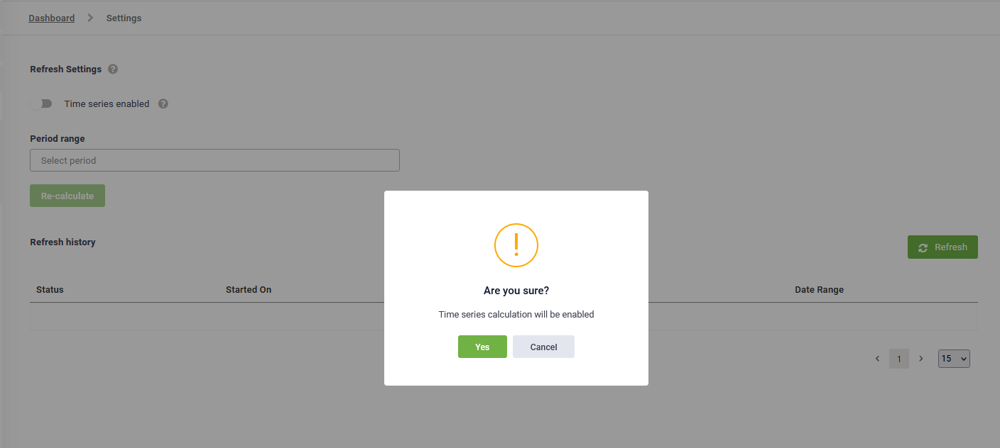
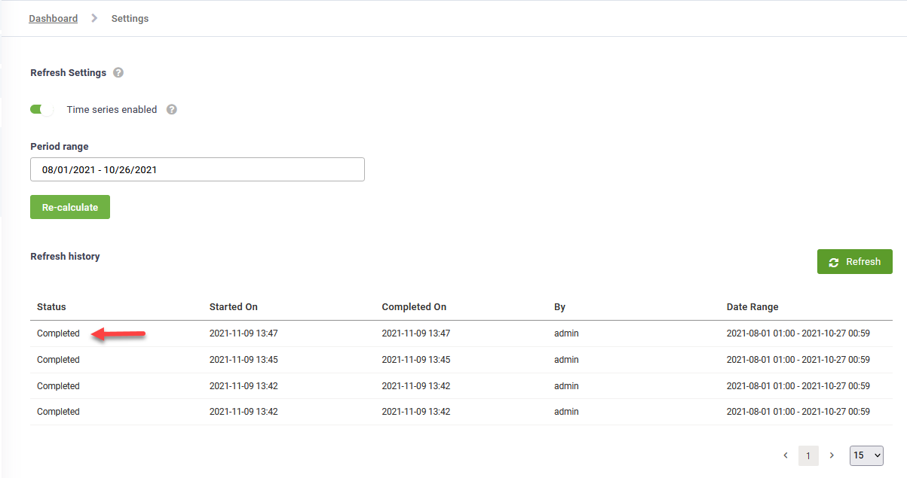

The AI Agent Summary Dashboard provides authors with insights on the AI Agent performance over time and enables them to identify actions they need to take to improve performance.

Druid offers a Dashboard template with predefined widgets, which provides you various ways (dashboard pages) of analyzing your AI Agent performance:

* Overview – get a summary of AI Agent KPIs around the conversation history data.
* [Engagement KPIs](<AI Agent Summary Dashboard.md#Engagement_KPIs>) – provides metrics that help you understand how people engage with your AI Agent.
* [Origin](<AI Agent Summary Dashboard.md#Origin>) - provides metrics that are stored in the \[\[QueryParams]] system entity.
* [Contact Center](<AI Agent Summary Dashboard.md#Contact_Center_KPIs>) – provides Live Chat metrics that help you analyze the performance and efficiency of your Contact Center.
* [Automations](<AI Agent Summary Dashboard.md#Automations_KPIs>) – provides insights related to Druid integrations.
* [NLU](<AI Agent Summary Dashboard.md#NLU_KPIs>) – provides information that helps you analyze the performance of your NLP model.

The dashboard template contains only predefined Druid KPIs. If you want to customize the dashboard with your own KPIs, see [Customizing the dashboard with custom KPIs](https://docs.druidai.com/docs/Content/Usage/Customizing%20the%20dashboard%20with%20custom%20KPIs.htm).

## Accessing the AI Agent Summary Dashboard

To access the Dashboard, select your AI Agent and from the Dashboards menu, click **AI Agent Summary**.

## Engagement KPIs 

.png>)

| Metric name                             | Metric display name                          | Widget Type | Description                                                                                                                                                                                                                                                                                                                                                                                                                                                                                                                                                                                                                                                                                                                                                                                               |
| --------------------------------------- | -------------------------------------------- | ----------- | --------------------------------------------------------------------------------------------------------------------------------------------------------------------------------------------------------------------------------------------------------------------------------------------------------------------------------------------------------------------------------------------------------------------------------------------------------------------------------------------------------------------------------------------------------------------------------------------------------------------------------------------------------------------------------------------------------------------------------------------------------------------------------------------------------- |
| Messages                                | Total                                        | KPI         | The number of messages exchanged with the AI Agent, both user says and AI Agent says.                                                                                                                                                                                                                                                                                                                                                                                                                                                                                                                                                                                                                                                                                                                     |
| Number of interactions                  | Total                                        | KPI         | The number of times a user opened the AI Agent window (session initiation).                                                                                                                                                                                                                                                                                                                                                                                                                                                                                                                                                                                                                                                                                                                               |
| Number of interactions                  | Engaged                                      | KPI         | The number of active user sessions initiated, counted each time a user opens the AI Agent widget and sends at least one message. One conversation may contain multiple engaged interactions.                                                                                                                                                                                                                                                                                                                                                                                                                                                                                                                                                                                                              |
| Number of interactions                  | Dropped                                      | KPI         | The number of user-AI Agent interactions, in which the user abandoned the conversation at a specific moment in time. It can be either when the AI Agent asked for input, or after the special flow **Inactivity Cancel Conversation** was triggered.                                                                                                                                                                                                                                                                                                                                                                                                                                                                                                                                                      |
| Number of conversations                 | Total                                        | KPI         | The number of unique conversations (conversation IDs) initiated where the user sent at least one message. This groups related activities, even if the user opens and closes the widget multiple times.                                                                                                                                                                                                                                                                                                                                                                                                                                                                                                                                                                                                    |
| Users                                   | Total                                        | KPI         | Total number of users (both unique authenticated users and anonymous users) who interacted with the AI Agent.                                                                                                                                                                                                                                                                                                                                                                                                                                                                                                                                                                                                                                                                                             |
| Users                                   | Active                                       | KPI         | Total number of users who interacted with the AI Agent and sent at least one message.                                                                                                                                                                                                                                                                                                                                                                                                                                                                                                                                                                                                                                                                                                                     |
| Users                                   | Authenticated                                | KPI         | Total number of unique authenticated users who interacted with the AI Agent and sent at least one message.                                                                                                                                                                                                                                                                                                                                                                                                                                                                                                                                                                                                                                                                                                |
| Users                                   | Anonymous                                    | KPI         | Total number of anonymous users who interacted with the AI Agent and sent at least one message.                                                                                                                                                                                                                                                                                                                                                                                                                                                                                                                                                                                                                                                                                                           |
| Users                                   | Inactive                                     | KPI         | Total number of unique authenticated users who were inactive (did not send a message to the AI Agent).                                                                                                                                                                                                                                                                                                                                                                                                                                                                                                                                                                                                                                                                                                    |
| Conversation duration                   | AVG                                          | KPI         | The amount of time (in minutes) a conversation lasts on average between a user and the AI Agent. The metric also includes the live chat conversations.                                                                                                                                                                                                                                                                                                                                                                                                                                                                                                                                                                                                                                                    |
| Conversation turns                      | AVG                                          | KPI         | The number of messages exchanged on average in a user-AI Agent conversation. The metric also includes the live chat conversations.                                                                                                                                                                                                                                                                                                                                                                                                                                                                                                                                                                                                                                                                        |
| Conversation turns                      | max                                          | KPI         | The maximum number of messages exchanged in a user-AI Agent conversation. The metric also includes the live chat conversations.                                                                                                                                                                                                                                                                                                                                                                                                                                                                                                                                                                                                                                                                           |
| Flows                                   | AVG Flows per user                           | KPI         | The number of flows a user interacts with on average in the conversation with the AI Agent.                                                                                                                                                                                                                                                                                                                                                                                                                                                                                                                                                                                                                                                                                                               |
| Flows                                   | AVG Flow Step per user                       | KPI         | The number of flow steps a user interacts on average in the conversation with the AI Agent.                                                                                                                                                                                                                                                                                                                                                                                                                                                                                                                                                                                                                                                                                                               |
| Feedback flows                          | Requested                                    | KPI         | The number of times the feedback flow was initiated (0-Requested). **IMPORTANT!** This KPI takes data from the **\[\[ChatActivityData]]** entity. As a best practice, you can download from the Solutions Library, the Customer Satisfaction solution template that contains this configuration. Otherwise, if you want to configure it yourself, make sure that: - In order to count the Requested feedback, you must have a step where you initialize **\[\[ChatActivityData]].FeedbackFlows** with **0**. On this step add internal action **SaveActivity**. - After that, you can configure the next steps in which you collect the positive and negative feedback rate.                                                                                                                              |
| Feedback Flows                          | Answered                                     | KPI         | The number of conversations that requested feedback and have an answer. **IMPORTANT!** This KPI takes data from the **\[\[ChatActivityData]]** entity. As a best practice, you can download from the Solutions Library, the Customer Satisfaction solution template that contains this configuration. Otherwise, if you want to configure it yourself, make sure that: - You set up a flow, with a step saving the user feedback in **\[\[ChatActivityData]].FeedbackFlows** and add internal action **SaveActivityData**. - When you finish the flow, add internal action **CloseActivity**.                                                                                                                                                                                                             |
| Feedback Flows                          | Positive                                     | KPI         | The number of conversations that requested feedback and a positive answer was provided (4/5-Positive). **IMPORTANT!** This KPI takes data from the **\[\[ChatActivityData]]** entity. As a best practice, you can download from the Solutions Library, the Customer Satisfaction solution template that contains this configuration. Otherwise, if you want to configure it yourself, make sure that: - You set up a flow, with a step saving the user feedback in **\[\[ChatActivityData]].FeedbackFlows** and add internal action **SaveActivityData**. - When you finish the flow, add internal action **CloseActivity**. **NOTE:** This KPI has a redirect to the conversation history data (Conversation History V2) which has the Context Data filter set on the respective conversations.          |
| Feedback flows                          | Negative                                     | KPI         | The number of conversations that requested feedback and a negative answer was provided (1/2/3-Negative). **IMPORTANT!** This KPI takes data from the **\[\[ChatActivityData]]** entity. As a best practice, you can download from the Solutions Library, the Customer Satisfaction solution template that contains this configuration. Otherwise, if you want to configure it yourself, please make sure that: - You set up a flow, with a step saving the user feedback in **\[\[ChatActivityData]].FeedbackFlows** and add internal action **SaveActivityData**. - When you finish the flow, add internal action **CloseActivity**. **NOTE:** This KPI has a redirect to the conversation history data (Conversation History V2) which has the Context Data filter set on the respective conversations. |
| Top flows                               | -                                            | Table       | Counts the top flows used in conversations, ordered descending.                                                                                                                                                                                                                                                                                                                                                                                                                                                                                                                                                                                                                                                                                                                                           |
| Channel (active users)                  | Web, Skype, Facebook, Slack, WhatsApp, Teams | Chart       | The total number of users who interacted with the AI Agent and sent at least one message, grouped by channel.                                                                                                                                                                                                                                                                                                                                                                                                                                                                                                                                                                                                                                                                                             |
| TTA                                     | 1,2,3,4,5,>5                                 | Table       | Counts how fast the AI Agent responded to the user messages, spitted by seconds (1,2,3,4,5,>5) and counted only one time. The metric does not take into consideration the live chat conversations.                                                                                                                                                                                                                                                                                                                                                                                                                                                                                                                                                                                                        |
| TTA drivers, flows                      | -                                            | Table       | Top 10 flows that generated the longest AI Agent response time (>5 seconds, grouped by flow name and ordered descending.                                                                                                                                                                                                                                                                                                                                                                                                                                                                                                                                                                                                                                                                                  |
| TTA drivers, integrations               | -                                            | Table       | Top 10 integrations that generated the longest AI Agent response time (>5 seconds), grouped by Druid integration name and ordered descending.                                                                                                                                                                                                                                                                                                                                                                                                                                                                                                                                                                                                                                                             |
| Feedback Flows                          | 1,2,3,4,5                                    | Chart       | Counts the number of feedbacks registered for each evaluation score and displays them in a bar chart.                                                                                                                                                                                                                                                                                                                                                                                                                                                                                                                                                                                                                                                                                                     |
| Feedback Flows                          | Positive/Negative/Requested                  | Chart       | Displays the Feedback Flows KPIs in a time series chart.                                                                                                                                                                                                                                                                                                                                                                                                                                                                                                                                                                                                                                                                                                                                                  |
| Number of conversations                 | With Live Chat, Without Live Chat            | Chart       | Counts the number of conversations that had live chat with a helpdesk agent and the number of conversations without.                                                                                                                                                                                                                                                                                                                                                                                                                                                                                                                                                                                                                                                                                      |
| Number of interactions dropped, drivers | -                                            | Chart       | Top flows, including flow name and flow steps in which the user abandoned more the conversation.                                                                                                                                                                                                                                                                                                                                                                                                                                                                                                                                                                                                                                                                                                          |

## Origin 

| Metric name | Metric display name | Type  | Description                                                                                                                  |
| ----------- | ------------------- | ----- | ---------------------------------------------------------------------------------------------------------------------------- |
| Mobile no   | Mobile              | KPI   | Total number of conversations that were initiated from Direct Line (web channel).                                            |
| Mobile Yes  | Mobile              | KPI   | Total number of conversations that were initiated from mobile devices.                                                       |
| Mobile      | Mobile              | Chart | Displays the daily count of conversations initiated through Direct Line and mobile devices.                                  |
| Origin      | Origin              | Chart | Displays the daily count of conversations initiated from the base URLs of webpages hosting the web chat.                     |
| Origin      | Origin              | Table | Displays the top 10 base URLs of webpages hosting the web chat, indicating where conversations were initiated.               |
| App         | App                 | Chart | Displays the daily count of conversations based on the browser name from which the web chat was initiated.                   |
| OSVersion   | OSVersion           | Chart | Displays the daily count of conversations based on the operating system of the device from which the web chat was initiated. |
| Path Name   | Path Name           | Table | Displays the top 10 full paths to the web pages from which the user initiated the chat.                                      |

## Contact Center KPIs 

| Metric name                                               | Metric display name                | Type  | Description                                                                                                                                                                                                                                                                                                                                                                                                                                                                                                                                                                                                                                                                                                                                                                                                                             |
| --------------------------------------------------------- | ---------------------------------- | ----- | --------------------------------------------------------------------------------------------------------------------------------------------------------------------------------------------------------------------------------------------------------------------------------------------------------------------------------------------------------------------------------------------------------------------------------------------------------------------------------------------------------------------------------------------------------------------------------------------------------------------------------------------------------------------------------------------------------------------------------------------------------------------------------------------------------------------------------------- |
| Conversations                                             | Total                              | KPI   | Total number of conversations in which a live chat connection was initiated.                                                                                                                                                                                                                                                                                                                                                                                                                                                                                                                                                                                                                                                                                                                                                            |
| Conversations                                             | Answered                           | KPI   | Total number of conversations in which a live chat connection was initiated and on the other side the agent answered / connected to the waiting client.                                                                                                                                                                                                                                                                                                                                                                                                                                                                                                                                                                                                                                                                                 |
| Conversations                                             | Missed                             | KPI   | Total number of conversations in which a live chat connection was initiated and on the other side the agent couldn't connect to the waiting client.                                                                                                                                                                                                                                                                                                                                                                                                                                                                                                                                                                                                                                                                                     |
| Avg wait live chat                                        | Total                              | KPI   | The average waiting time calculated across all queues before the client is redirected to a live chat conversation with a helpdesk agent.                                                                                                                                                                                                                                                                                                                                                                                                                                                                                                                                                                                                                                                                                                |
| Avg live chat conversation duration                       | Total                              | KPI   | KPI that calculates how much time lasts a live chat conversation.  Calculated as average from total number of live chat conversations.                                                                                                                                                                                                                                                                                                                                                                                                                                                                                                                                                                                                                                                                                                  |
| Chat events                                               | Agent Login                        | KPI   | Event triggered every time a helpdesk agent clicks the **Log In** button and becomes an available agent for taking over live chat conversations.                                                                                                                                                                                                                                                                                                                                                                                                                                                                                                                                                                                                                                                                                        |
| Chat events                                               | Client In Queue                    | KPI   | Event triggered every time a user is placed in a waiting queue.                                                                                                                                                                                                                                                                                                                                                                                                                                                                                                                                                                                                                                                                                                                                                                         |
| Chat events                                               | Client disconnect from queue       | KPI   | Event triggered every time Druid automatically disconnects a user from a waiting queue, because the conversation could not be connected with a helpdesk agent.                                                                                                                                                                                                                                                                                                                                                                                                                                                                                                                                                                                                                                                                          |
| Feedback LiveChat                                         | Requested                          | KPI   | The number of feedback flows requested for each live chat conversation (**\[\[ChatActivityData]].FeedbackLiveChat** equals 0, that is, Requested). **IMPORTANT!** This KPI takes data from the **\[\[ChatActivityData]]** entity. As a best practice, you can download from the Solutions Library, the LiveChat Advanced solution template that contains this configuration. Otherwise, if you want to configure it yourself, make sure that: - In order to count the Requested feedback, you must have a step where you initialize **\[\[ChatActivityData]].FeedbackLiveChat** with 0. On this step add internal action **SaveActivity**. - After that, you can configure the next steps in which you collect the positive and negative feedback rate.                                                                                 |
| Feedback LiveChat                                         | Answered                           | KPI   | The number of live chat conversations that requested feedback and have an answer. **IMPORTANT!** This KPI takes data from the **\[\[ChatActivityData]]** entity. As a best practice, you can download from the Solutions Library, the LiveChat Advanced solution template that contains this configuration. Otherwise, if you want to configure it yourself, make sure that: - The feedback flow contains on dedicated step, in Input Mapping enter the field **\[\[ChatActivityData]]. FeedbackLiveChat**; otherwise the KPI will not register any data. Further rating score will be saved to this field. - On the feedback step, add internal action **SaveActivityData**. - When you finish the flow, add internal action **CloseActivity**.                                                                                        |
| Feedback LiveChat                                         | Positive                           | KPI   | The number of live chat conversations that requested feedback and have a positive answer, **\[\[ChatActivityData]].FeedbackLiveChat** equals 4 or 5 (4/5-Positive). **IMPORTANT!** This KPI takes data from the **\[\[ChatActivityData]]** entity. As a best practice, you can download from the Solutions Library, the LiveChat Advanced solution template that contains this configuration. Otherwise, if you want to configure it yourself, make sure that: - The feedback flow contains on dedicated step, in Input Mapping enter the field **\[\[ChatActivityData]]. FeedbackLiveChat**; otherwise the KPI will not register any data. Further rating score will be saved to this field. - On the feedback step, add internal action **SaveActivityData**. - When you finish the flow, add internal action **CloseActivity**.      |
| Feedback LiveChat                                         | Negative                           | KPI   | The number of live chat conversations that requested feedback and have a negative answer, **\[\[ChatActivityData]].FeedbackLiveChat** equals 1, 2 or 3 (1/2/3-Negative). **IMPORTANT!** This KPI takes data from the **\[\[ChatActivityData]]** entity. As a best practice, you can download from the Solutions Library, the LiveChat Advanced solution template that contains this configuration. Otherwise, if you want to configure it yourself, make sure that: - The feedback flow contains on dedicated step, in Input Mapping enter the field **\[\[ChatActivityData]]. FeedbackLiveChat**; otherwise the KPI will not register any data. Further rating score will be saved to this field. - On the feedback step, add internal action **SaveActivityData**. - When you finish the flow, add internal action **CloseActivity**. |
| Conversations                                             | Missed/ Answered                   | Chart | The number of live chat conversations that missed and answered daily displayed in a time series chart.                                                                                                                                                                                                                                                                                                                                                                                                                                                                                                                                                                                                                                                                                                                                  |
| Total number of conversations per queue                   | -                                  | Chart | The total number of live chat conversations registered for each queue displayed in a time series chart.                                                                                                                                                                                                                                                                                                                                                                                                                                                                                                                                                                                                                                                                                                                                 |
| Avg wait live chat                                        | -                                  | Chart | Chart displaying on a time series what is the average waiting time calculated across all queues, grouped by queue. Queue Name – Represents the name of the queue. If a queue has a defined name, that name will be displayed in the KPI graphic. If the system cannot identify or retrieve a defined queue name, it will appear generically as “Queue Name.” Total – Represents the average waiting time calculated across all queues. The values are displayed in minutes.                                                                                                                                                                                                                                                                                                                                                             |
| Feedback LiveChat                                         | -                                  | Chart | Counts the **\[\[ChatActivityData]].FeedbackLiveChat** grouped by feedback rating score.                                                                                                                                                                                                                                                                                                                                                                                                                                                                                                                                                                                                                                                                                                                                                |
| Agent resolution                                          | -                                  | Chart | Count the **\[\[ChatActivityData]].AgentResolution**, grouped by agent resolution. **IMPORTANT!** This KPI takes data from the **\[\[ChatActivityData]]** entity, therefore make sure that: - The feedback flow contains a dedicated step for agent resolution and in Input Mapping, you add the field **\[\[ChatActivityData]].AgentResolution**; otherwise, the KPI will not register any data. - On the feedback step, add internal action **SaveActivityData**. - When you finish the flow, add internal action **CloseActivity**.                                                                                                                                                                                                                                                                                                  |
| Avg waiting time (s) for agent per hour                   | -                                  | Chart | The average waiting time (in seconds) of a helpdesk agent, displayed in a chart split by hours during a day.                                                                                                                                                                                                                                                                                                                                                                                                                                                                                                                                                                                                                                                                                                                            |
| Total livechat conversation per agent (hours and minutes) | -                                  | Table | The amount of time spent in live chat conversations, grouped by agent.                                                                                                                                                                                                                                                                                                                                                                                                                                                                                                                                                                                                                                                                                                                                                                  |
| Avg waiting time for agent response                       | -                                  | Table | The average time spent by a helpdesk agent to connect to a user waiting in the queue.                                                                                                                                                                                                                                                                                                                                                                                                                                                                                                                                                                                                                                                                                                                                                   |
| Avg agent TTA                                             |                                    | Table | The average time spent to respond to the user messages in a live chat conversation, grouped by agent.                                                                                                                                                                                                                                                                                                                                                                                                                                                                                                                                                                                                                                                                                                                                   |
| Waiting for agent                                         | 0-1m, 1-3m,3-5m, 5-10m,10-15m,>15m | Table | The number of waiting conversations, grouped by time slot.                                                                                                                                                                                                                                                                                                                                                                                                                                                                                                                                                                                                                                                                                                                                                                              |
| Number of conversations per time slot                     | 0-5m, 5-10m, 10-15m, >15m          | Table | The number of live conversations, grouped by duration.                                                                                                                                                                                                                                                                                                                                                                                                                                                                                                                                                                                                                                                                                                                                                                                  |
| Avg conversation turns per time slot                      | 0-5m, 5-10m, 10-15m, >15m          | Table | The number of messages sent on average during a time slot.                                                                                                                                                                                                                                                                                                                                                                                                                                                                                                                                                                                                                                                                                                                                                                              |

## Automations KPIs 

| Metric name                       | Metric display name | Type  | Description                                                                                                                                                                                                                                                                  |
| --------------------------------- | ------------------- | ----- | ---------------------------------------------------------------------------------------------------------------------------------------------------------------------------------------------------------------------------------------------------------------------------- |
| ROI                               | Savings             | KPI   | Calculates how many euros you saved when using the AI Agent on specific business flows. You can change the currency from the AI Agent details, Analytics section (see [Configuring AI Agent Advanced Settings](https://druidai.gitbook.io/druid-ai-docs/ai-platform/build-ai-agents/authoring-tools/configuring-ai-agent-advanced-settings)). |
| ROI                               | Revenue             | KPI   | Calculates the revenue generated when using the AI Agent on specific business flows. You can change the currency from the AI Agent details, Analytics section (see [Configuring AI Agent Advanced Settings](https://druidai.gitbook.io/druid-ai-docs/ai-platform/build-ai-agents/authoring-tools/configuring-ai-agent-advanced-settings)).    |
| ROI                               | FTE                 | KPI   | Calculates how many hours you saved when using the AI Agent on specific business flows.                                                                                                                                                                                      |
| Integration error                 | Total               | KPI   | The total number of integrations (connectors), flows and apps that triggered an integration error.                                                                                                                                                                           |
| Integration errors, drivers       | -                   | Chart | The total number of integrations that triggered an integration error, grouped by Druid integration name.                                                                                                                                                                     |
| Integration errors, flows drivers | -                   | Chart | The total number of flows that triggered an integration error, grouped by flow name.                                                                                                                                                                                         |
| Integration errors, apps drivers  | -                   | Chart | The total number of apps that triggered an integration error, grouped by app name.                                                                                                                                                                                           |
| ROI Cost Saving Drivers           | -                   | Table | Shows which flow/connector generated the expected ROI Cost Saving value set on the flow/connector. You can filter drivers by using group tags. For more information, see Analytics.                                                                                          |
| ROI Revenue Drivers               | -                   | Table | Shows which flow/connector generated the expected ROI Revenue value set on the flow/connector. You can filter drivers by using group tags. For more information, see Analytics.                                                                                              |
| ROI FTE Drivers                   | -                   | Table | Shows which flow/connector generated the expected ROI FTE (Full Time Equivalent) value set on the flow/connector. You can filter drivers by using group tags. For more information, see Analytics.                                                                           |

## NLU KPIs 

| Metric name                         | Metric display name          | Type       | Description                                                                                                                                                                                                                                                                                                                                                                                                                                                                                                                                                                                                                                                                                                                                                                                                                                                                                                            |
| ----------------------------------- | ---------------------------- | ---------- | ---------------------------------------------------------------------------------------------------------------------------------------------------------------------------------------------------------------------------------------------------------------------------------------------------------------------------------------------------------------------------------------------------------------------------------------------------------------------------------------------------------------------------------------------------------------------------------------------------------------------------------------------------------------------------------------------------------------------------------------------------------------------------------------------------------------------------------------------------------------------------------------------------------------------- |
| Messages                            | Intents not recognized       | KPI, chart | The messages said by the users, the AI Agent replied to with the special flow “Intent not recognized”.                                                                                                                                                                                                                                                                                                                                                                                                                                                                                                                                                                                                                                                                                                                                                                                                                 |
| Messages                            | Conversation paths not found | KPI, chart | The number of inputs that don't match the flow step validation criteria, hero or choice steps. The AI Agent tries to understand what the user says and convert into expected format. If it fails, it responds the user with “I do not understand, please repeat”.                                                                                                                                                                                                                                                                                                                                                                                                                                                                                                                                                                                                                                                      |
| Messages                            | Invalid inputs               | KPI        | The number of messages where inside a dialog the user input was not the one the AI Agent expected. If for example, we have a prompt step that expects in input mapping a date of birth (type:DateTime) and the user inputs the name (type:string), the AI Agent will trigger the special message InputValueInterpretationError.                                                                                                                                                                                                                                                                                                                                                                                                                                                                                                                                                                                        |
| Messages                            | Security violation           |            | The number of user says that trigger a flow the user is not allowed to use. For example, you have “Activate contract” flow that only users with Role Account Manager can use. The AI Agent uses NLP to identify the user intent and triggers the respective flow. If the user in chat user doesn’t have the Account Manager role, the AI Agent replies with “I cannot give that information” and logs the event as “Security violation”.                                                                                                                                                                                                                                                                                                                                                                                                                                                                               |
| Conversation path not found drivers | -                            | Chart      | The number of inputs that don't match the flow step validation criteria, grouped by flow and step name.                                                                                                                                                                                                                                                                                                                                                                                                                                                                                                                                                                                                                                                                                                                                                                                                                |
| Invalid input drivers               | -                            | Chart      | The number of messages where inside a dialog the user input was not the one the AI Agent expected, grouped by flow and step name.                                                                                                                                                                                                                                                                                                                                                                                                                                                                                                                                                                                                                                                                                                                                                                                      |
| NLU Accuracy                        | Total Free-Text Accurate     | Sum        | Total number of correctly matched free-text phrases, excluding exact matches exact matches, such as user inputs made by selecting buttons. It is calculated as follows: **Total Free-Text Accurate = (True Single Match + True Multiple Match + True Unknown) − Exact Matches** **Info:** For AI Agents created in Druid versions prior to 9.29, this KPI is not automatically added to the AI Agent Summary dashboard: - If you use the default dashboard, turn on the **Edit mode** toggle and click **Back to Default** from the toolbar to add it. - If you customized the dashboard, add a KPI widget manually and select **NLU Accuracy** as the **Metric name** and **Total Free-Text Accurate** as the **Metric display name**.                                                                                                                             |
| NLU Accuracy                        | Free-Text Accuracy           | %          | The percentage of correctly matched free-text phrases, excluding exact matches, such as user inputs made by selecting buttons. It is calculated as follows: **Free-Text Accuracy (%) = ((True Single Match + True Multiple Match + True Unknown) − Exact Matches) / (Total number of messages in Conversation History − Exact Matches) × 100** **Info:** For AI Agents created in Druid versions prior to 9.29, this KPI is not automatically added to the AI Agent Summary dashboard: - If you use the default dashboard, turn on the **Edit mode** toggle and click **Back to Default** from the toolbar to add it. - If you customized the dashboard, add a KPI widget manually and select **NLU Accuracy** as the **Metric name** and **Free-Text Accuracy** as the **Metric display name**.                                                                         |
| NLU Accuracy                        | Free-Text Errors             | %          | The percentage of incorrectly matched free-text phrases, excluding exact matches, such as user inputs made by selecting buttons. It is calculated as follows: **Free-Text Errors (%) = 100% − Free-Text Accuracy (%)** **Info:** For AI Agents created in Druid versions prior to 9.29, this KPI is not automatically added to the AI Agent Summary dashboard: - If you use the default dashboard, turn on the **Edit mode** toggle and click **Back to Default** from the toolbar to add it. - If you customized the dashboard, add a KPI widget manually and select **NLU Accuracy** as the **Metric name** and **Free-Text Errors** as the **Metric display name**.                                                                                                                                                                                                     |
| NLU Accuracy                        | Percent Accuracy             | %          | The percent of correctly matched phrases by the conversational model.                                                                                                                                                                                                                                                                                                                                                                                                                                                                                                                                                                                                                                                                                                                                                                                                                                                  |
| NLU Accuracy                        | Percent Errors               | %          | The percent of phrases matched incorrectly by the conversational model.                                                                                                                                                                                                                                                                                                                                                                                                                                                                                                                                                                                                                                                                                                                                                                                                                                                |
| NLU Accuracy                        | Total Accuracy               | Sum        | Total number of correctly matched phrases.                                                                                                                                                                                                                                                                                                                                                                                                                                                                                                                                                                                                                                                                                                                                                                                                                                                                             |
| NLU Accuracy                        | Total Errors                 | Sum        | Total number of incorrectly matched phrases.                                                                                                                                                                                                                                                                                                                                                                                                                                                                                                                                                                                                                                                                                                                                                                                                                                                                           |
| NLU Accuracy Buckets                | -                            | Chart      | The number of correctly matched phrases, with their corresponding probability bucket.                                                                                                                                                                                                                                                                                                                                                                                                                                                                                                                                                                                                                                                                                                                                                                                                                                  |
| NLU Accuracy Buckets False          | -                            | Chart      | The number of incorrectly matched phrases, in their corresponding probability bucket.                                                                                                                                                                                                                                                                                                                                                                                                                                                                                                                                                                                                                                                                                                                                                                                                                                  |
| NLU Accuracy                        | -                            | Chart      | The number of true and false matched phrases by the conversational model: - **False Unknown** - The number of phrases matched with a probability under the **MinScoreThreshold**, but the conversational model should have matched at least one intent. - **True Unknowns** - The number of phrases that the conversational model did not match and it was not even supposed to match (marked Out Of Scope). - **False Match Others** - The number of phrases matched under the **TargetMatchScore** and annotated into other lows. - **False Match Unknown** - The number of phrases that were matched by the conversational model but they should not be (marked Out Of Scope). - **True Multiple Match** - The number of phrases matched correctly between the **MinScoreThreshold** and the **TargetMatchScore**. - **True Single Match** - The number of phrases matched correctly over the **TargetMatchScore**. |

## Filtering dashboard data


**NOTE:** You cannot filter dashboard data while the dashboard is in edit mode.


To filter dashboard data, select the date range for which you want to monitor your AI Agent usage:

1. Click the **Filter** button on top of the dashboard. The Dashboard Filters pop-up appears.
2. Click on the **Date range** field. The period selector appears.
3. Select the desired period.

4. Click the **Apply** button.

The Dashboard displays the metrics historical data for the selected AI Agent within the specified date range. Historical data means that if today is selected within the date range, Druid calculates KPI values for events beginning the first day selected (from date) until the past 24 hours. If you select **Today** as Date range, the dashboard shows KPI vales for the past 24 hours.


**NOTE:** The dashboard template contains time series KPIs and time series is disabled by default. To show time series data, you need to enable it. For more information, see [Enabling Time Series KPIs](<AI Agent Summary Dashboard.md#Enabling_Time_Series_KPIs>).


## Enabling Time Series KPIs 

By default, time series is disabled. For time series KPIs to register data on the Dashboard, you need to enable time series.


**Info:** The time series KPIs are only available for widgets of type **Chart** or **Table**.


To do so, follow these steps:

1. On the right-top corner of the dashboard, click the **Settings** icon ().

The Dashboard Settings page appears.

2. Tap on Time series enabled. A pop-up appears.

3. Click **Yes**.

By default, if you do not select a specific period, Druid runs an automatic job in the background at the end of each day, which calculates the KPIs using historical data from the past 30 days. KPI data from today will be registered on the dashboard widgets tomorrow. Historical data means, Druid uses today’s data in KPIs calculation at the end of the day and will reflect the data on the dashboard tomorrow.

If you want Druid to calculate time series KPIs using historical data within a specific period (other than the last 30 days), from the **Period range** field, select the desired period and click the **Re-calculate** button.

Druid starts calculating the KPIs using historical data within the selected period.

Click the **Refresh** button .

When the status is “Completed”, Druid finished calculating the KPIs within the specified period.

On the dashboard, the time series KPIs will show data registered within the specified period.

## Related Topics

* [Internal Actions](https://druidai.gitbook.io/druid-ai-docs/ai-platform/build-ai-agents/authoring-tools/flows/conversational-flows/internal-actions)
