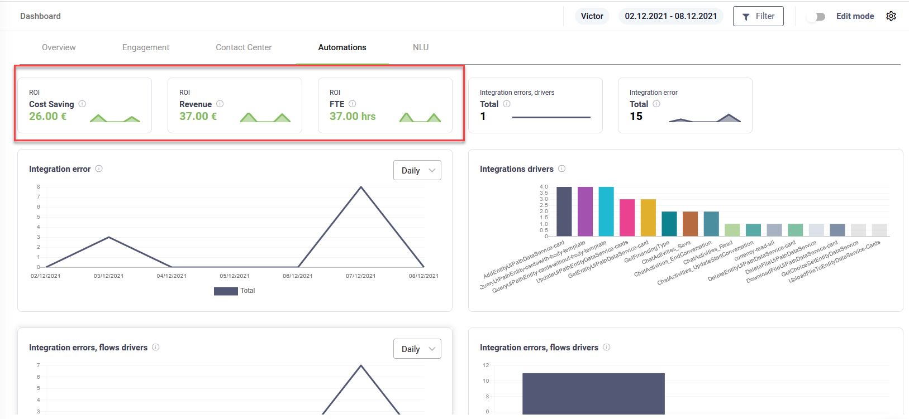
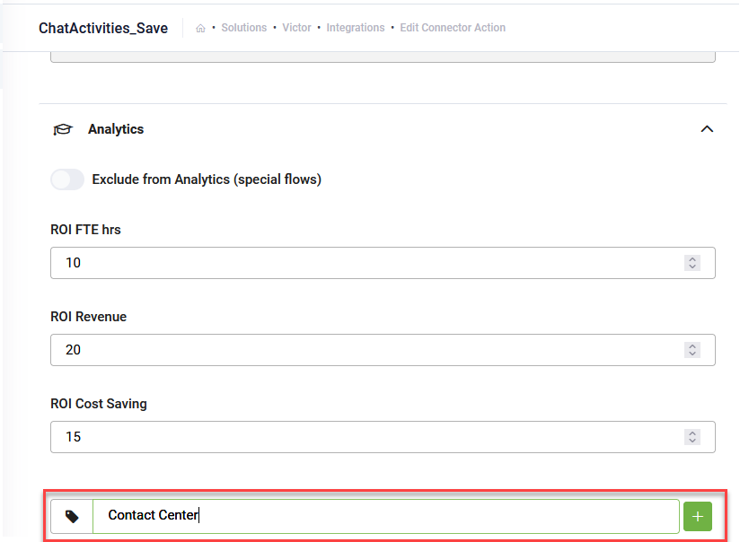

The default Automations page of the Dashboard template provides an overview of automations performed by the AI Agent.

It also provides you with business metrics, ROI, automatically calculated based on KPIs set on flows and integrations and the list of flows and connectors that drive the ROI results.

By default, no ROI KPIs value are set on flows or connector actions; at configuration time you have to decide what flows or connectors to be used in business metrics or  to analyze the dashboard data and decide for which data you want to calculate the ROI metrics.

In this section you will learn how to set up ROI KPIs on flows and integrations, how to improve the analytics and how to group dashboard ROI metrics by using group tags.

## Setting up analytics

Analytics are available on all flows (Flow, **Details** tab) and on all integrations (Integrations, connector action, **ConnectorGeneral** tab).


**NOTE:** The Analytics are not available at integration task level.


To set up ROI analytics, go to the desired flow or integration on which you want to run your calculations.

_Analytics on Flows_

_Analytics on Integrations_

Provide values for the desired business ROI KPIs.

The dashboard will calculate the ROI metrics by multiplying the number of times a flow / connector which has analytics defined, is executed with the value set in the Analytics section.

## Exclude from Analytics (special flows)

Improve analytics keeping only relevant business data by excluding flows and integrations from analytics. The Dashboard provides you with some KPIs that are calculated on a regular basis. Analyzing your dashboard data you might realize that specific flow / integration data is not relevant from a business perspective.

For example, Top Flows which shows how many times a flow was executed, including the special flow like Welcome flow which is not relevant data from a business perspective. You can exclude this data from analytics.

### Use cases for excluding flows and integrations from analytics

* If you want to see how many users have registered vacation requests, but to get to the flow that actually saves the vacation request, the AI Agent goes through intermediary flows which are part of the process, you might want to exclude all the intermediary flows from analytics which are not relevant from a business perspective as you’re interested to see only the end result.
* If you have a connector which after initializing the Welcome flow gets user data which brings no business value, you might want to exclude get-user-data from analytics.

For all situations where specific flows and integrations do not provide relevant metrics from a business perspective, exclude them from analytics. For such flows and integrations, go to the flow **Detail**s tab or integration **ConnectorGeneral** tab, click **Analytics** and tap on **Exclude from Analytics (special flows)**.

Click the **Save** button to save and stay on page, or **Save \&Close** to save and exit the page.

## Group ROI drivers by using tags (GroupingTags)

Similar to hashtags, you can group ROI drivers by using tags. This enables you to see which drivers have generated the highest ROI FTE, Cost Savings or Revenue.

To set the desired tag on specific integration, go to the flow **Details** tab or integration **ConnectorGeneral** tab, click **Analytics** and in the field at the bottom, type the desired tag.

Click the plus icon () to add the tag. You can add multiple tags as best suits your filtering needs.

Click the **Save** button to save and stay on page, or **Save \&Close** to save and exit the page.

The Dashboard groups the business analytics in new KPIs based on the tags set on flows and integrations.

