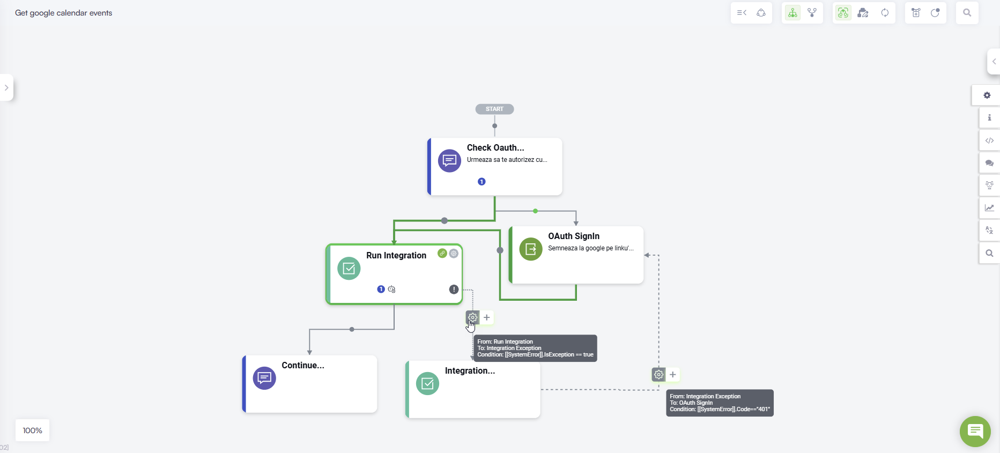

To enable user sign-in using OAuth 2.0 and ensure a smooth conversational experience, follow the steps below. This process includes the latest updates for automated session management and timeout handling.

## Configuration Steps

To enable user sign-in using OAuth 2.0, follow these steps:

1. From the Flow Palette, Dialog section, drag the **Oauth 2.0 Sign in** step and drop it within the flow where you want to perform the OAuth v2 sign in.

2. Provide a flow step name.
3. From the **Connection Code** field, select the connector app you created for OAuth v2 authorization.
4. In the General section, turn the **Get user identity** toggle on.


**NOTE:** For Druid versions earlier than 8.15, enter the sign-in link in the **Step message** field using the following format: **\[\[ChatUser]].OauthAccessURL**. For example: "Sign in to Google using this link: \[\[ChatUser]].OauthAccessURL"


5. In the Metadata section, tap on **Block user input**. By default, the sign-in step is rendered as a hero card.
6. Configure the hero card with the following buttons:

* **Sign In** - Set the value to: **\[\[ChatUser]].OauthAccessURL**.


**IMPORTANT!** After you save the step, you need to configure the **Sign In** button to open the URL, otherwise, at runtime, the user will not be redirected to the sign in page. For more information, see[Configuring hero card buttons to open URLs](https://druidai.gitbook.io/druid-ai-docs/ai-platform/build-ai-agents/authoring-tools/flows/conversational-flows/flow-steps/hero-steps-configuration#Configur).


* **Cancel** - Set the value to: **cancel**.

7. Save the step to apply the changes.

Continue designing your flow with actions the assistant should perform on user’s behalf after getting user’s authorization.


**NOTE:** You can use the authorization URL in any other application and channel; this is why you might need to white list the domain of this application (the domain of the Redirect URL set on the OAuth2 app).


When the **OAuth 2.0 Sign in** step runs, the user's identity metadata will be stored in the \[\[ChatUser]] entity. This mapping is based on the response configuration in the **Get User Identity** connector action.


**IMPORTANT!** The SSO Sign step DOES NOT automatically authenticate the user in the conversation!


After this step, continue with Druid-specific authentication using actions such as: **SaveIdentifiedUser** and **SaveAuthenticatedUser**. These can be configured either in the next step of the flow or in the PostActions section of the SSO Sign In step.

At runtime, when the user clicks the Sign in button/link, Druid redirects the user to a Druid hosted page (the login/consent page at the WEB API service). Example:


**NOTE:** The authentication session is valid for 120 seconds from the moment the sign-in link is generated. If the user does not complete the authentication within this window, the Flow Engine will automatically trigger the SSO Timeout exception. This ensures the conversation does not remain in a deadlocked state if the user abandons the process.


After the user confirms the authorization, the first special action in the OAuth App is automatically invoked and the authorization process completes, meaning that the access token will be saved in the conversation context and used on any integration which consumes that specific OAuth App. The AI Agent will further perform the actions on user’s behalf as set in the conversational flow.

## Authentication Timeout Management


**NOTE:** This feature is available in Druid 9.20 and higher.


To prevent the conversation from becoming unresponsive if a user does not complete the sign-in process, the Flow Engine includes an automated timeout mechanism. This ensures the flow does not remain blocked until the user manually selects **Cancel**.

### How it works

The authentication session is active for 120 seconds from the moment the sign-in link is generated in the chat. If the user fails to authenticate within this window:

* The system triggers a failure state instead of remaining stuck in the sign-in step.
* The Flow Engine raises a specific exception that can be caught and handled within the flow.

### Handling the Timeout Exception

To manage the conversation path when a SSO timeout occurs:

1. Open the **OAuth 2.0 Sign in** step and go to the Metadata section.
2. Enable the **Exception Handler**.
3. Create a flow path for when the exception is raised. Recommended actions include:

* **Retry logic**. Ask the user if they wish to receive a new sign-in link.
* **Custom notification**. Inform the user that the authentication window has expired and provide instructions for the next steps.
* **Redirection**. Move the user to a different part of the conversation or back to the main menu.

## Signing in users with OAuth v2 best practices

Use these best practices to ensure that the access token used to authorize server-to-server API calls is handled correctly:

* Set condition to execute the **Oauth 2.0 Sign in** flow step (the one you configured at step 4 above) only if **\[\[ChatUser]].SSOToken == null**.

* After executing the **Oauth 2.0 Sign in** flow step, run the integration.

* Handle the exceptions when the access token expires. For that, on the integration step, in the Metadata section, tap on **Exception handler**.

* Add an action step for integration exception that is executed if **\[\[SystemError]].IsException == true**. The **Oauth 2.0 Sign in** flow step is executed if **\[\[SystemError]].Code=="401"**.

* Continue the conversation if no exceptions are thrown during the integration execution.
