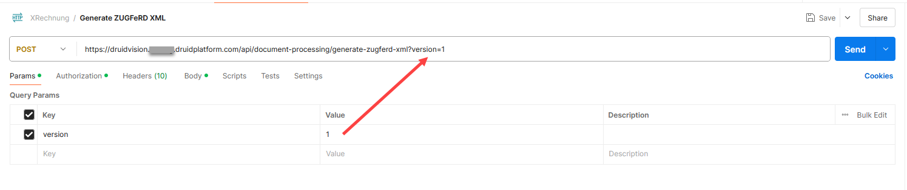

The generate-zugferd-xml endpoint generates a ZUGFeRD-compliant XML invoice document based on the provided invoice data.

ZUGFeRD (Zentraler User Guide des Forums elektronische Rechnung Deutschland) is a standardized electronic invoicing format that enables seamless data exchange between businesses and organizations.

This endpoint converts structured invoice information into a ZUGFeRD XML format, ensuring compliance with industry standards. It is useful for businesses that need to generate electronic invoices in the ZUGFeRD format for automated processing and integration with financial systems.


**NOTE:** This feature is available in DRUID 8.9 and higher. To use this Druid Vision service, you must have at least one Identity Vision API service enabled for your tenant. If not, please contact [Druid Tech Support](../Druid%20AI%20Services/mailto:support@druidai.com).


## Request

|                             |                                                                                                                                                                                                                                                                                                                                                                                                                                                                                                                                                                                                                                                                                                                                                                                                                                                                                                                                                                                                                                                                                                                                                                                                                                                                                                                                                                                                                                                                                                                                                                                                                                                                                                                                                                                                                                                                                                                                                                                                                                                                                                                                                                                                                                                                                                                                                                                                                                                                                                                                                                                                                                                                                                                                                                                                                                                                                                                                                                                                                                                                                                                                                                                                                                                                                                                                                                                                                                                                                                                                                                                                                                                                                                                                                                                                                                                                                                                            |
| --------------------------- | -------------------------------------------------------------------------------------------------------------------------------------------------------------------------------------------------------------------------------------------------------------------------------------------------------------------------------------------------------------------------------------------------------------------------------------------------------------------------------------------------------------------------------------------------------------------------------------------------------------------------------------------------------------------------------------------------------------------------------------------------------------------------------------------------------------------------------------------------------------------------------------------------------------------------------------------------------------------------------------------------------------------------------------------------------------------------------------------------------------------------------------------------------------------------------------------------------------------------------------------------------------------------------------------------------------------------------------------------------------------------------------------------------------------------------------------------------------------------------------------------------------------------------------------------------------------------------------------------------------------------------------------------------------------------------------------------------------------------------------------------------------------------------------------------------------------------------------------------------------------------------------------------------------------------------------------------------------------------------------------------------------------------------------------------------------------------------------------------------------------------------------------------------------------------------------------------------------------------------------------------------------------------------------------------------------------------------------------------------------------------------------------------------------------------------------------------------------------------------------------------------------------------------------------------------------------------------------------------------------------------------------------------------------------------------------------------------------------------------------------------------------------------------------------------------------------------------------------------------------------------------------------------------------------------------------------------------------------------------------------------------------------------------------------------------------------------------------------------------------------------------------------------------------------------------------------------------------------------------------------------------------------------------------------------------------------------------------------------------------------------------------------------------------------------------------------------------------------------------------------------------------------------------------------------------------------------------------------------------------------------------------------------------------------------------------------------------------------------------------------------------------------------------------------------------------------------------------------------------------------------------------------------------------------------- |
| Method                      | POST                                                                                                                                                                                                                                                                                                                                                                                                                                                                                                                                                                                                                                                                                                                                                                                                                                                                                                                                                                                                                                                                                                                                                                                                                                                                                                                                                                                                                                                                                                                                                                                                                                                                                                                                                                                                                                                                                                                                                                                                                                                                                                                                                                                                                                                                                                                                                                                                                                                                                                                                                                                                                                                                                                                                                                                                                                                                                                                                                                                                                                                                                                                                                                                                                                                                                                                                                                                                                                                                                                                                                                                                                                                                                                                                                                                                                                                                                                                       |
| API Resource URL (Endpoint) | \*.druidplatform.com/api/document-processing/generate-zugferd-xml                                                                                                                                                                                                                                                                                                                                                                                                                                                                                                                                                                                                                                                                                                                                                                                                                                                                                                                                                                                                                                                                                                                                                                                                                                                                                                                                                                                                                                                                                                                                                                                                                                                                                                                                                                                                                                                                                                                                                                                                                                                                                                                                                                                                                                                                                                                                                                                                                                                                                                                                                                                                                                                                                                                                                                                                                                                                                                                                                                                                                                                                                                                                                                                                                                                                                                                                                                                                                                                                                                                                                                                                                                                                                                                                                                                                                                                          |
| Params                      | Enter the ZUGFeRD standard version.                                                                                                                                                                                                                                                                                                                                                                                                                                                                                                                                                                                                                                                                                                                                                                                                                                                                                                                                                                                                                                                                                                                                                                                                                                                                                                                                                                                                                                                                                                                                                                                                                                                                                                                                                                                                                                                                                                                                                                                                                                                                                                                                                                                                                                                                                                                                                                                                                                                                                                                                                                                                                                                                                                                                                                                                                                                                                                                                                                                                                                                                                                                                                                                                                                                                                                                                                                                                                                                                                                                                                                                                                                                                                                                                                                                                                                                 |
| Authorization               | Select Bearer Token. If you already have a Druid Vision Token generated for an Identity API service in the Druid Portal, provide that token. For details on obtaining the token, refer to [Druid Vision](<Druid Vision.md>). If you don't have a token, generate one using the Authentication endpoint from Webhooks. For more information, see [Webhooks](../Webhooks.md).                                                                                                                                                                                                                                                                                                                                                                                                                                                                                                                                                                                                                                                                                                                                                                                                                                                                                                                                                                                                                                                                                                                                                                                                                                                                                                                                                                                                                                                                                                                                                                                                                                                                                                                                                                                                                                                                                                                                                                                                                                                                                                                                                                                                                                                                                                                                                                                                                                                                                                                                                                                                                                                                                                                                                                                                                                                                                                                                                                                                                                                                                                                                                                                                                                                                                                                                                                                                                                                                                                       |
| Body                        | The request body must include invoice details such as invoice number, date, buyer and seller information, itemized trade line items, tax details, and payment terms. **Request Body** `{   "documentInfo": {     "invoiceNo": "string",     "invoiceDate": "2024-12-04T11:57:50.726Z",     "currencyCode": 0,     "invoiceNoAsReference": "string",     "documentName": "string",     "referenceOrderNo": "string",     "actualDeliveryDate": "2024-12-04T11:57:50.726Z",     "totals": {       "lineTotalAmount": 0,       "chargeTotalAmount": 0,       "allowanceTotalAmount": 0,       "taxBasisAmount": 0,       "taxTotalAmount": 0,       "grandTotalAmount": 0,       "totalPrepaidAmount": 0,       "duePayableAmount": 0,       "roundingAmount": 0     },     "notes": [       {         "note": "string",         "subjectCode": 0,         "contentCode": 0       }     ],     "buyer": {       "name": "string",       "postcode": "string",       "city": "string",       "street": "string",       "country": 0,       "id": "string",       "globalID": {         "id": "string",         "schemeID": 0       },       "receiver": "string",       "legalOrganization": {         "id": {           "id": "string",           "schemeID": 0         },         "tradingBusinessName": "string"       }     },     "buyerTax": [       {         "no": "string",         "schemeID": 0       }     ],     "buyerContact": {       "name": "string",       "orgunit": "string",       "emailAddress": "string",       "phoneno": "string",       "faxno": "string"     },     "seller": {       "name": "string",       "postcode": "string",       "city": "string",       "street": "string",       "country": 0,       "id": "string",       "globalID": {         "id": "string",         "schemeID": 0       },       "legalOrganization": {         "id": {           "id": "string",           "schemeID": 0         },         "tradingBusinessName": "string"       },       "description": "string"     },     "sellerTax": [       {         "no": "string",         "schemeID": 0       }     ],     "buyerOrderReferenceDocument": {       "orderNo": "string",       "orderDate": "2024-12-04T11:57:50.726Z"     },     "deliveryNoteReferenceDocument": {       "orderNo": "string",       "orderDate": "2024-12-04T11:57:50.726Z"     },     "applicableTaxList": [       {         "basisAmount": 0,         "percent": 0,         "typeCode": 0,         "categoryCode": 0,         "allowanceChargeBasisAmount": 0,         "exemptionReasonCode": 0,         "exemptionReason": "string"       }     ],     "logisticServiceCharge": {       "amount": 0,       "description": "string",       "taxTypeCode": 0,       "taxCategoryCode": 0,       "taxPercent": 0     },     "paymentTerms": [       {         "description": "string",         "dueDate": "2024-12-04T11:57:50.726Z",         "paymentTermsType": 0,         "dueDays": 0,         "percentage": 0,         "baseAmount": 0       }     ],     "tradeLineItems": [       {         "name": "string",         "description": "string",         "unitCode": 0,         "unitQuantity": 0,         "grossUnitPrice": 0,         "netUnitPrice": 0,         "billedQuantity": 0,         "lineTotalAmount": 0,         "taxType": 0,         "categoryCode": 0,         "taxPercent": 0,         "comment": "string",         "id": {           "id": "string",           "schemeID": 0         },         "sellerAssignedID": "string",         "buyerAssignedID": "string",         "deliveryNoteID": "string",         "deliveryNoteDate": "2024-12-04T11:57:50.726Z",         "buyerOrderID": "string",         "buyerOrderDate": "2024-12-04T11:57:50.726Z",         "billingPeriodStart": "2024-12-04T11:57:50.726Z",         "billingPeriodEnd": "2024-12-04T11:57:50.726Z"       }     ]   },   "version": 100 }` |

## Response

If the request is successful, the response is a ZUGFeRD-compliant XML document containing the structured invoice data.

**Example response**

```
<?xml version="1.0" encoding="utf-8"?>
<rsm:CrossIndustryDocument xmlns:rsm="urn:ferd:CrossIndustryDocument:invoice:1p0">
    <rsm:HeaderExchangedDocument>
        <ram:ID>INV-12345</ram:ID>
        <ram:IssueDateTime>
            <udt:DateTimeString format="102">20241204</udt:DateTimeString>
        </ram:IssueDateTime>
    </rsm:HeaderExchangedDocument>
    <rsm:SpecifiedSupplyChainTradeTransaction>
        <ram:ApplicableSupplyChainTradeAgreement>
            <ram:SellerTradeParty>
                <ram:Name>XYZ Ltd</ram:Name>
            </ram:SellerTradeParty>
            <ram:BuyerTradeParty>
                <ram:Name>ABC Corp</ram:Name>
            </ram:BuyerTradeParty>
        </ram:ApplicableSupplyChainTradeAgreement>
        <ram:IncludedSupplyChainTradeLineItem>
            <ram:SpecifiedTradeProduct>
                <ram:Name>Product A</ram:Name>
            </ram:SpecifiedTradeProduct>
            <ram:SpecifiedSupplyChainTradeDelivery>
                <ram:BilledQuantity>10</ram:BilledQuantity>
            </ram:SpecifiedSupplyChainTradeDelivery>
            <ram:SpecifiedSupplyChainTradeSettlement>
                <ram:SpecifiedTradeSettlementMonetarySummation>
                    <ram:LineTotalAmount>500.00</ram:LineTotalAmount>
                </ram:SpecifiedTradeSettlementMonetarySummation>
            </ram:SpecifiedSupplyChainTradeSettlement>
        </ram:IncludedSupplyChainTradeLineItem>
    </rsm:SpecifiedSupplyChainTradeTransaction>
</rsm:CrossIndustryDocument>
```

If the request contains invalid data, an error message is returned in JSON format.
