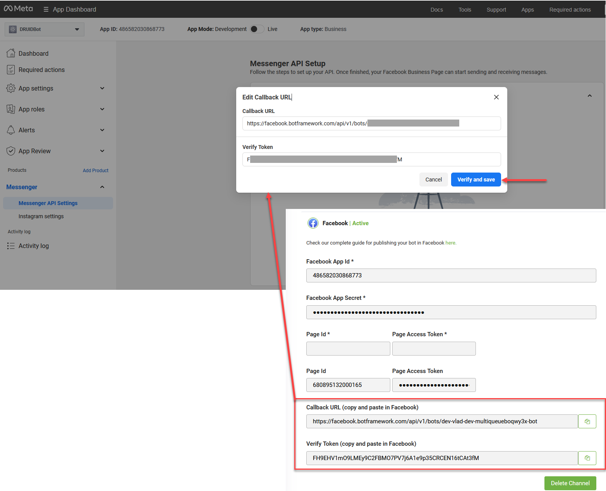
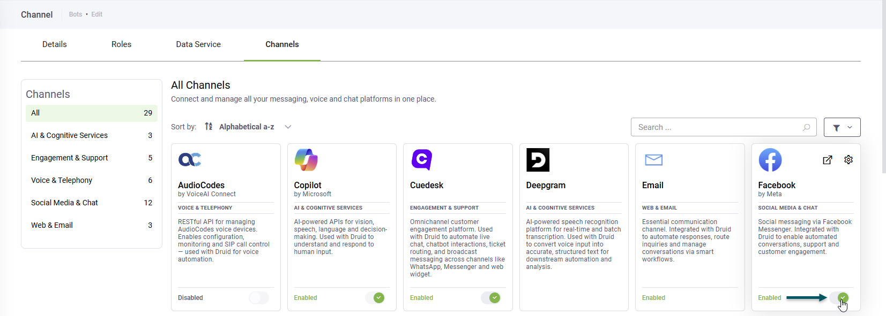

You can set up your AI Agent to interact with users through Facebook Messenger. This section explains how to create a Facebook app on the Facebook for Developers portal and connect it to your AI Agent in the Druid Portal.

## Prerequisites

Before integrating your AI Agent with Facebook, ensure you have set up the required accounts, assets, and network rules based on your deployment type.

### Accounts & Permissions

* **Facebook page**: You have administrative access to one or more Facebook Pages.

### AI Agent Setup & Data

* **Published** AI Agent: An active, published AI Agent built within the Druid Portal.
* **Facebook page ID**: Locate your Facebook page ID and write it down as you will need it to activate the Instagram channel in the Druid Portal:

1. Open the Facebook page in a browser.
2. Check the browser address bar:

* If the URL contains profile.php?id=123456789, those numbers at the end represent the page ID.
* If the URL includes a username along with numbers (e.g., https://facebook.com/yourname-123456789), the string of digits at the end is the page ID.

### Network Configuration (On-Premises Deployments Only)

**IMPORTANT!** Cloud and hybrid deployments use the Microsoft Bot Framework for Facebook routing. You can configure the channel only if the Bot Framework is enabled on your tenant. If the channel configuration is unavailable – the Post Office is set to BotService (AI Agent Details → General) – contact Druid Support to enable the Microsoft Bot Framework on your tenant. On-premises deployments connect directly to Facebook endpoints.

If running Druid on-premises, ensure your firewall permits traffic to and from the following endpoints:

|          |                    |
| -------- | ------------------ |
| Outbound | graph.facebook.com |
| Inbound  | Druid.BotApp       |

## Integration procedure

## Connect an AI Agent to Facebook


**NOTE:** The Facebook UI may appear slightly different depending on which version you are using.


To connect an AI Agent with Facebook Messenger, follow these steps:

### Step 1. Create a Facebook app

1. In your browser, navigate to [Facebook for Developers](https://developers.facebook.com/) and log in.
2. On the toolbar, click **My Apps**. Your Apps page appears.
3. Click the **Create App** button.

The Create an app wizard appears.

4. Enter an **App name** and **App contact email**. Meta uses this email address to send important updates about your application. By default, this field pre-fills with the email address linked to your Meta developer account, but you can change it if needed.

.png>)

5. Click **Next**.
6. Filter use cases by **Business messaging** and select **Engage with customers on Messenger from Meta**.

7. Click **Next**.
8. Select your business portfolio.

.png>)

9. Click **Next**.
10. If no publishing requirements are identified, click **Next**; otherwise, follow the on screen instructions.

11. In the Overview step, click **Create app**.


**Info:** For security reasons, you might be required to re-enter your Facebook password.


12. After the app creation process completes, the App Dashboard appears.

### Step 2. Set up Messenger for your app

In this section you will enable Messenger. connect your app to a Facebook Page and generate an access token for the FB page:

1. On the **Add Products to Your App** page, search for Messenger and click the **Set Up** button. The Messenger API Setup appears.
2. Scroll-down to the **Generate access tokens** section and click **Connect**.

3. Continue as logged in user or log in using another account.
4. Select the target Facebook page and click **Continue**.

5. When prompted to review the app's permission requests, click **Save**.

A pop-up appears informing you that you linked your Facebook app to Facebook.

6. Click **Got it**.

The connected Facebook page appears on the Messenger API Setup.

7. Click the **Generate** button to generate an access token for your FB page. The Token Generation pop-up appears.
8. Tick **I understand**, then click the **Copy** button to copy the page access token and save it for use at Step 4.

9. Click **Done**.

### Step 3. Get Facebook app details

Get these Facebook app details as you will need them to configure the Instagram channel in the Druid Portal:

1. On the menu, go to **App settings** > **Basic**.
2. Click the **Show** button next to the **App secret**.

3. Enter the password associated to your Facebook account and click **Confirm** twice. The App secret is showed in the field.
4. Copy the **App secret** and the **App ID** and keep them in a safe location as you will need these details later to configure the channel in the Druid Portal.

5. Find out the API version of your app. Go to the **App settings** > **Advanced**and check what the API version is.

Continue the integration setup following subsequent steps.

### Step 4. Customize your app

This section describes how to customize your app:

1. Go to app Dashboard and click **Customize the Engage with customers on Messenger from Meta use case**.

2. The Permissions and features list appears. The basic permissions required for testing are already selected. You can add additional ones as per your needs.

Continue with generating Facebook page access token.

### Step 5. Generate Facebook Page access token

To generate a Facebook page access token:

1. On the app customization menu, click **Messenger API Settings**.
2. Under section **2. Generate access tokens**, click **Connect**.

3. Confirm that you want to continue with the Facebook account (the one with administrative access to the Facebook page) or log in using another account.

4. Select the target Facebook Pages for app access and click **Continue**.

5. Review app access and click **Save**.

6. Wait until you get confirmation that your Facebook account has been connected to the app, then click **Got it**. The pop-up closes and the Facebook page(s) appear under section **2. Generate access tokens**.
7. Click **Generate**.

8. Select **I understand**, then copy the token and keep it in a safe location as you will need it to configure the channel in the Druid Portal.

9. Click **Done** to close the modal.
10. Click **Add Subscriptions**.

11. Select **messages** and **messaging\_postbacks**. Select **messaging\_customer\_information** if you want Druid to store the user's first name and last name (in \[\[ChatUser]].FirstName and \[\[ChatUser]].Lastname).

12. Click **Confirm**.

You can now configure the channel in the Druid Portal.

### Step 6: Activate the Facebook channel in the Druid Portal

1. In the Druid Portal go to your AI Agent settings.
2. Click the **Channels** tab, then click the **Facebook** card.

The channel configuration modal appears.

3. Enter the **Facebook App ID** and the **Facebook App Secret**. Use the **App ID** and **App Secret** you copied when creating the Facebook app.
4. Click the **Add Page** button and enter the **Facebook Page ID** and **Page Access Token** and click **Pave Page** button.


**Info:** If you host the AI Agent (via Facebook app) in multiple Facebook pages, click **+Add page** and enter the Page ID and access token for any subsequent Facebook pages.


5. Copy the **Callback URL** and **Verify Token** and save them in a safe location as you will need them to configure the Facebook app webhooks.

6. Optionally, customize channel display settings as follows:

* **Alias**: Enter a clear, business-friendly display name (e.g., Interactive Messaging). This value is stored in\*\*\[\[ChatUser]].ChannelDisplayName\*\*, which appears in reporting tools like AI Agent Summary dashboard - Engagement KPIs and can also be referenced in flow business logic.
* **Description**: Enter a brief description. This is particularly helpful when using an alias, as it helps identify the channel's specific purpose within the Druid Portal.
* **Channel Icon**: Upload a custom icon to display on the channel card within the Druid Portal.

7. Click **Publish** to activate the channel. The channel activation might take up to 1 minute.

After the channel activates, the following fields are available in Druid:

* **\[\[ChatUser]].ChannelId** = "facebook"
* **\[\[ChatUser]].UserId** - Stores an unique identifier of the Facebook user account.
* **\[\[ChatUser]].ChannelDisplayName** - Stores the Alias which is used in AI Agent Summary Dashboard > Engagement KPIs > Channel chart.

### Step 7: Configure Facebook app webhooks

In order to send messages and other events from your AI Agent to Facebook Messenger, you must enable webhooks:

1. Go to the web page with your Facebook app configuration.
2. Under section **1. Configure webhooks**, enter the **Callback URL** and **Verify Token** you copied from the Druid Portal when activating the channel.

3. Click **Verify and save**. The web page refreshes and the customization page appears on Permissions and features.

4. On the app customization menu, click **Messenger API Settings**.
5. Expand section **1. Configure webhooks**.

6. Subscribe to the following events: **messages**, **messaging\_postbacks**, **messaging\_handover**and **messaging\_optins**.
7. Collapse the section and expand section **2. Generate access tokens**.
8. Click **Add Subscriptions** displayed in line with the Facebook page for which you want to activate the webhook events.

9. In the modal, select the following events: **messages**, **messaging\_postbacks**, **messaging\_handover**and **messaging\_optins**. Select **messaging\_customer\_information** if you want Druid to store the chat user's first name and last name (in \[\[ChatUser]].FirstName and \[\[ChatUser]].Lastname).

10. Click **Confirm**.
11. Close the pop-up. The selected webhook fields appear in the section.

The integration between the AI Agent and the Facebook Page is complete.


**NOTE:** The Facebook app is in **Development Mode** until you publish it. The plugin and API functionality will only work for admins, developers and testers.


### Step 8. For testing purposes, add Tester role (Optional)

While your Facebook app is in Development roles, you can test the integration directly in Instagram only by using an account who has been granted the Tester role.


**Info:** For testing purposes, an account other than the admin account is required to interact with the channel and chat with the AI Agent.


Before testing the integration from Instagram, assign the Instagram Tester role to a Facebook test account:

1. In the main menu, go to **App roles** > **Roles**.
2. Click **Add People**.

3. Select **Tester** and enter the Email / username / Facebook ID of a Facebook account that has been linked to an Instagram account (ensure you have access to this account), then click **Add**.

To get the Facebook ID:

1. Open [Facebook](https://www.facebook.com/) in a web browser and log into your account.
2. Click your profile picture icon in the top-right corner and select your personal profile.

3. Look at the address bar at the top of your browser:

* If the URL displays a username: Copy the text after facebook.com/ (e.g., facebook.com/john.doe).
* If the URL displays a numeric ID: Copy the number after id= (e.g., facebook.com/profile.php?id=1000123456789).

Once added, the account status will show as Pending.

4. To accept the pending invite:
   1. Open [Facebook](https://www.facebook.com/) in a web browser and log into your test account.
   2. Check the **Notifications** bell icon, click on the invite request notification and accept the invite.
   3. Close Facebook web page.
5. Return to the Meta Developer Portal and refresh the Roles page. The status of the Tester account is no longer **Pending**.

You can now test the Facebook integration.

## Test the Instagram Integration

1. Log into Facebook using the personal / tester account you authorized at Step 8.
2. Search for your the Facebook page.
3. Send a direct message.


**Info:** If the **Message** button does not appear on the Page, the Page administrators have disabled incoming messages from the public.


The AI Agent will reply with the message set on the **Welcome flow**.

## Publish the Facebook App (Switch from Development to Live Mode)

When your app is in Development mode, only designated Testers can message your AI Agent. To allow any public Instagram user to send direct messages to your AI Agent, you must publish your app.

### Prerequisites before requesting app review

Before submitting your app for review or toggling to Live mode, ensure the following basic app configuration is complete in the Meta Developer Portal:

* **Privacy Policy URL**. Go to **App Settings** > **Basic** and enter a valid, publicly accessible **Privacy Policy** link.
* **Data Deletion Instructions**. In **App Settings** > **Basic**, provide a **Data Deletion Callback URL** or clear instructions page.
* **App Icon & Category**. Add a square app icon ($1024 \times 1024$ px) and choose a category under Basic Settings.
* **Business Verification**. Go to Verification (or Meta Business Suite) to complete Business Verification for your organization. Meta requires this for apps requesting advanced messaging capabilities.

### Official Meta developer documentation references

For further details and direct guidance from Meta, refer to these official resources:

* [Meta App Review Overview](https://developers.facebook.com/docs/app-review). Guides on preparing, submitting permissions, and meeting policy criteria.
* [App Modes & Roles Guide](https://developers.facebook.com/docs/development/build-and-test/app-modes). Explains differences between Development and Live modes, access restrictions, and tester limits.
* [Permissions & Features Reference](https://developers.facebook.com/docs/permissions). Direct specification details for **instagram\_manage\_messages** and related platform permissions.
* [Meta Business Verification Docs](https://developers.facebook.com/docs/development/release/business-verification). Instructions for verifying your Business Manager profile in Meta Business Suite.

Complete your Facebook app review, make the app public and publish the Facebook Page.


**NOTE:** When a user initiates a conversation with the AI Agent, the Welcome flow will be automatically triggered. Regardless of the user's subscription status to the AI Agent channel, the welcome message will be promptly sent to the user, ensuring a seamless and engaging interaction experience.


## Handle Facebook Data Deletion Requests

To comply with Meta data privacy requirements, Druid supports an automated **Facebook data deletion flow**. When a user who has interacted with an AI Agent via the Facebook channel deletes their Facebook account or removes the app, Facebook sends a data deletion notification to Druid. You can configure a specific flow to handle these requests, such as anonymizing personal information or deleting records from the Conversation History.

To enable this functionality, you must create a data deletion handling flow select it from the **Facebook data deletion flow** dropdown in the Dialogue Management section of your AI Agent settings. For more information, see [Facebook Data Deletion Flow](https://druidai.gitbook.io/druid-ai-docs/ai-platform/build-ai-agents/authoring-tools/flows/special-flows/facebook-data-deletion-flow).

## Inactivate the channel

To inactivate the channel, go to the Channels page and turn off the **Enabled** toggle on the Facebook card.

[\<https://druiddocs.file.core.windows.net/docs-shares/Rebranded/Instagram Integration\_20260811.pdf?sv=2025-07-05\&spr=https\&st=2026-08-11T15%3A47%3A47Z\&se=2030-08-12T15%3A47%3A00Z\&sr=f\&sp=r\&sig=VpfDKT9u1bWlYZtXvZ58WieSuVoXT7Yv21vz6j74Rjg%3D>](../Facebook%20Integration/https:/druiddocs.file.core.windows.net/docs-shares/Rebranded/Instagram%20Integration_20260811.pdf)

## Limitations

* The Facebook channel has a limitation on file transfer, it only supports common media files (images or video). Other file formats like .doc, .docx, .txt or .xslx (etc.) will be altered and corrupted both on file upload or when generated by AI Agents.

## Related Topics

* [Channels](../Channels.md)
