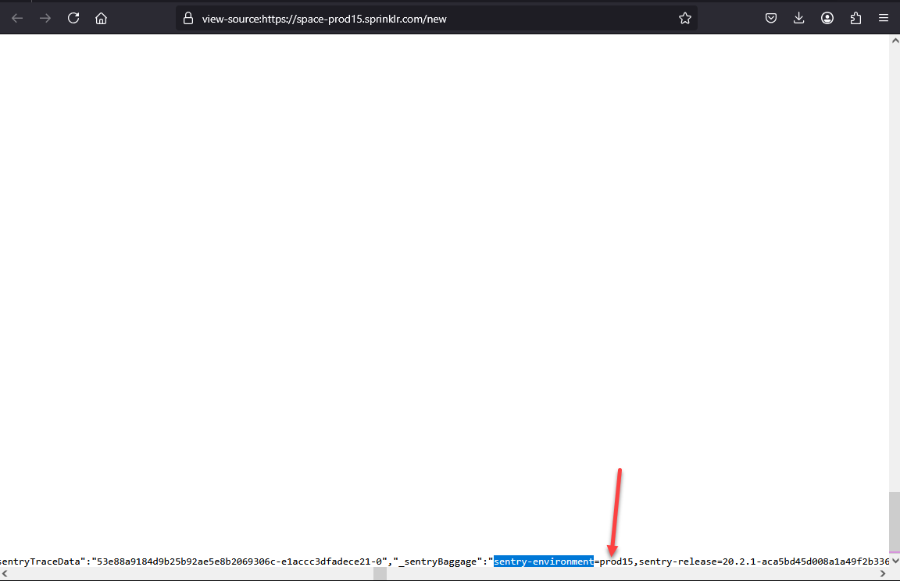
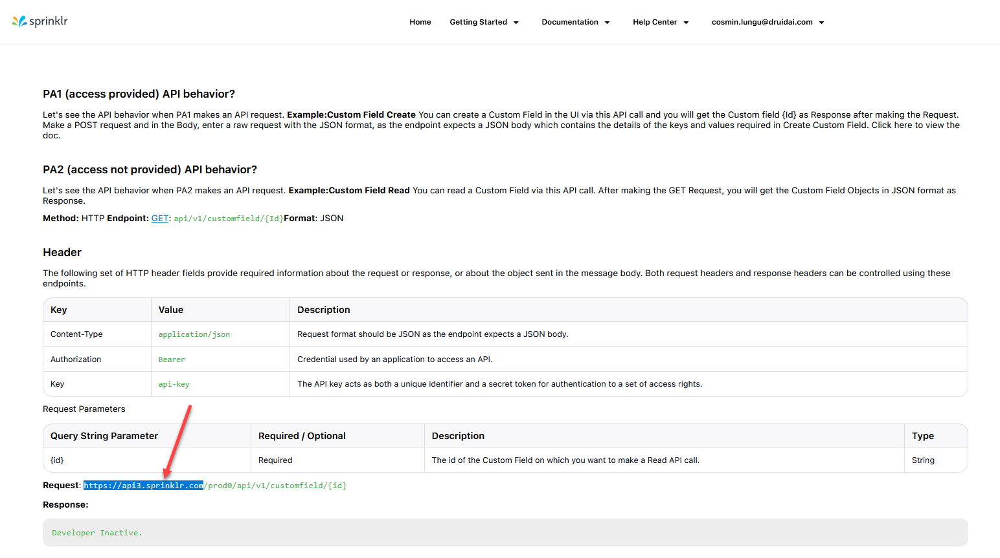
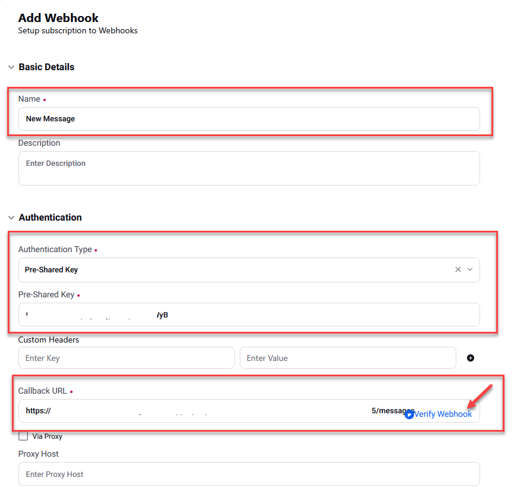

Sprinklr is a customer service platform that lets you connect with your customers through AI Agents, live chat, and broadcasts on various channels. You can integrate AI Agents with Sprinklr to handle user requests within various channels.

## Prerequisites

Before integrating your AI Agent with Instagram, ensure you have set up the required accounts and assets

* A Sprinklr Developer account (using a service account email) to register the application that will be linked to your AI Agent.
* A Client user account on the Sprinklr platform with access to your company's Sprinklr environment.
* An active, published AI Agent built within the Druid Portal.

## Integration procedure

To integrate an AI Agent with Sprinklr, follow these steps:

### Step 1. Get the Sprinklr platform environment and Campaign ID

1. Sign in to the [Sprinkler Platform](https://space.sprinklr.com/).
2. Right click anywhere on the homepage and select **View Page Source**.
3. Press **Ctrl+F** and search for "sentry-environment". The value of **sentry-environment** is where your Sprinklr instance is hosted. This is your Sprinkler environment.



4. Copy the environment name you will need it to create a Sprinkler app.
5. Close the Page source code page.
6. Type "Campaigns" in the search bar and select the desired item from the search results.


7. The list of defined campaigns appears. Campaigns are used in Sprinklr as the primary tags to categorize outbound messages and thereby effectively organize and collaborate on activities around the campaign such as tasks, assets, messages, workflows, etc.
8. Copy the ID of the approved campaign as you will need it to configure the Sprinklr channel in the Druid Portal.


You can now create a Sprinklr app.

### Step 2. Create a Sprinklr app

1. Sign into [Sprinklr Developer Portal](https://dev.sprinklr.com/accounts/login).
2. Click on your email address appearing at the top right corner and select **Apps** from the drop-down menu.


3. Click on the **+ NEW APP** button to create a new application.
4. In the application form, fill in the required fields:

| Field    | Description                                                                                                             |
| -------- | ----------------------------------------------------------------------------------------------------------------------- |
| App Name | The name of the application. It is recommended to name your application based on the use case you will be using it for. |
| APIs     | Enable the API for your Sprinklr platform environment, the one you copied at Step 1.                                    |

5. In the **Callback URL** field, enter https://www.sprinklr.com.
6. Click the **Save** button at the bottom of the page to save the app. An API Key and Secret are generated for the app.
7. Copy the **API Key** and **Secret** as you will need them to configure the Sprinklr channel in the Druid Portal.


8. Reach out to Sprinklr support to activate your app.


**IMPORTANT!** Although the app status shows as Active in the Sprinklr Developer Portal, it is not actually active in your specific environment. To activate the app, you must contact Sprinklr Support and request activation for your environment.


Now configure the Sprinklr channel in the Druid Portal.

### Step 3. Activate the Sprinklr channel in the Druid Portal

1. In the Druid Portal, go to your AI Agent details and click the **Channels** tab.
2. Search for **Sprinklr** and click on the channel card.

.png>)

3. Fill in the fields as follows:

| Field       | Description                                                                                                                                                                                                                                     |
| ----------- | ----------------------------------------------------------------------------------------------------------------------------------------------------------------------------------------------------------------------------------------------- |
| Environment | The name of the environment you copied at Step 1, substep 4.                                                                                                                                                                                    |
| Campaign ID | The ID of the campaign you copied at Step 1, substep 8. The AI Agent messages will be sent to this campaign.                                                                                                                                    |
| ApiHost     | The Sprinklr API URL. It is in the format: https://api.sprinklr.com. For example: https://api3.sprinklr.com. You can get it from the [Sprinklr documentation](https://dev.sprinklr.com/api-overview).  |
| API key     | The API Key and Secret you copied at Step 2, substep 7.                                                                                                                                                                                         |
| API secret  |                                                                                                                                                                                                                                                 |

4. Generate the Webhook Secret.
5. Copy the **Webhook inbound URL** and the **Webhook Secret** as you will need them to configure the Sprinkler webhook.
6. Optionally, customize channel display settings as follows:
   * **Alias**: Enter a clear, business-friendly display name (e.g., Interactive Messaging). This value is stored in\*\*\[\[ChatUser]].ChannelDisplayName\*\*, which appears in reporting tools like AI Agent Summary dashboard - Engagement KPIs and can also be referenced in flow business logic.
   * **Description**: Enter a brief description. This is particularly helpful when using an alias, as it helps identify the channel's specific purpose within the Druid Portal.
   * **Channel Icon**: Upload a custom icon to display on the channel card within the Druid Portal
7. Click **Publish** to activate the channel.

After the channel activates, the following fields are available in Druid:

* **\[\[ChatUser]].ChannelId** = "sprinklr"
* **\[\[ChatUser]].ChannelDisplayName** - Stores the Alias which is used in AI Agent Summary Dashboard > Engagement KPIs > Channel chart.

### Step 4. Create Sprinklr webhook

1. Sign in to the [Sprinkler Platform](https://space.sprinklr.com/).
2. Type "webhook" in the search bar and select the item from the search results.


From the main menu, click **API 2.0** and on the page, click **Webhooks**.

.png>)

3. Click the **Add Webhook** button at the top-right corner of the page.
4. In the webhook configuration page, enter the following details:

| Field               | Description                                                                                                                                           |
| ------------------- | ----------------------------------------------------------------------------------------------------------------------------------------------------- |
| Name                | Enter a webhook name.                                                                                                                                 |
| Authentication Type | Select **Pre-Shared Key**.                                                                                                                            |
| Pre-Shared Key      | Enter the **Webhook Secret** you copied from the Druid Portal at Step 3, substep 5.                                                                   |
| Callback URL        | Enter the **Webhook inbound URL** you copied from the Druid Portal at Step 3, substep 5. Click the **Verify Webhook** button available in this field. |
| Subscription        | Add the following subcriptions: - Message Received - Message Association Change - Case Updated                                                        |




5. Save the webhook.

You have successfully completed the Sprinklr channel configuration.

## Send the conversation transcript to Sprinklr Agents

To save the conversation transcript and make it available for Sprinklr agents, on the flow that connects the client with the helpdesk agent, make the following settings:

1. On the step where you call the internal action **ConnectToHelpdeskAgent**(Post Actions section), in the **Pre Actions** section, call the internal action **GetConversationTranscript**.


**IMPORTANT!** When calling the **GetConversationTranscript** internal action on the same step where you call **ConnectToHelpdeskAgent**, make sure to call it in the PreActions section. Calling it in the PostActions section will not send the conversation transcript to agents.



**Info:** You can call the **GetConversationTranscript** internal action on a previous step.


2. On the **ConnectToHelpdeskAgent** internal action add the following:

```
{
  "SendConversationTranscript": true
}
```


**Info:** You can send additional client information to Sprinklr Agents together with the conversation transcript. For more information, see [Send Contact Center Parameters](<Sprinklr Integration.md#Send_Contact_Center_Parameters>).


3. Save the step.

## Send Contact Center Parameters <a href="#send_contact_center_parameters" id="send_contact_center_parameters"></a>

To send Contact Center parameters to Sprinklr, on the **ConnectToHelpdeskAgent** internal action, provide the desired parameters inside the `ContactCenterParameters` object in JSON format.

You can populate Sprinklr parameters using values from \[\[ChatUser]],or any other defined Druid entity, as long as they are mapped to Sprinklr properties.


**Info:** Starting with Druid 9.29, you can also send additional custom Sprinklr parameters in the workflow payload mapped to \[\[QueryParams]] fields, provided these properties are defined as fields within the Query Params system entity.



**NOTE:** The payload must follow a key-value format where both the key and value are strings. When using values from Druid conversation context (entities, local variables) as parameter values, ensure they are enclosed in double quotes ("") to maintain valid JSON formatting.


**Example - Send Custom Contact Center parameters**

```
{
     "SendConversationTranscript":true,
     "ContactCenterParameters":
        {
         "_c_6a030a7b68b959408b2ad006": "Status",
        "_c_6a030a5568b959408b2a9c64": [[Case]].Status,
        "_c_6a59fb586e0b50ee156921fa": "Genuine"
        }
}
```

## Receiving and Processing Voice Messages

Druid supports audio messages only through Microsoft Cognitive Services and ElevenLabs. For Microsoft Cognitive Services, it supports all languages available in the Azure Speech Service. For a complete list of supported languages, refer to [Language and Voice Support for the Speech Service](https://learn.microsoft.com/en-us/azure/ai-services/speech-service/language-support?tabs=tts#supported-languages).

Here's how it works:

1. Receive audio messages. When a user sends an audio message via WhatsApp, the AI Agent will:

* Process the audio recording using Azure Speech/ElevenLabs resources configured in the channel settings.
* Recognize the language for Speech-To-Text (STT) based on the user's language (\[\[ChatUser]].Language).
* Log in the Conversation History the user message type as 'Audio Recording'.

2. Process audio. The AI Agent:

* Converts the audio message to text using Microsoft Cognitive Services/ElevenLabs.
* Uses the converted text to predict the next conversational step.

3. Respond. By default, the AI Agent will respond to voice messages with text. You can choose the AI Agent to reply with voice.

To enable voice messages support, follow these steps:

1. In the channel configuration page, tap on **Support voice messages**.
2. Select the Speech provider (either **Azure** or **ElevenLabs**), then enter the required details:

* For **Azure**, enter your MS Azure Speech API key and select the region.
* For **ElevanLabs**, enter your API key.

3. By default, the AI Agent replies with text. To have the AI Agent respond with voice, toggle on **Reply with voice messages**.
4. In the table, click the plus icon. A row is added to the table.
5. From the **Language** drop-down, select the AI Agent language (default or additional) and from the **Voice** drop-down, select the human-like neural or standard voice the AI Agent will use to respond to the user.
6. Click the **Save** icon displayed inline. You can add more languages and different voices per language as best suits your needs.


7. If the channel has not been published yet, click **Publish**.
8. Click the **Save** button at the bottom of the page to save the AI Agent configuration.
