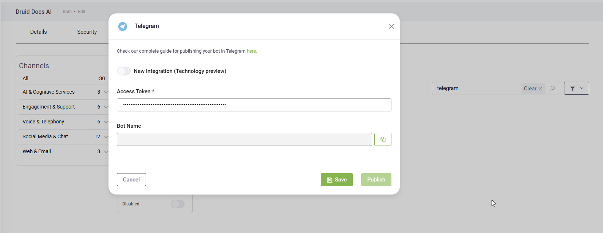

You can integrate AI Agents with Telegram allowing your customers to start conversations with the AI Agents in the Telegram app.


**NOTE:** Telegram channel integration is not available in Druid on premise deployments; you cannot activate the channel.



**IMPORTANT!** The Welcome flow will be triggered at the user's first conversation with the AI Agent or when receiving the **/start** command in Telegram (supported across both direct Telegram and Bot Framework integrations); the predict with the initial "user says" is dropped. If no Welcome flow is configured, the **NoIntentIdentified** special message will be triggered instead.


## Integrating your AI Agent with Telegram

To integrate the AI Agent with Telegram, follow these steps:

1. Create a new Telegram AI Agent following [Microsoft instructions](https://docs.microsoft.com/en-us/azure/bot-service/bot-service-channel-connect-telegram?view=azure-bot-service-4.0).


**NOTE:** Write down or copy/paste in a document the access token generated when creating the Telegram AI Agent.


2. In the Druid Portal, go to AI Agent settings, and then click the **Channels** tab.
3. Search for 'telegram' and click the **Telegram** card.

.png>)

The channel configuration modal appears.

4. Enter / Paste the access token you copied when creating the Telegram AI Agent.

5. Click the **Publish** button. The channel activation might take up to 1 minute, wait until it completes.

After the channel's activation, two fields are available in DRUID:

* **\[\[ChatUser]].ChannelId** = "telegram"
* **\[\[ChatUser]].UserId** stores the unique identifier of the Telegram user account.

To open the AI Agent in the Telegram channel, in the Druid Portal, go to the AI Agent settings, click the **Channels** tab and click on the Telegram channel icon. You can start talking to the AI Agent.


**NOTE:** In DRUID 7.5 and higher, when a user initiates a conversation with the AI Agent, the Welcome flow will be automatically triggered. Regardless of the user's subscription status to the AI Agent channel, the welcome message will be promptly sent to the user, ensuring a seamless and engaging interaction experience.


### Limitations

Telegram has a limited number of characters for hero cards / choice buttons, as follows:

* Maximum 60 characters for button Value and Title.
* Approximately 200 characters for Subtitle.


**NOTE:**

In UTF-8 encoding, 128 ASCII characters are encoded in 1 byte while 1920 Cyrillic characters are encoded using 2 bytes. This is why the words length between ASCII and the Cyrillic native script differs. To see the words length, you can use Notepad++.



## Starting specific Druid Flows via Telegram DeepLinks

Telegram DeepLinks are a powerful mechanism to launch your AI Agent and immediately trigger a specific Druid flow by providing the associated flow Intent. This key capability moves beyond the default behavior of simply triggering the Welcome flow when a user initiates a chat. By allowing you to create targeted entry points, DeepLinks are ideal for QR code campaigns, enabling you to generate custom codes that direct users to specific actions or flows within your AI Agent.


**NOTE:** Telegram DeepLinks support is available in Druid version 9.9 and later.


### DeepLink Format

The link format used to generate QR codes that trigger a specific flow is: `vhttps://t.me/<botusername>?start=<intent>`.

| Parameter | Description                                                                                       |
| --------- | ------------------------------------------------------------------------------------------------- |
|           | The unique username of your Telegram AI Agent, set up in BotFather(e.g., my\_druid\_bot).         |
|           | The intent of the flow you want to start when users scan the QR code generated with the DeepLink. |

### Generic Procedure

1. Identify the username () of your Telegram AI Agent from BotFather.
2. Identify the exact name of the Druid flow intent that you want to be executed when the user scans the QR code.
3. Construct the DeepLink. Combine your AI Agent username and target intent into the standard DeepLink format. E.g., `https://t.me/my_druid_bot?start=check_product_info`.
4. Publish the DeepLink directly in your digital channels (website, email) or input it into a third-party QR code generator tool to create the scannable code.
5. Make the DeepLink or QR Code available for your users.


**IMPORTANT!** DeepLinks requires the Telegram application to be installed on the user's device to execute and launch the targeted Druid flow.

