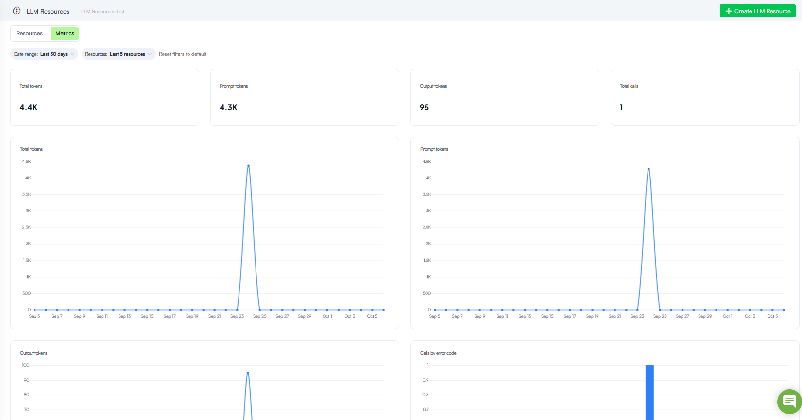

# Druid 10.1 - Latest

Deployment Dates

The table below lists the deployment date of Druid 10.1 across Druid Clouds. To view the Druid Releases Calendar, see [Druid Releases](Druid%20AI%20Releases.md).

| Druid Cloud Community  \*.community.Druidplatform.com | Druid Cloud US  \*.us.Druidplatform.com | Druid Cloud Australia  \*au.Druidplatform.com | Druid Cloud West-Europe (PROD)  \*.Druidplatform.com |
| --- | --- | --- | --- |
| October 08, 2026 | October 22, 2026 | October 22, 2026 | October 22, 2026 |

These release notes give you a brief, high-level description of the improvements implemented to existing features.

If you have questions about your Druid tenant, please contact [support@druidai.com](mailto:support@druidai.com) or your local Druid partner for more information.

## What's New

- **Druid webRTC Channel**. Powered by the Druid voice technology stack, the webRTC channel offers a complete, bi-directional audio experience. Users can speak to the AI Agent and receive real-time, synthesized voice responses powered by server-side Text-to-Speech (TTS). Unlike voice-assisted chat, which only transcribes spoken input into text on the client side, webRTC enables continuous spoken dialogue with audio playback for a fully interactive voice session. For more information, see [webRTC](../Druid%20Voice/webRTC.md).

**Key Highlights**

- **Easy Deployment**. Enable voice interactions within the Druid Portal without re-deploying your existing website webchat snippet.
- **Flexible Modes**. Choose between a dedicated voice-only experience or a hybrid mode that lets users seamlessly switch from talking to typing.

> **NOTE:** Druid webRTC channel requires prior setup of [Druid SIP Connectivity](../Druid%20Voice/Configure%20Druid%20SIP%20Connectivity.md).

- **ElevenLabs Voices**. We are thrilled to announce the release of ElevenLabs Voices, a super useful and powerful capability designed to elevate your ElevenLabs voice management directly in the Druid Portal.
  For more information, see [ElevenLabs Voices](../Druid%20Voice/ElevenLabs%20Voices.md).

**Key Highlights**

- **Custom Voice Creation**: Seamlessly explore and create ElevenLabs voices directly within the platform to easily manage your speech resources.
- **Flexible Speech Configuration**: Fine-tune both Text-to-Speech (TTS) and Speech-to-Text (STT) services effortlessly using dedicated JSON editors.
- **Interactive Playground**: Test configurations and experiment with real-time streaming versus batch generation.

The voices you manage in the **Druid Portal** will be in your ElevenLabs account under **My Voices**.

- **Agent Mandate (Technology Preview)**. Agent Mandate is now available in technology preview for agentic flows. The dedicated Mandate Editor enables you to define an agent goal, scope, and boundaries, establishing how the agent should operate and what it can do.

You can define the instructions that guide the agent and equip it with the tools required to accomplish its tasks. You can use predefined tools for common operations or create and configure custom tools based on specific business requirements.

*Custom tool configuration*

By bringing the agent’s mandate and tooling together in one place, you gain greater control over agent behavior and execution.

> **Info:** Documentation will be available soon.

- **Sakari SMS Channel**. The Sakari SMS channel enables you to connect your Druid AI Agent directly with Sakari for powerful text messaging and customer engagement. This new channel streamlines outbound campaigns and two-way messaging—especially for clients already utilizing Sakari—allowing quick setup, automated alerts, and real-time delivery status tracking.  For more information, see [Sakari SMS](../Channels/Sakari_SMS.md).
- **LLM Resources Metrics and Usage Monitoring**. With this release, you gain comprehensive visibility into Large Language Model (LLM) consumption and performance through the new LLM Resources Metrics dashboard.  For more information, see [LLM Resources Metrics and Usage Monitoring](../Governance%20%26%20Security/LLM%20Resources%20Metrics%20and%20Usage%20Monitoring.md).

**Key Benefits**

- **Real-Time Token Tracking**. Monitor aggregate and chronological token consumption—including separate prompt and output token volumes—to understand usage patterns and optimize resource costs.
- **Call Volume & Error Analysis**. Track total request counts and quickly isolate integration issues using the Calls by error code breakdown.
- **Flexible Filtering**. Effortlessly scope your telemetry data by custom date ranges and specific LLM resource endpoints to target your analysis.

- **Knowledge Base improvements**. This release introduces various improvements:

- **Dynamic search priority at conversation time**. With this release, you have greater control over knowledge retrieval during live interactions. While you can configure default search priorities at the data source level, you can now override these priorities dynamically at runtime during a conversation. For more information, see [Dynamic Search Priority at Conversation Time](../Knowledgebase/Dynamic%20Search%20Priority%20at%20Conversation%20Time.md).
- **Intelligent Document Processing (IDP) extractor (Technology Preview)**. The IDP extractor is now available for Knowledge Base extraction, supporting CSV, Word, PowerPoint, Excel, and PDF files. It provides advanced document parsing to improve the accuracy and contextual understanding of content extracted from complex business documents.
> **NOTE:** The IDP extractor is a tenant-level feature. To activate it on your tenant during the Technology Preview, contact Druid Support.

> **Info:** For best results, we recommend using the IDP extractor with the **Basic** content chunker.

- **Augmentation for Basic content chunking**. Knowledge Base Augmentation has been enhanced to support Basic content chunkers, enabling authors to use an LLM to generate additional information for extracted content.

The new **Augmentation** area in **Knowledge Base Settings** > **Advanced** allows you to create multiple augmentation strategies, each defining the generative endpoint and prompt used to generate additional elements. Additionally, **Generated Elements**, previously available only for LLM content chunkers, have moved to the new Augmentation area and now apply to both **Basic** and **LLM** content chunkers.

For more information, see [Augmentation](../Knowledgebase/KB%20Settings/Augmentation.md) and [Basic Content Chunking](../Knowledgebase/KB%20Settings/Content%20Chunkers.md#Basic).

## Improvements

- **GetConversationTranscript internal action improvements**. We have added two new parameters to the **GetConversationTranscript** internal action, empowering seamless troubleshooting, and enhanced AI-driven insights.

- **IncludeErrorMessages** - Gain complete visibility into troubleshooting sessions. Setting this parameter to **true** loads all messages originating from the exception flow, ensuring error messages are properly captured in the transcript output.
- **IncludeSystemMessages**. Improve automated monitoring and AI diagnostics. Setting this parameter to **true** delivers all system messages from the conversation, providing the comprehensive context required by analytical tools like the  [Conversation Diagnostics Agent](../2_AI%20Agents/Conversation%20Diagnostics%20Agent.md) for deeper and more accurate transcript evaluation.

For more information, see [GetConversationTranscript](../4_Flows/Internal%20Actions.md#GetConve).

- **Score Calculator selection for programmatic KB prediction**. The **GetIntentMatching** and **GetMegaBotIntentMatching** internal actions now support the optional **ScoreCalculator** parameter. When programmatically running Knowledge Base prediction at conversation time, authors can use this parameter to specify the Score Calculator strategy to apply for the prediction. This provides greater control over how Knowledge Base matches are calculated for different use cases. If no Score Calculator is specified, the default KB Score Calculator strategy is used.  For more information, see [GetIntentMatching](../4_Flows/Internal%20Actions.md#GetInten).
- **Granular interaction export in Conversation History**. Starting with this release, you can export the conversation history for a single interaction directly into a structured Excel file, available from both the Conversation History list and individual conversation details pages. This allows you to quickly analyze a specific user interaction without needing to download massive, full-range conversation exports.

## Bug Fixes

- **Solution import fix**. Resolved a bug where importing a solution into an AI Agent with a different primary language caused the metadata for flow steps (Hero Cards, Choice Cards, and Adaptive Cards) to be mapped incorrectly.
