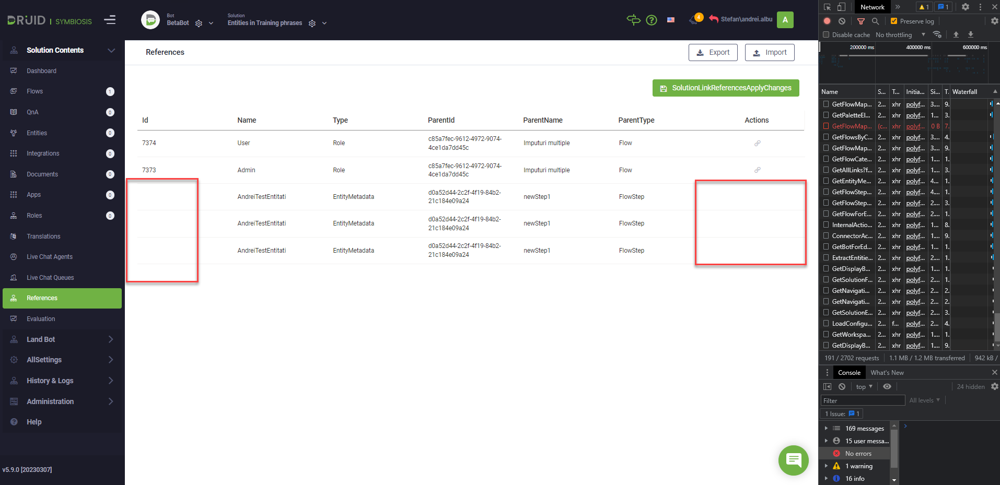
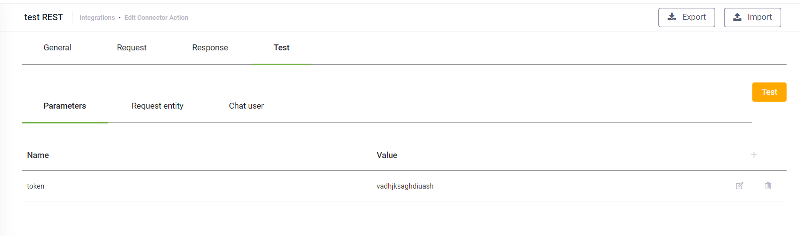

<a id="DRUID511"></a>

# DRUID 5.11

Deployment Dates

The table below lists the deployment date of DRUID v5.11 across DRUID Clouds. To view the DRUID Releases Calendar, see [Druid AI Releases](../Druid%20AI%20Releases.md).

| Druid Cloud Community  \*.community.Druidplatform.com | Druid Cloud US  \*.us.Druidplatform.com | Druid Cloud Australia  \*au.Druidplatform.com | Druid Cloud West-Europe (PROD)  \*.Druidplatform.com |
| --- | --- | --- | --- |
| March 30, 2023 | April 20, 2023 | April 20, 2023 | April 20, 2023 |

These release notes give you a brief, high-level description of the improvements implemented to existing features.

If you have questions about your DRUID tenant, please contact [support@Druidai.com](mailto:support@druidai.com) or your local DRUID partner for more information.

**Recommended!** This release includes features that require upgrade of your DRUID Connector Host to the latest version:

- Windows Authentication
- Encrypt traffic

<a id="WhatsNew"></a>

## What's New

- **Live Dashboard**. Available in technology preview, the Live Dashboard provides helpdesk managers with an overview on how helpdesk agents are performing, at any given moment. It offers real-time metrics that help managers analyze the contact center queues performance and track their agents’ efficiency in real time.

By default the Live Dashboard is disabled. To activate Live Dashboard for your AI Agent, go to the AI Agent settings, **Details** tab. Click on the **Live Chat** section header and select **Enable Live Dashboard**.


For information on how to configure the Live Dashboard, see [Live Dashboard](../../Live%20Chat/Live%20Dashboard.md).

- **Limit intent switch**. The **Limit intent switch** option provides a simple way to configure intent switch on flow steps with input mapping (prompt, choice, thumbnail, hero card, adaptive card) where you want to allow the user to ask questions in the same area with the current flow without creating child intents.


For more information, see [Flow Steps General Configuration](../../4_Flows/General.md).

- **Provisioning users from Active Directory in Druid Portal through OpenID Connect**. You can provision users from Active Directory by mapping DRUID roles to AD groups. At provisioning, a user will be assigned with the reunion of associated DRUID roles for all AD groups that user is member of.


If the user is member of an AD group for which there is no DRUID role mapped, at provisioning, the user will be assigned the role(s) set as **Default**, if there are any defined; otherwise, the user will be provisioned without any role associated and the administrator will have to manually assign a DRUID role for that user.

> **NOTE:** The mapping of the AD groups to DRUID security roles is validated and updated at every user login and it is updated based on the changes done in Active Directory, if any. For example, if in Active Directory a user has been moved from an AD group to another one, when the user logs in DRUID, the mapping of the AD groups to DRUID security roles is validated and the user will be assigned with the DRUID role(s)mapped for the new AD group the user is member of (if any DRUID security roles were mapped for that AD group).

For more information, see [Provisioning Portal Users and Single Sign On Authentication via OpenID Connect](../../Governance%20%26%20Security/User%20Management/Provisioning%20Portal%20Users.md).

- **Azure Translator for authoring time translation**.
  Document Translation, a cloud-based feature of the Azure Translator service (that is part of the Azure Cognitive Service) is now available for authoring time translation.


For information on the prerequisites and how to set up Azure Translator for authoring time translation, see Building Multi-Language AI Agents Using Machine Translation.

- **Windows Authentication**. Windows authentication is now available in the DRUID Connector Host Installer when connecting to the SQL database that stores the conversation history and in the SQL Connector app when connecting to an SQL database.


For more information, see [Install Druid Connector Host](../../Druid%20Deployment/Install%20Druid%20Connector%20Host.md) and [Create SQL App](../../7_Integrations/SQL/Step%201%20Create%20SQL%20App.md).

- **Encrypt traffic**. A new option is now available in the DRUID Connector Host Installer, in the Conversation History DB section, that allows you to encrypt the communication between the DRUID Connector Host and the SQL Server with a certificate that is installed on the SQL Server.
> **NOTE:** If the traffic is encrypted using a self-signed certificate or a certificate that has not been issued by a recognized Certified Authority (CA), in DRUID Connector Installer, select **Trust server certificate**; otherwise, the DRUID Connector Host and the SQL Database will be unable to communicate.


- **Code Extension**. The following additional flow metadata in now available in the property **.thisStep**: FlowName, FlowDescription and FlowCategory.
- **IBM Db2 client available for SQL integrations**. Integration with IBM Db2 is now available in **technology preview**.


> **NOTE:** DRUID SQL Connector only supports DB2 Connect server-based license. To establish direct client connection to the Db2® for z/OS® or Db2 for i servers, you can activate the Db2 Connect Unlimited Edition license certificate file on the corresponding Db2 for z/OS subsystem or Db2 for i server, following the procedure described in [IBM documentation](https://www.ibm.com/docs/en/db2/11.5?topic=li-activating-license-certificate-file-db2-connect-unlimited-edition).

For information on how to configure the SQL connector for your Db2 database, see [Create SQL App](../../7_Integrations/SQL/Step%201%20Create%20SQL%20App.md).

<a id="Improvements"></a>

## Improvements

- **Test predict feature (user says) provides language detection results** - If language detection is enabled on the AI Agent, you can test user says to see the **Predicted language** and the **Confidence** (the score of the predicted language). This is particularly useful for debugging purposes to check why language detection was not done on user says or why the **Language changed flow** was not triggered.


- **Chat bubble positioning in the Druid Portal**. To enable authors to use pagination or edit records that display in the backward of the chat bubble, you can now change the position of the chat bubble by using drag and drop.


- **Support for Viber Stickers**. You can create a custom sticker in Viber using your Viber admin account and capture the sticker ID in input mapping entity field or local variable and guide the conversation on specific paths based on the sticker ID. For more information, see [Capture sticker id](../../Channels/Viber/Capture%20sticker%20id.md).

<a id="BugFixes"></a>

## Bug Fixes

- The description of hero cards with repeater was not rendering properly. Now all hero card elements render different descriptions.
- The Step messages within flow steps were not translated at conversation time by Machine Translation.
- The statuses: Last modification time and Last modifier user name were not updated in all elements (Flows, Entities, Documents).
- Orphan items appeared on the References page when deleting entities used in Training phrases and these entities did not have a field of type entity that referencing to other entities.



- Adaptive Cards sometimes did not inactivate.
- Parameters did not work in connector task; in the Test tab, RequestTask in the JSON variable was null.



- Iterate by JSON path expression - If the collection upon which the connector task should iterate is empty, the error "value cannot be null" is no longer thrown.
- NER fixes:

- Deterministic recognition: fixed the extraction issues for the same entity, when typed with capital letter instead of small letter.
- Deterministic (string) extraction issue - incomplete extraction. For example for user says "Which are the acceptance conditions for University of California?", only California was extracted.
- Punctuation influenced the entity extraction. E.g., "What is the schedule for clinic X?" versus "What is the schedule for clinic X".
- Indexed entities: issue when input value was written in lower case instead of upper case (or viceversa).
- Fixed the wrong extraction of entities of type Location, Person and Organization.

- The authorization issues in the VoiceText channel was fixed by adding the following parameter in the request body of the DRUID Authorize API call: `"channelId": "voicetext"`.

```
{
   "botId": "<bot_id>",
   "queryString": "phone=<phone>",
   "channelId": "voicetext"
}
```
