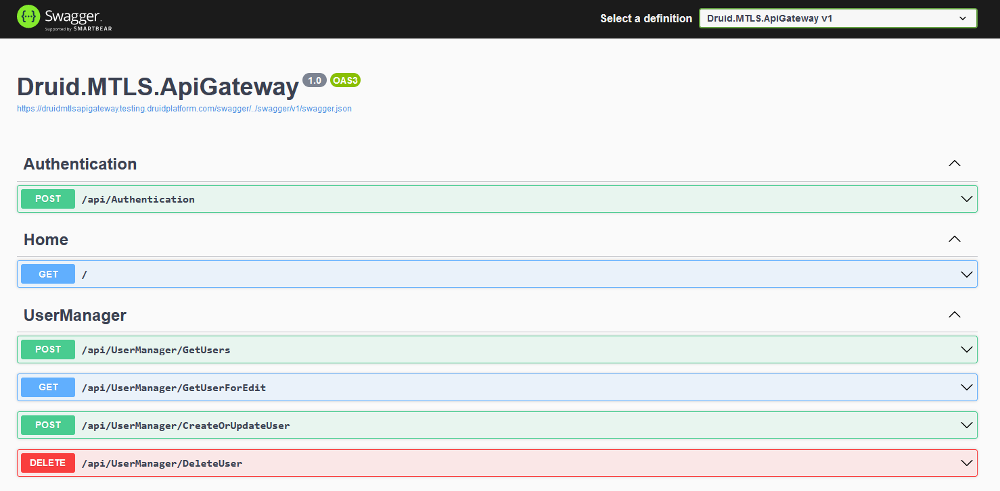

# DRUID 5.16

Deployment Dates

The table below lists the deployment date of DRUID v5.16 across DRUID Clouds. To view the DRUID Releases Calendar, see [Druid AI Releases](../Druid%20AI%20Releases.md).

| Druid Cloud Community  \*.community.Druidplatform.com | Druid Cloud US  \*.us.Druidplatform.com | Druid Cloud Australia  \*au.Druidplatform.com | Druid Cloud West-Europe (PROD)  \*.Druidplatform.com |
| --- | --- | --- | --- |
| June 12, 2023 | July 06, 2023 | July 06, 2023 | July 06, 2023 |

These release notes give you a brief, high-level description of the improvements implemented to existing features.

If you have questions about your DRUID tenant, please contact [support@Druidai.com](mailto:support@druidai.com) or your local DRUID partner for more information.

## What's New

- **Cisco Unified Contact Center Express (CCX) Live Chat**. A new live chat contact center provider is now available in DRUID, Cisco which you can use to integrate DRUID with Cisco Unified CCX.

For more information, see the [Cisco Contact Center Express Live Chat Integration](../../Live%20Chat/Cisco%20Live%20Chat.md).

- **Mutual TLS (mTLS)**. A new service is now available in DRUID, **Druid.MTLS.ApiGateway** that exposes an API for user management in the Druid Portal using mTLS authentication.

> **NOTE:** As Mutual TLS is a method for mutual authentication, you need to install the mTLS certificate on the DRUID environment; otherwise, calling the new API endpoints will fail. For more information on how to do that, get in touch with [DRUID Support](<mailto:support@druidai.com?subject=Install mTLS certiicate on DRUID environment>).

- **DRUID Vision: UK Driver License**. With this release, the Druid API engine performs OCR and data extraction from UK driver licenses. For more information, see [UK Driver License OCR](../../Druid%20AI%20Services/UK%20Driver%20License%20OCR.md).

## Improvements

- **Added support for Flex messages in the LINE channel**. DRUID allows you to do enhanced customizations of message steps for the LINE channel using Flex messages. For more information, see [Use flex messages for Line channel](../../Channels/Line/Use%20flex%20messages%20for%20Line%20channel.md).
- **Special views available to use on forms and charts**. This release introduces three special types of views which you can use at authoring time on forms and charts to allow business users drill down for more information. Additionally, when selecting a view on forms you can prevent users from navigating to the view and/or prevent users from adding new records to the view.

For more information, see [Create Special Views for Forms and Charts](../../CBA/Create%20special%20views%20to%20drill-down%20info%20in%20Forms%20and%20Charts.md), [Charts.htm](../../CBA/Charts.md), [Create and Design Forms](../../CBA/Create%20and%20Design%20Forms.md).

## Bug Fixes

- CNN Installer: encrypted configurations are now editable on Upgrade Connector Host.
- Default Workspace is now selected when logging in the first time.
- BF4: Scroll bug - When zoomed out, the "more messages" now scrolls down at the bottom of the snippet.
- Workspace - read role. On the current role setup, if the user has access to workspace read role, in order to access the workspace, the platform does not raise the error for workspace edit role anymore.
