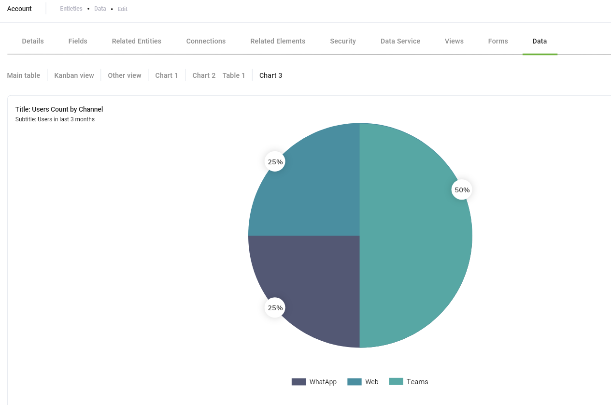
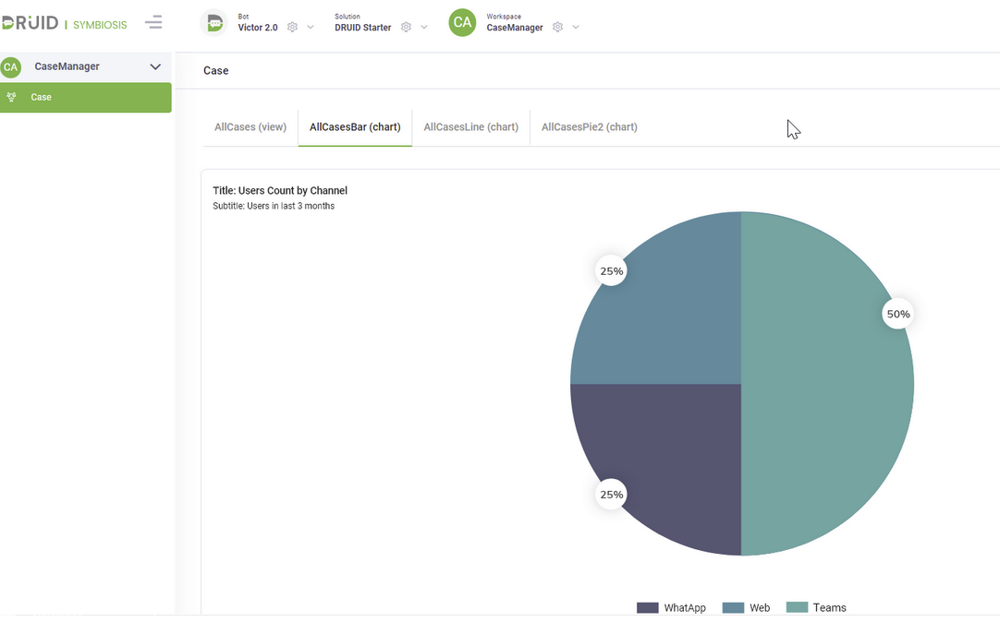

# DRUID 5.3

Deployment Dates

The table below lists the deployment date of DRUID v5.3 across Druid Clouds. To view the Druid Releases Calendar, see [Druid AI Releases](../Druid%20AI%20Releases.md).

| Druid Cloud Community  \*.community.Druidplatform.com | Druid Cloud US  \*.us.Druidplatform.com | Druid Cloud Australia  \*au.Druidplatform.com | Druid Cloud West-Europe (PROD)  \*.Druidplatform.com |
| --- | --- | --- | --- |
| December 08, 2022 | January 05, 2023 | January 05, 2023 | January 05, 2023 |

These release notes give you a brief, high-level description of the improvements implemented to existing features.

If you have questions about your Druid tenant, please contact [support@Druidai.com](mailto:support@druidai.com) or your local Druid partner for more information.

**Required!** This release includes features that require upgrade of your Druid Connector Host to the latest version:

- SSO Authentication and authorization with OAuth 2.0 Protocol

## What's New

- **SSO Authentication and authorization with OAuth 2.0 Protocol**. authors can now use the OAuth 2.0 protocol to authenticate users conversationally and allow DRUID assistants to access their data hosted with a third–party API service without revealing their credentials to DRUID.

The OAuth 2.0 authorization flow implementation in DRUID is a seven-step process.

As you can use OAuth 2.0 for both authorization and user authentication, DRUID provides you with three types of actions you can use for OAuth 2.0 purposes:

- **Sign in** – handles both authentication and authorization when calling external API services on user’s behalf without necessarily authenticating the user within the conversation.
- **Get user identity** – get user data (first name, last name, email, etc.) to identify and authenticate the user within the conversation. Requires Sign in.
- **Sign out** – You can give the users the possibility to prevent the conversation from having access to external services on user’s behalf. You can use this action only if the external service provides an endpoint for signing out.

This new feature also introduces the field **[[ChatUser]].OauthAccessURL** that stores the authorization URL, the URL where the service will redirect the user after granting an authorization code or access token.

For more information, see [SSO Authentication and authorization with OAuth 2.0 Protocol](../../7_Integrations/OAuth2/SSO%20Authentication%20and%20authorization.md).

- **Charts**. Charts are a powerful tool that allows authors to put at business users disposal grouped information about entity records. Business users can view charts from the **Data** tab defined on the entity or from Workspaces.

In a future DRUID release, authors will be able to embed charts on web forms. For example, display the sales trend for a specific account in an account 360-view form.

For more information about charts, see [Charts](../../CBA/Charts.md).

- **Language Change Detection**. DRUID is now capable of detecting any language change in the conversation prior triggering the **Intent not found** flow, covering the cases when the user types something in another language than the default language of the AI Agent. It does not include the cases when the user changes the conversation language using the snippet's Language option.

This new feature introduces the following:

- Enabling language detection from the AI Agent details page (Dialogue management section). For more information, see [AI Agent Advanced Settings](../../2_AI%20Agents/Configuring%20AI%20Agent%20Advanced%20Settings.md).
- Two new fields in the [[ChatUser]] system entity:

- **[[ChatUser]].AvailableLanguages** - Stores all languages available on the AI Agent.
- **[[ChatUser]].DetectedLanguage** - Stores the current language in the conversation.

For more information, see [System Entities](../../5_Entities/System%20Entities.md).

- A new system entity, **[[SystemLanguage]]** that stores information DRUID uses when language change is detected in the conversation.

For more information, see [System Entities](../../5_Entities/System%20Entities.md).

- authors can define a special flow, **Language Changed flow** to handle the situations when DRUID detects a language change in the conversation. For more information, see [Language Changed Flow](../../4_Flows/Language%20changed%20flow.md).

- With this release, you can enable machine translation for Conservation Time translation from either **SDL** or **Azure Translator (Cognitive Services)** machine translation service providers or from both. Using multiple machine translation service providers at the same time for Conversation Time translation can be useful when you want to address languages that are not available in one of your machine translation subscriptions (or in the provider's supported languages set). For more information, see Building Multi-Language AI Agents Using Machine Translation.
> **NOTE:** Using both machine translation service providers for Conversation Time translation requires specific configuration. For more information, see [Conversation Time Translation](../../2_AI%20Agents/Conversation%20Time%20Translation.md).

- **Support for NER dedicated entity fields**. Three field types have been added to DRUID (and are available in the **Data type** drop-down when adding/ editing entity fields), **Location**, **Organization** and **Name** that enhance the NLP model (deterministic NER) allowing better extraction of a location name, organization name and person's name from user input. For more information, see [Field Types](../../5_Entities/Field%20Types.md).

## Improvements

- **Viber Channel**. DRUID allows you to do enhanced customizations of hero cards and message steps for the Viber channel. For more information, see [Customize hero card buttons in Viber channel](../../Channels/Viber/Customize%20hero%20card%20buttons%20in%20Viber%20channel.md) and [Attaching a keyboard to Message flow steps for Viber channel](../../Channels/Viber/Attaching%20a%20keyboard%20to%20Message%20flow%20steps%20for%20Viber%20channel.md).
- You can now change the Data type of an existing entity field as long as they refer to the same Storage Data type (email, URL, Hash, etc. which are all using the same string Storage data type). For example, changing the Email entity field from Data type **Email** to **String**.
- On the AI Agent Details page, two sections have been renamed as follows: NLP to **Conversational AI** and Special Flows to **Dialogue Management**.

## Bug Fixes

- Improved user loading service in Druid Portal (for tenants with a very large number of users, e.g., 50k+).
- Druid Portal: The chat bubble is now hidden for unpublished bots.
