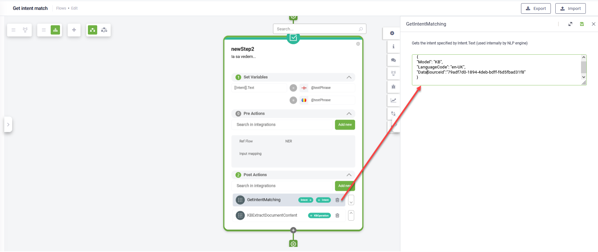

# Druid 7.1

Deployment Dates

The table below lists the deployment date of DRUID v7.1 across DRUID Clouds. To view the DRUID Releases Calendar, see [Druid AI Releases](../Druid%20AI%20Releases.md).

| Druid Cloud Community  \*.community.Druidplatform.com | Druid Cloud US  \*.us.Druidplatform.com | Druid Cloud Australia  \*au.Druidplatform.com | Druid Cloud West-Europe (PROD)  \*.Druidplatform.com |
| --- | --- | --- | --- |
| February 01, 2024 | February 15, 2024 | February 15, 2024 | February 15, 2024 |

These release notes give you a brief, high-level description of the improvements implemented to existing features.

If you have questions about your DRUID tenant, please contact [support@Druidai.com](mailto:support@druidai.com) or your local DRUID partner for more information.

**Recommended!** This release includes features that require upgrade of your DRUID Connector Host:

- Druid Data Services Connector - Update entity integration task enhancements

> **IMPORTANT!**
> In DRUID 7.0, the Knowledge Base engine has undergone a significant upgrade to the DRUID-based version, bringing you enhanced performance across all AI Agents. The old KB engine will be decommissioned in PROD environments on February, 15, 2024. To have an operational Knowledge Base after this date, it's essential to manually retrain all your AI Agents before making any predictions in the Knowledge Base.

## What's New

- **KBExtractDocumentContent - new internal action**. This release introduces the **KBExtractDocumentContent** internal action, a powerful external tool designed for document extraction during conversations, particularly valuable for conducting document analysis using Large Language Models (LLMs). It receives a document from a [[File]] entity and provides the response in [[KBOperation]].ExtractedDocument[i].Question / [[KBOperation]].ExtractedDocument[i].Answer. The internal action extracts the document content as a string collection.

This internal action uses the content extraction functionality found in the DRUID KB Engine but operates in isolation from the KB processing pipeline, focused on content extraction without introducing changes to the underlying KB infrastructure.

For more information, see [Internal Actions](../../4_Flows/Internal%20Actions.md).

- **New system entity - [[KBOperation]]**. The new system entity of type entity list stores chunks or articles extracted by the KBExtractDocumentContent internal action.
- **Live Chat - Conversation takeover at agent request**.
  DRUID introduces a valuable enhancement allowing agents to seamlessly reconnect with users (activate past conversations) on various persisted channels: WhatsApp, Facebook, Telegram, Viber, GoogleChat, Instagram, Slack, and Twilio SMS.

Reconnecting with users becomes valuable when agents require additional time to perform specific tasks outside the DRUID Platform and need to inform users once these tasks are completed.

> **IMPORTANT!**
> Agents can activate a past conversation only if the user is not engaged in a conversation with the AI Agent and the channel-specific limit for the last user interaction with the AI Agent has not reached the maximum value (if any).

> **NOTE:**
> We recommend upgrading the **Live Chat Advanced** solution template from the Solution Library to effortlessly incorporate this functionality without additional flow authoring.

Agents can connect to one of their past conversations or to a past conversation of another agent.

For more information, see [Multichat for Helpdesk Agents](../../Live%20Chat/Multichat%20v2%20for%20Helpdesk.md).

- **ConnectToPastConversation - new internal action**. This internal action is designed to empower agents with the ability to effortlessly reconnect to past conversations.

## Improvements

- **GetIntentMatching internal action enhancements**. The GetIntentMatching internal action has been enhanced to manually execute predictions against NLU/KB models. This internal action has three parameters:

- **Model**: Specifies the model for prediction—options include KB (Knowledge Base), NLP, or BOTH (KB and NLP).
- **Language**: Set the prediction language either as "en-US" or dynamically use the language of [[ChatUser]].
- **DataSourceId**: When targeting a specific KB data source for prediction, provide its ID. Otherwise, predictions will encompass the entire Knowledge Base.

- **DRUID Data Service Connector - Update entity**. This release brings a powerful enhancement to the Update entity integration task, allowing users to execute conditional updates on multiple records. Using conditional queries with where clauses and filters streamlines the process, empowering users to update identical values across multiple records sourced from DRUID Data Service.
> **NOTE:**
> This feature requires Connector Host upgrade.

For more information, see [Update Entity](../../7_Integrations/Druid%20Data%20Service%20Connector/Update_Entity.md).

- **Comments available on various configurations**. Now, you have the ability to enhance your configurations by adding more details (comments) to directly in the following configurations:

- Set Variables
- Flow Designer - steps authoring

- Flow Designer - Link Condition
- Connector Task
- Connector Designer - Link Condition
- Entity Page (Details)
- Edit Entity Field Page

> **NOTE:** Comments are not available in multiple languages at this time.

- **DRUID Vision - XCode and Barcode**. The DRUID API engine now seamlessly perform OCR (Optical Character Recognition) and extract data from Barcodes and XCodes (QRCode, Barcode, PharmaCode and MaxCode).

For more information, see [XCode](../../Druid%20AI%20Services/XCode%20OCR.md) and [Barcode](../../Druid%20AI%20Services/Barcode%20OCR.md).

- **UI Improvement in Knowledge Base Settings**. Ui enhancements have been made to the Knowledge Base Settings, specifically focusing on the Search balance. The improved user interface provides a clearer understanding of the allocation between the semantics search algorithm (Vector) and the text search algorithm (Text) in terms of percentage. This enhancement aims to offer users a more transparent and informative experience when configuring search parameters.

## Bug Fixes

- **Knowledge Base special flow triggered on intent switch**. The Knowledge Base special flow is now triggered within a flow when the user switches to an intent that doesn't match any flows but matches a Knowledge Base response.
