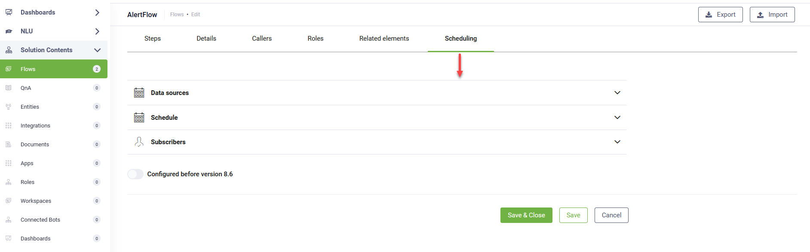
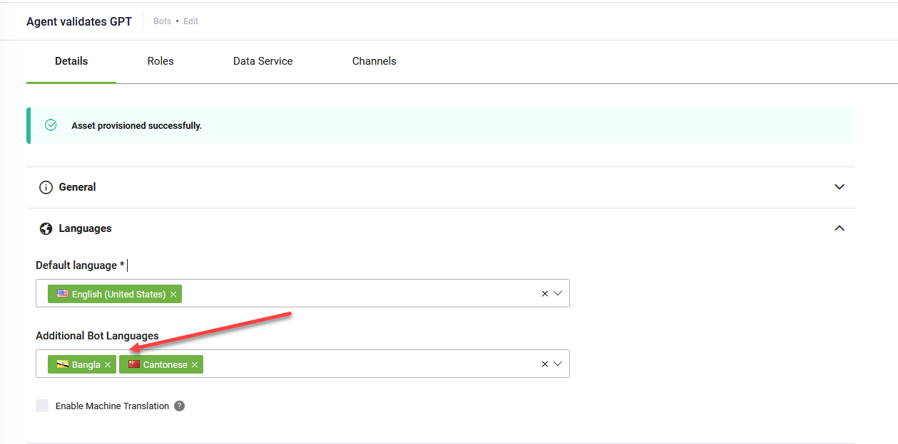

# DRUID 8.7

Deployment Dates

The table below lists the deployment date of DRUID v8.7 across DRUID Clouds. To view the DRUID Releases Calendar, see [Druid AI Releases](../Druid%20AI%20Releases.md).

| Druid Cloud Community  \*.community.Druidplatform.com | Druid Cloud US  \*.us.Druidplatform.com | Druid Cloud Australia  \*au.Druidplatform.com | Druid Cloud West-Europe (PROD)  \*.Druidplatform.com |
| --- | --- | --- | --- |
| January 08, 2025 | January 16, 2025 | January 16, 2025 | January 16, 2025 |

These release notes give you a brief, high-level description of the improvements implemented to existing features.

If you have questions about your DRUID tenant, please contact [support@Druidai.com](mailto:support@druidai.com) or your local DRUID partner for more information.

**Recommended!** This release includes features that require upgrade of your DRUID Connector Host:

- Custom Code - Clone Entities
- Custom Code bug fix

## What's New

- **Alert Flows**. The enhanced Alert functionality simplifies configuration and overcomes previous limitations. Users can schedule notifications for static users or dynamically target users based on data source evaluations. Key improvements include a streamlined scheduling interface, dynamic subscriber options, and the ability to send alerts tailored to specific conditions, ensuring timely and relevant communications to authenticated users.

For more information, see [Alert Flows](../../4_Flows/Alert%20Flows.md).

## Improvements

- **Live Chat - Show Connect button for multiple clients waiting in the queue**. A new option, **Display Connect Button at Queue Level**, is now available at the queue level. When enabled, agents can connect with the oldest client waiting in any queue, regardless of the clients’ join order or priority. This is particularly useful for agents managing multiple active queues.

For transferred clients, they are moved to the end of the new queue. However, to allow agents to connect with transferred clients regardless of their position, add the `"DisplayConnectButton": true` parameter to the **TransferHelpdeskCall** internal action in the transfer flow. The **Connect** button will appear next to the transferred client, indicating their priority based on previous wait time in another queue.

- **Special Flows - Customizable Inactivity Cancel Conversation Flow timeout at AI Agent level**. In previous DRUID versions, conversations were automatically canceled after 15 minutes of user inactivity. With this release, you can now customize the inactivity timeout at the AI Agent level, allowing you to set the timeout duration anywhere between 0 and 15 minutes, providing more flexibility in managing user interactions.

For more information, see [Inactivity Cancel Conversation Flow](../../4_Flows/InactivityCancelConversationFlow.md).

- **Custom Code - Clone Entities**. With this release, the `EntityUtils.Clone(entity)` function allows you to create a clone of an entity, ensuring that modifications to the clone do not impact the original entity. This is particularly useful when working with multiple instances of an entity, as it preserves the integrity of the original data and prevents accidental changes. Cloning enables independent management of different versions of the entity, enhancing flexibility in your workflows.
  For more information, see [Custom Code](../../7_Integrations/Custom%20Code.md).
- **AI Agent - Deployment State**. In this release, you can now organize your AI Agents more effectively by setting the Deployment State at the AI Agent level, located in the General section of the AI Agent details page.

This setting does not affect the AI Agent behavior at runtime but helps streamline AI Agent management and tracking.

- **DRUID Vision - PDF Page Count**. The *\*.druidplatform.com/api/document-processing/pdf-properties* endpoint counts the total number of pages in a PDF document. This functionality is particularly helpful when converting specific PDF pages to JPEG or managing page-specific processing tasks.

For more information, see [PDF Page Count](../../Druid%20AI%20Services/PDF%20Page%20Count.md).

- **File Upload step field - authoring improvement**. This release enhances the authoring experience for configuring File Upload steps. Instead of manually entering allowed file types, you can now select one or more file types from a predefined list, making the configuration process faster and more user-friendly.

- **New AI Agent languages**. Three new languages are now supported in AI Agents: Bangla (bn-BN), Cantonese (yue-YUE) and Somali (so-SO).

For more information, see [DRUID Supported Languages](../../Conversational%20AI/DRUID%20Supported%20Languages.md).

## Bug Fixes

- **Custom Code**: Fixed an issue in Custom Code where errors within a try-catch block caused the integration to terminate instead of continuing with the next iteration of the FOR loop.

- **Knowledge Base**: Resolved an issue where the search function failed to retrieve web pages with names starting with "/".
