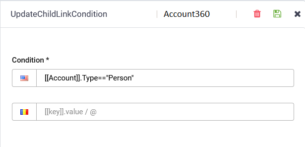

<a id="ConditionalStepExecution"></a>

# Conditional Step Execution

You can configure child steps to execute only under specific conditions, aligning with [the logic the AI Agent employs to process user input](Conversation%20Lifecycle.md).

<a id="Setupconditions"></a>

## Set up conditions

1. Navigate to the arrow connecting a parent step with its child step and click the **Settings** icon (). This action opens the Update link condition right editor.
2. In the **Condition** field, input the expression to be evaluated by the Flow engine. Refer to [Using Expressions in Dialogs](#Using_Expressions_in_Check_Conditions_Examples) for examples of expressions in check conditions.
3. Click the **Save** icon () to store the condition. The **Settings** icon turns green, indicating the successful setup of a condition on the step.


<a id="ExampleSettingupconditionsonsteps"></a>

## Example: Setting up conditions on steps

Consider the scenario where:

- The step "GetActiveProducts" has two child steps: "Business360" and "Account360".
- We aim to provide the list of active products based on the user's account type.

To achieve this, two conditions are set on the "GetActiveProducts" step:

- The first condition is linked to the "Business360" child step.


- The second condition is linked to the "Account360" step.



After executing the "GetActiveProducts" step, if the account type is "Business," it will proceed to execute the "Business360" step. Conversely, if the account type is "Person," it will execute the "Account360" step.

<a id="Usingexpressionsincheckconditionsexamples"></a>

## <a id="Using_Expressions_in_Check_Conditions_Examples"></a>Using expressions in check conditions examples

Refer to the table below for examples of expressions utilized when defining conditions on child steps. For more information, see [Conversation Lifecycle](Conversation%20Lifecycle.md), section *How the AI Agent Processes What the User Says*.

| Expression | Description |
| --- | --- |
| [[Product]] != null | Checks if the [[Product]] entity has a value within the conversation context. |
| [[Product]] == null |  |
| [[Product]].Name != null && [[Product]].Name !=”” | Verifies if the Name field in the [[Product]] entity has a value. |
| [[Product]].Code.toLowerCase() == “abcd100” |  |
| [[ProductList]].Count >0 | Determines if the number of products in the [[ProductList]] entity collection is greater than 0. |
| @InternalActionResult == true.toString() | Checks if the internal action of the previous step completed successfully. |
| [[Form]].YesNoAnswer | Inspects the YesNoAnswer field (a Boolean field) in entity [[Form]]. |
| ([[Product]].Category != null ) && ([[ProductList]] ==null || [[ProductList]].Count ==0) | If Product Category is known and no Products have been found in the ProductList entity collection. |
| [[ChatUser]].ChannelId == “directline” |  |
| [[ChatUser]].ChannelId == “nexmo-whatsapp” |  |
| [[ChatUser]].ChannelId == “facebook” |  |
| [[ChatUser]].ChannelId == “msteams” |  |
| [[ChatUser]].ChannelId == “slack” |  |

<a id="Advancedcodingforsettingconditionsonsteps"></a>

## Advanced coding for setting conditions on steps

For more complex conditions, you can use advanced coding:

1. In the flow diagram, click the desired set condition icon and then the edit condition icon in the right-side editor.


2. Use predefined code templates provided in the Code Editor (templates available in the **Add default template** drop-down ( )).
3. Customize the template code to suit your requirements.
> **NOTE:** Ensure that entity references in the Code Editor do not include brackets “[[ ]]” to facilitate usage with the Entity explorer. Use inline functions for intricate business rules, encapsulating the code within a function returning a Boolean.

<a id="Useinlinefunctionforcomplexbusinessrules"></a>

### Use inline function for complex business rules

For complex business rules, you pack the code inside an inline function returning an Boolean.

**Inline function**

```
(
 function ()
 {
      return true;
 }
 )()
```

> **NOTE:** Inside the code you can refer the conversation context using the same format you know: [[ChatUser]], [[ChatUser]].ChannelId, [[Account]], etc.

<a id="CheckConditionTemplate"></a>

### Check Condition Template

The following template checks if a specific condition is met before executing the linked flow step:.

**Example - executing linked flow step if channel is directline**

```
/*
 # Template Name: Check condition
 function returning a boolean
*/
(
 function ()
  {
       if ([[ChatUser]].ChannelId == "directline")
       {
           result = true;
       }
       else
       {
           result = false;
       }
            
return result;
}
)()
```

By leveraging conditions on steps, you can tailor the conversation flow of your AI Agent to respond intelligently to user input and execute actions based on specified criteria.
