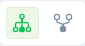
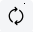
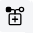

# Flow Designer

The Flow Graphical Designer is a robust tool that simplifies flow design within the Druid AI Platform, enhancing efficiency for authors. It offers an intuitive interface for visualizing, creating, and updating flows.

## Accessing the Flow Designer

To access the Flow Designer, select the AI Agent and solution, then click **Flows** on the main menu. The Flow Designer appears within the context of the selected AI Agent and solution.

If no flows are defined for the selected AI Agent within the current solution, the Flow Designer list will be empty.

## Flow Designer Overview

You have two options for viewing flows within the current solution:

|  |  |
| --- | --- |
|  | **List View**: Displays all flows in alphabetical order.   |
|  | **Diagram View**:Provides a graphical visualization of flows and their interconnections within the selected AI Agent.  |

### Available functionality

|  |  |
| --- | --- |
| Test utterance | Analyzes user phrases and attempts to match them with existing conversations, displaying Confidence Percentage based on the current training dataset.   |
| Search flow | Allows searching for flows using both exact and partial flow names. |
| View flows within a category | Enables grouping flows into categories for easier navigation and management.  **NOTE:** Available only in list view. |
| Link / Unlink flows | Adds or removes flows from the current solution.  **NOTE:** Available only in list view. |
| Create a new flow | Adds new flows to the selected solution. |
| Edit / Delete a flow | Allows editing or deleting a flow from the selected solution. |
| Clone flows | Creates a copy of a specific flow for reuse. To clone a flow, click the **Clone** icon displayed inline with the flow and confirm. The cloned flow appears on the **Steps** tab. Click the **Details** tab to rename the flow and adjust its elements as needed.  **NOTE:** Available only in list view. |

## AI Agent Diagram Designer

- Enables authors to visualize AI Agent flows and the connections between them.
- Highlights inconsistency zones requiring attention from AI Agent authors.
- Provides insights into the primary conversation path and possible flow paths.

To access the AI Agent Diagram Designer, in Druid Portal, select the AI Agent, select solution and click **Flows**. The Flows page appears.

At the top-left corner of the page, click the icon . Diagram Designer appears.

The nodes in the diagram represent the flows. By default, the Diagram Designer displays the most recently viewed selection on the **Toolbar**.

> **Info:** You can always go back to the flows list view by clicking the List view icon.

### Toolbar

The Toolbar offers options for viewing flow lists, flow steps, and adding/editing flow steps or child flows. Additionally, it provides features for flow layout adjustments and various actions such as testing, debugging, and analytics.

| Button | Description |
| --- | --- |
|  | Highlights the Welcome flow and the primary conversation path.  |
|  | Displays flows in the current solution. |
|  | Displays all AI Agent flows inside and outside the current solution. |
|  | Hides the flows details (badges and names).  |
|  | Displays the flows name.  |
|  | Displays in badges the number of child flows.  |
|  | Add a new flow. **NOTE:** From the AI Agent Diagram you can add new flows but you cannot add links between the flows. |
|  | The slicer allows you to view more or less flows based on the number of association levels between the flows. Slice up for more and slice down for less. |

### AI Agent Diagram Designer Legend

Visual elements within the AI Agent Diagram Designer convey key information:

| Visual element | Description |
| --- | --- |
|  | Identifies conversation entry points. The big green node indicates the Welcome flow. You can easily view it by clicking the **Home** button on the **Toolbar**. |
|  | Indicates intermediary flows. |
|  | Indicates AI Agent inconsistency zones. Indicates that the result of a menu flow is not found. The value of a button inside a menu flow does not correspond to a training phrase on any flows. The red endpoint indicates that you need to take action. To view what is missing and take the proper action, put the cursor on the red dotted line.  Click on the red node. The Flows Diagram of the menu flow where you need to take action appears. Make corrections as indicated in the tooltip displayed on the red dotted line. |
|  | Indicates that there are more links between the flow and its child flow(s). Example: the flow task-assign-to contains buttons which lead to the same flow, that is, my-tasks.  |
|  | Indicates that there is a strong link between two flows; that is, there is a trigger flow step defined on the first flow that triggers the execution of the second flow. |
|  | Indicates that there is a soft link between the flows. Indicates the result of a menu flow (flow step of type hero card), where the hero card step does not have input mapping and Is last step. The Flow Designer executes the next flow based on the value put in the hero card button. If the button value corresponds to a training phrase of another flow, a soft link is created between the two flows. |
|  | Indicates that the result of a menu flow is not found. The value of a button inside a menu flow does not correspond to a training phrase on any flows. |

### View flow paths

When you click on a flow, the diagram shows the possible paths for the currently selected flow, that is, the links between the currently selected flow and subsequent flows. The bigger node indicates the currently selected flow.

*Example*: Clicking on the menu-loan-analyst node, you get an overview of the conversations dedicated to the loan analyst role.

## Flow Diagram Designer

- Allows users to define the flow structure.
- Facilitates addition of flow child steps and setting conditions on steps.
- Offers detailed visual information on flow step settings, including:

- Number of pre/post actions and variables defined on a flow step.
- Conditions set on a step.
- Identification of the first and last steps in the flow.

To view the Flow Diagram Designer of a specific flow, in the AI Agent Diagram Designer, click the node corresponding to the desired flow.

You can edit a flow by adding steps, editing step details, remove flow steps, add conditions on steps, etc. to best suit your AI Agent needs.

### Flow Diagram Toolbar

The Toolbar offers options for viewing flow lists, flow steps, and adding/editing flow steps or child flows. Additionally, it provides features for flow layout adjustments and various actions such as testing, debugging, and analytics.

|  |  |
| --- | --- |
|  | Displays the flow steps in either list view or diagram view. |
|  | Displays the flow steps in either tree view or layered digraph view. The layered digraph view is available in Druid version 8.14 and higher. |
|  | Automatically calculates all flow steps positions. If you select the Auto layout mode, all previous flow steps positions will be lost. |
|  | Allows you to change the flow steps positions on the Flow Diagram. Click the **Manual layout** icon, change the position of the desired flow steps using drag and drop and click the **Save** icon next to the Manual layout icon. |
|  | Reload the diagram. |
|  | Add a flow step. |
|  | Add a child flow to the current flow. |
|  | Search for the following elements within the Flow Diagram:   - Flow step names (e.g., get-step) - Messages (e.g., "Tell me your name", 'your name') - Connector action names (e.g., Case-UpdateStatus) - Link conditions - Child flows - Trigger flows - Hero steps    |

### Actions menu

The Actions menu provides you with extensive options to edit and analyze the flow and the flow steps.

|  |  |
| --- | --- |
|  | **Settings**. Edit the selected flow step (node). |
|  | **Info**. View and edit the current flow details. |
|  | **Audit**. Provides you with the JSON structure of the flow and a comprehensive historical record of all changes made by authors to the flow (**Audit trail** tab). For information on how to view the flow changes, see [Review Flow Changes](Review%20flow%20changes.md).  **NOTE:** The Audit feature is available in technology preview in DRUID version 7.3. |
|  | **Webchat**. Test your flow. |
|  | **Entity Context Viewer**. View the entities (and their fields) used throughout the flow. You can also copy entity labels and add or delete entity fields as best suits your needs. For more information, see [Using Entity Context Viewer](Viewing%20and%20Managing%20Entities%20in%20a%20Flow.md). |
|  | **Debugging Tool**. View Conversation History on a flow and flow step level and debug any issues that occurred during the flow / flow step execution (if any). |
|  | **Analytics**. View flow and flow step analytics. |
|  | **Search**. Search elements within the Flow Diagram. |

In the Flow Diagram Designer, all steps are connected by strong links (). The flow steps that are last steps (have the **Is last step?** selected) are marked with **END**.

On the connector (arrow), a gray dot displays. If you place the mouse over the icon, two options are available:

- Add condition  - Allows you to set the next step to be executed only if a specific condition is met, following the logic the AI Agent uses to process user input. For more information on the logic the AI Agent uses to process user input, see [Conversation Lifecycle](Conversation%20Lifecycle.md).
- Add flow step  - Allows you to add a parent step to the child step or access the Flow Palette (). If you add a parent step, the flow diagram layout is automatically resized to accommodate the new tree-like structure.

