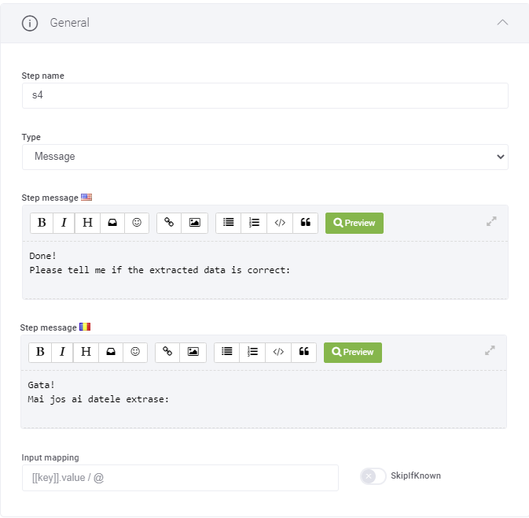
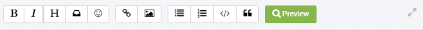

# General

To access the flow step general parameters, in the Flow Step editor, click on the General section header. The section expands.

The table below describes the parameters available in the General section.

| Parameter | Description |
| --- | --- |
| Step name | The name of the step that is used by the system. It is not visible to the end user, but is useful for the AI Agent author to document the dialog and later understand reports in conversation analytics. Consider the Step name like a set of tags. A best practice is to set the Step name as <tag1>-<tag2>… Examples:  - input-amount - input-currency - send-one-time-password |
| Type | The flow step type. For more information, see [Flow Step Types](Flow%20Steps.md). |
| Step message | The message which will be displayed to the user before executing the step. There are as many Step message fields as languages your AI Agent has. The first field is for the AI Agent default message. Enter the message in the default language and the localized text in additional AI Agent languages (if any). This field has an editor which allows you to format the message using the Markdown syntax and also preview the message. **NOTE:** Each individual channel has its own rules regarding supported message formats. For example the web channel provides full support for the HTML Markdown. WhatsApp partially support HTML markdown. Facebook Messenger also supports partially the Markdown syntax. DRUID platform provides automatic conversion within a predefined set of rules. If your DRUID targets multiple channels, take the channel specifics in to consideration. The editor provides you with icons and buttons which allows you to:  - Format text bold. - Format text italic. - Format Heading text. - Insert merge field (using the Custom Object Explorer icon). - Add emoji. - Add an external link. - Add Phone Number Call Link using the following format: `<a href="tel:<``Druid entity storing the phone number / phone number``>"``>``call to action / visual portion``</a>` Examples: `<a href="tel:[[ChatUser]].Phone" style="color:red">[[ChatUser]].Phone</a>` `<a href="tel:123-456-7890">123-456-7890</a>` `<a href="tel:[[ChatUser]].Phone" style="color:red">Call Now</a>` `<a href="tel:+1123-456-7890" style="color:green">Click to call</a>`- Add an image by providing the image URL. - Add an ordered or unordered list - Add code. - Add quotes. - Preview the message shown to the user.     You can maximize the editor page by clicking the Maximize icon displayed at the right-side of the editor’s toolbar.  You can also use expressions in the messages the AI Agent returns to the users. For information on how to format such expressions, see [Using Expressions in Dialogs](Dialog%20Expressions%20Reference%20%20.md). |
| Input mapping | Set the conversation context in which you want to capture what the user says. You can set to an Entity or to a Variable. For more information, see [Mapping input from user expressions](../Conversational%20AI/Using%20NER%20with%20Intent%20Recognition.md). |
| Skip if known | Tick if you want the dialog to move further when the expression in the Input Mapping already has a value within the conversation context. For example, the AI Agent will not ask the user’s name if the user is authenticated when chatting with the AI Agent. Or when asking for a quote, skip asking the product name if [[Quote]].Product is already available within the conversation context. **NOTE:**  This setting applies to both DRUID entity /entity fields and DRUID local variables (@variable). |
| Hide in conversation history | Anonymizes sensitive data from Input mapping (what the user says) in the conversation history.     |
| Disable intent switch | While AI Agents have been designed to allow intent change, there are situations when authors want to prevent AI Agents from doing intent change and keep users in a specific flow whenever data validation fails or when after a step with input mapping when evaluating user input no conditions are met. The most common use case, is the Voice channel integration when users tend to respond with more words than expected. In this regard, tapping on **Disable intent switch** ensures that the AI Agent does not perform intent switch and keeps the users in a loop until data validation passes or until a condition is met (if conditions are set on the flow step). |
| Limit intent switch | **NOTE:** This option is available for all steps with input mapping (prompt, choice, thumbnail, hero card, adaptive card).  Allow the user to ask questions in the area of the current flow by configuring the execution of a limited set of flows on intent switch. It is particularly useful when you want to allow intent switch to a limited set of flows inside multiple flows without creating child intents for the parent flows.  Tap on **Limit intent switch** and select the flows to be executed on intent switch. Even if the intent exists on other flows defined on the AI Agent, on intent switch, the AI Agent will execute only the flow matched from the limited set of flows you configured here.    **IMPORTANT!** You cannot use both **Disable intent switch** and **Limit intent switch** at the same time. |

## Related Topics

- [Common Flow Settings](Common%20Flow%20Settings.md)
