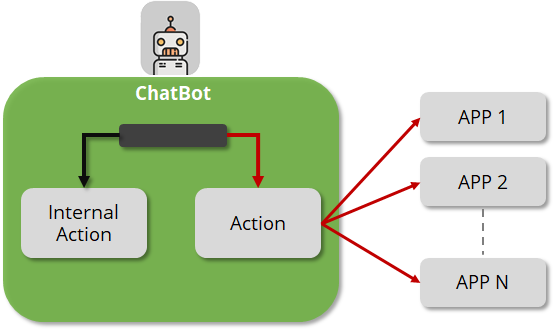

# Pre Actions

DRUID provides authors with two types of actions, as follows:

- **PreAction** – External actions from integrations which are defined using the Connector Designer. You can use the actions to trigger certain actions defined in your external system integrated with the AI Agent.
- **PreInternalAction** – The system has a predefined set of system commands known as internal actions. You can use them to trigger specific system commands. For example, when provisioning an identified user, you want to assign the roles User and Admin. To do so, add the system command **AddUserRoles** and in the text field enter **["User","Admin"]**.

To view the PreActions section on a flow step, in the Flow Step editor, click on the PreActions section header.

## Add external actions on flow steps

> **NOTE:** If you are viewing the flow steps in list view, before adding external actions on a step, you first need to define the action(s) using the Connector Designer. For more information, see [Integrations](../7_Integrations/Enterprise%20Connectors.md). If you're using the diagram view, you can define the action directly within the desired flow step.

To add an existing external action on a step using flow steps in diagram view, double-click on the flow step and in the PreActions section, search in integrations and select an existing external action.

To add a new external action on a flow step by defining it from scratch, click the **AddNew** button, define the connector action and add subsequent integration tasks.

To add an external action on a step using flow steps in list view, follow these steps:

1. In the PreActions section of the step, click **AddNew** and select **PreAction**. The AddNewAction page appears.
2. Click on the **SelectConnector** field. A pop-up appears listing all existing external actions. You can either scroll-down to the desired action or you can use the search functionality to search for the desired action.

3. Select the desired action and click the **Add** button. The external action associated with your selection is listed in the PreActions section.

The actions are executed in the order of their listing in this section.

If you have more actions in this section and you want to change their execution order, you can do so by holding the cursor on the icon (the one with the arrows) and use the drag and drop functionality.

4. Click the **Save** button at the bottom of the page to save the changes.

## Add DRUID internal actions on flow steps

To add a DRUID predefined action (internal action) on a flow step using flow steps in diagram view, double-click on the flow step and in the PreActions section, search in integrations and select the desired predefined action. These actions are marked with the word "INTERNAL".

To add an internal action on a step using flow steps in list view, follow these steps:

1. In the PreActions section, click **AddNew**and select **PreInternalAction**. The AddNewAction page appears.
2. Click on the **SelectConnector** field. A pop-up appears which lists the predefined actions available in DRUID.

3. Select the desired action and click the Add button. The selected action is listed in the PreActions section.

The actions are executed in the order of their listing in this section.

If you have more actions in this section and you want to change their execution order, you can do so by holding the cursor on the icon (the one with the arrows) and use the drag and drop functionality.

4. Click the **Save** button at the bottom of the page to save the changes.

## Delete actions

To delete an action from the PreActions section, click the **Delete** icon displayed inline with the action.

## Related Topics

- [Common Flow Settings](Common%20Flow%20Settings.md)
- [Internal Actions](Internal%20Actions.md)
