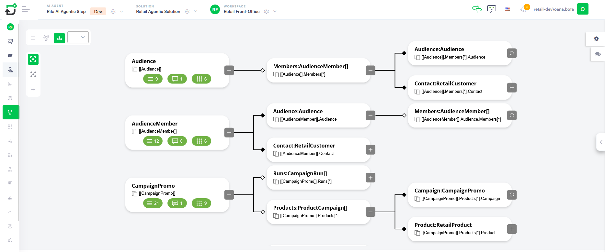

# Creating Entity Models

An entity model serves as the relational data structure for your AI Agent. It defines how the agent collects, stores, and interacts with business data—acting as the agent’s "memory" during a conversation.

To build an entity model, you will define individual entities, add specific fields, and establish relationships between them.

> **NOTE:** Rather than building data models from scratch, you can leverage AI Authoring Agents. By launching the Data Modeler from the Page Help icon, you can describe your business requirements in natural language. The Data Modeler analyzes your existing schema and either creates from scratch or adjusts it as needed. For more information, see the [AI Authoring Agents](../2_AI%20Agents/AI%20Authoring%20Agents.md#Create).

## Accessing the Entity Designer

To start building the informational model, you must first access the designer interface:

1. Select your solution and navigate to the **Solution Contents** menu.
2. Click **Entities**. The Entity Designer will open. By default, it displays the view you last used (List, Diagram, or Tree).

> **Info:** We recommend using Diagram View when creating a new model. This provides a visual map of your data architecture as you build it.

## Creating a New Entity

Follow these steps to add a new entity to your solution:

1. Initiate creation:

- In Diagram or Tree view: Click the **Add entity** (+) icon in the toolbar.
- In List view: Click the **Create New Entity** button at the top-right.

The Create entity modal appears.

2. Define entity name: Enter a unique name following these naming conventions:

- Does not start with a number.
- Does not contain spaces.
- Is ASCII no diacritics.
- Does not contain the following special characters: -, +, ., # and @.

> **Info:** We recommend you to use PascalCaseNames (upper camel), no spaces. The Name starts with an uppercase, as do all additional words. Example: SalesOrder.

3. Specify a category to help organize your entities as the model grows.
4. Click **Save** .

Once saved, the system automatically generates an Entity ID (Primary Key). You can view this under the **Details** tab of the Entity Editor.

## Building the Data Structure

After creating the entity, you must define what data it holds:

- Add entity fields. Define the specific attributes (e.g., EmailAddress, Price, IsActive).
- Establish entity relationships. Use Lookup or Entity List fields to connect entities (e.g., linking a Contact entity to a Company entity).
- Configure data storage. If using the Druid Data Service, ensure your entity fields are mapped correctly to persist data across user sessions.

## Entity Model Best Practices

- Keep it modular. Instead of one massive entity, break data into logical business objects (e.g., User, Address, and Subscription).
- Use compound nouns. For clarity in flows, name your entities using descriptive compound nouns (e.g., SupportTicket rather than just Ticket).
- Plan for multilingualism. If your AI Agent supports multiple languages, remember to enable the **Holds Multilanguage Records** toggle on relevant string fields.

## Related Topics

- [Field Types](Field%20Types.md)
- [Managing Entity Fields](Managing%20Entity%20Fields.md)
- [Manipulate Data Without DRUID Entity Structures](../How%20to/Manipulate%20Data%20without%20Entity%20Structures.md)
- [System Entities](System%20Entities.md)
