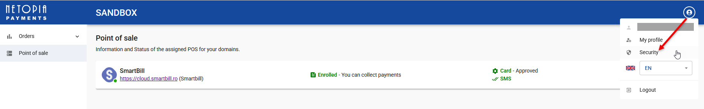
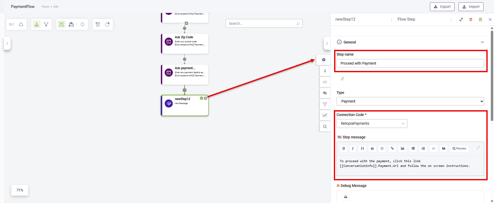

<a id="NetopiaPayments"></a>

# Netopia Payments

The Netopia Payments integration lets you collect payments directly in your conversational flows. With this integration, your AI Agent can guide users through a seamless payment experience—from capturing billing and shipping details to generating a secure payment link through Netopia Payments.

When users reach the payment step in a conversation, the AI Agent prompts them to enter the required details (such as billing and shipping information, depending on your flow configuration). Once all necessary data is provided, the AI Agent automatically sends the user a payment link generated by Netopia. Users can then complete the transaction securely through the Netopia payment gateway.


This integration streamlines your sales or billing processes by combining conversational engagement with fast, secure online payments—all within the chat interface.

<a id="Prerequisites"></a>

## Prerequisites

Before you begin, make sure you have the following:

- An active merchant account with Netopia Payments. Having an active account means you’ve already signed a contract with Netopia and completed the required onboarding steps.
- A configured Point of Sale (POS) in the Netopia Payments Portal for your e-commerce solution, linked to your domain.

<a id="IntegratingNetopiaPaymentsinyourconversations"></a>

## Integrating Netopia Payments in your conversations

This section explains how to configure Netopia Payments in your conversational flows.

<a id="Step1GenerateanAPIKeyforyourNetopiaPaymentsprofile"></a>

### <a id="Step_1"></a>Step 1. Generate an API Key for your Netopia Payments profile

1. Go to [Netopia Payments admin console](https://admin.netopia-payments.com/domains) and log in.
2. To generate an API Key for a Sandbox environment, click **Sandbox** on the main menu.
> **Info:** If you’re working in the **Live** environment, skip this step.

3. In the top-right corner, click on the profile icon and select **Security**.



The API key page appears.

4. Enter a key name, then click **GENERATE KEY**.


5. Copy the API key value as you will need it to configure the payment app in the Druid Portal.

<a id="Step2CreateaNetopiaPaymentsapp"></a>

### <a id="Step_2"></a>Step 2. Create a Netopia Payments app

To configure a payment app in Druid Portal:

1. Go to **Solution Contents** > **Apps**.
2. In the top-right corner, click **Create App** and select **Payment**.


The app configuration page appears.

3. In the **Code** field, enter a unique name for your app.
4. From the **NETOPIA Payment Environment** drop-down, select the environment type: **Sandbox** or **Live**.
> **Info:** Start with the Sandbox environment to test and confirm your configuration. After successful testing, update the app with the POS Signature and API Key for the Live environment. These credentials are specific to each Netopia Payments environment.

5. In the **API Key** field, enter the API key you generated at [Step 1](#Step_1).
6. In the **POS Signature** field, enter the **Signature** generated for your POS in the Netopia Payments admin console. To get the Signature, follow these steps:

1. Go to [Netopia Payments admin console](https://admin.netopia-payments.com/domains) and log in.
2. To view POS details for the sandbox environment, click **Sandbox** on the main menu, then in the sandbox environment, click **Point of sale** on the main menu.
> **Info:** If you’re working in the **Live** environment, skip this step.

3. Next to your e-commerce provider, click the **Actions** icon (⋮) and select **Technical settings**.


4. Copy the **Signature**.


7. (Optional) Update the following settings:

- **Default currency**: The default value is **RON**. You can change it here; this setting overrides the default.
- **Default language**: The default is **Romanian**. You can change it using the **ISO 3166-1 numeric code** for the desired country.

8. Save, then publish the app.

<a id="Step3Configurethepaymentflow"></a>

### Step 3. Configure the payment flow

Add a new flow for payments and configure it as follows:

1. Add prompt steps to capture the information provided in the table below.
   Pay attention to the entity fields you need to enter in **Input mapping** for each prompt step.

| Information type | Required | Ask the user for | Info type | Input mapping |
| --- | --- | --- | --- | --- |
| Billing information | Yes | amount | decimal | [[ConversationInfo]].Payment.Amount |
|  |  | currency | string | [[ConversationInfo]].Payment.Currency |
|  |  | email | string | [[ConversationInfo]].Payment.Email |
|  |  | phone | string | [[ConversationInfo]].Payment.Phone |
|  |  | first name | string | [[ConversationInfo]].Payment.FirstName |
|  |  | last name | string | [[ConversationInfo]].Payment.LastName |
|  |  | city | string | [[ConversationInfo]].Payment.City |
|  |  | country | integer  **ISO 3166-1 numeric code** for the country | [[ConversationInfo]].Payment.Country |
|  |  | state | string | [[ConversationInfo]].Payment.State |
|  |  | postal code | string | [[ConversationInfo]].Payment.ZipCode |
|  |  | details | string | [[ConversationInfo]].Payment.Details |
| Shipping information | No  **NOTE:** If you don’t collect shipping information from the user, the billing information is automatically used as the shipping information. | email | string | [[ConversationInfo]].PaymentShipping.Email |
|  |  | phone | string | [[ConversationInfo]].PaymentShipping.Phone |
|  |  | first name | string | [[ConversationInfo]].PaymentShipping.FirstName |
|  |  | last name | string | [[ConversationInfo]].PaymentShipping.LastName |
|  |  | city | string | [[ConversationInfo]].PaymentShipping.City |
|  |  | country | string | [[ConversationInfo]].PaymentShipping.Country |
|  |  | state | string | [[ConversationInfo]].PaymentShipping.State |
|  |  | postal code | integer  **ISO 3166-1 numeric code** for the country | [[ConversationInfo]].PaymentShipping.ZipCode |
|  |  | details | string | [[ConversationInfo]].PaymentShipping.Details |


2. From the Flow Palette, add the **Payment** flow step and click the Configuration icon.


3. Click on the General section.
4. Enter a **Step name**.
5. From the **Connection Code** drop-down, select the Netopia Payments app you created at [Step 2](#Step_2).
6. In the **Step message** field, enter a message that includes the entity field **[[ConversationInfo]].Payment.Url**. This entity field stores the Netopia payment URL that users access to complete their payment.

For example, 'To proceed with the payment, click this link: [[ConversationInfo]].Payment.Url, and follow the on-screen instructions.



7. Save the step.

When the conversation reaches the payment step, the system automatically validates all payment information provided by the user in the prompt steps. If any required information is missing or invalid, an error message is displayed until all necessary details are provided.

This validation helps conversation authors properly configure and test their payment flows before deploying the AI Agent to production, ensuring that all required data is captured correctly.

<a id="TestingonNetopiaSandbox"></a>

## Testing on Netopia Sandbox

When testing the Netopia Payments integration in sandbox mode, please note the following important details:

| Card number | CVV | Expiry | Expected result |
| --- | --- | --- | --- |
| 9900004810225098 | 111 | Any future date | Successful payment |
| 9900541631437790 | 111 | Any future date | Expired card |
| 9900518572831942 | 111 | Any future date | Insufficient funds |
| 9900827979991500 | Any CVV | Any future date | Incorrect CVV |
| 9900334791085173 | 111 | Any future date | High-risk/fraud scenario |

<a id="PaymentTransactionDetails"></a>

## Payment Transaction Details

The Netopia Payments integration provides the full transaction details into the conversation context —including issuer information, currency, and Netopia identifiers.

> **NOTE:** In Druid versions prior to 9.18, only the status codes were available after the payment processing.

When a payment is processed, Druid populates the **[[ConversationInfo]].Payment.Status** entity field with a JSON object containing the full response from Netopia.

To use these details within your conversational flows, use Code Extension on the flow step to map the specific properties from the JSON object to your Druid entity fields.

The following JavaScript snippet demonstrates how to parse the response and assign values to your payment entities:

**Example**

```
// Parse the JSON string from the system variable
let s = JSON.parse([[ConversationInfo]].Payment.Status);

// Map transaction details to Druid entity fields
[[ConversationInfo]].Payment.Id = s.payment.ntpID; // The unique Netopia transaction identifier.
[[ConversationInfo]].Payment.Name = s.payment.data.ISSUER; // The bank name that issued the card
[[ConversationInfo]].Payment.Amount = s.payment.amount;
[[ConversationInfo]].Payment.Currency = s.payment.currency;
```

<a id="NetopiaResponseExamples"></a>

### Netopia Response Examples

This section provides response examples for the three possible situation.

#### Standard Success (Non-3DS)

In a standard successful transaction, the `customerAction` object is empty, and the payment data includes specific card details like the issuer name.

**Response Example**

```
{
    "error": {
    "code": "00",
    "message": "Approved"
  },
  "payment": {
    "amount": 200,
    "currency": "RON",
    "data": {
      "AuthCode": "24od",
      "BIN": "990000",
      "ISSUER": "Netopia GB",
      "ISSUER_COUNTRY": "642",
      "RRN": "hYnY8zpdcNo-"
    },
    "ntpID": "1309088",
    "status": 3,
    "token": "MjMyMjqqdx3XTbYC78OoidTk6DTtEvHcrqcz91Pr4PQqXf/u33xoDkdgIlkq226avk1ik8fvLElkbLopnvNbIs8+Ve6L"
  }
} 
```

#### 3D Secure (3DS) Redirect

When 3DS authentication is required, the `customerAction` object is populated with the redirect URL and the authentication token. Note that the `payment.data` object is typically not present.

```
{
  "customerAction": {
    "authenticationToken": "iNPqJWDRoRXsd77StNELrv...",
    "formData": {
      "backUrl": "http://yourdomain.com/example/backUrl.php",
      "paReq": "AT5ewtLVDsEgB5lcRjeEoSMF..."
    },
    "type": "Authentication3D",
    "url": "https://secure.sandbox.netopia-payments.com/sandbox/authorize"
  },
  "error": {
    "code": "100",
    "message": "Approved"
  },
  "payment": {
    "amount": 200,
    "currency": "RON",
    "ntpID": "1310396",
    "status": 15
  }
}
```

#### Payment Transaction Error

If the transaction fails (e.g., the order is closed or funds are insufficient), the `error` object provides the the specific reason for the failure and the `payment.status` reflects the error type.

```
{
  "customerAction": {},
  "error": {
    "code": "56",
    "message": "Order closed"
  },
  "payment": {
    "amount": 200,
    "currency": "RON",
    "ntpID": "1309088",
    "status": 5
  }
}
```

<a id="PaymentStatusCodes"></a>

### Payment Status Codes

The most common status codes are:

- **3** — Payment completed (paid)
- **5** — Payment confirmed
- **12** — Invalid account
- **15** — Requires authorization

For a complete list of status codes and error messages, refer to the [Netopia Errors & Statuses](https://doc.netopia-payments.com/docs/payment-api/v2.x/start/start-Error) documentation.

> **NOTE:** The payment status can be accessed in your conversation flow using **[[ConversationInfo]].Payment.Status** in the last message.

<a id="TrackingPaymentHistory"></a>

## <a id="Tracking"></a>Tracking Payment History

Druid maintains a comprehensive audit log of all payment trials within a single session. If a user enters incorrect data or a transaction fails (e.g., insufficient funds), the Payment flow step execution remains open. The step only completes once a "Success" or "Cancel" event is received from Netopia.

All transaction attempts are stored in an JArray within the **[[Payment]].Status** object. This allows authors to access the entire payment history in the conversation context after the step is completed, which can then be saved to an external database.

The **[[Payment]].Status** contains the final status and an Audit array containing details for every attempt:

- **orderID**: The unique identifier for the order.
- **status**: The numerical status code from Netopia.
- **message**: The response message (e.g., "Insufficient funds" or "Approved").
- **ntpID**: The Netopia transaction ID.

<a id="ExampleScripttoExtractAuditData"></a>

### Example Script to Extract Audit Data

You can use a code extension to parse the payment status and retrieve specific payment retry data:

```
(
  function ()
  {
        let s = JSON.parse([[ConversationInfo]].Payment.Status)
        [[ConversationInfo]].Payment.Id = s.Status;
        let a = JSON.parse(s.Audit);
        [[ConversationInfo]].Payment.Name = a[0]["payment"]["status"];
  }
)();
```
