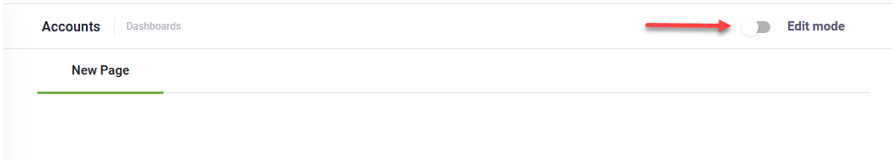

# Dashboards

You can put at business users disposal data from web views and charts by adding multiple dashboards to workspaces.

## Authoring dashboards

To create a dashboard, select the AI Agent and solution and from the **Solution Contents** menu, click **Dashboards**. At the top-right corner of the Dashboards page, click the **Create new dashboard** button. The Create new dashboard page appears.

Enter a dashboard name and description and click **Save**.

The dashboard is listed in the Dashboards page.

Click the **Edit** icon displayed in line with the dashboard record.

The dashboard with an empty page appears. Tap on **Edit mode**.

The Dashboard becomes editable. A toolbar appears and provides you with the following options:

|  |  |
| --- | --- |
|  | Add a new widget on the dashboard page. |
|  | Add a new dashboard page. |
|  | Rename the current dashboard page. |
|  | Delete the current dashboard page.  **IMPORTANT!**  This action cannot be undone. Make sure that you really want to delete the current dashboard page. |
|  | Restores the current page to default dashboard template.  **IMPORTANT!**  This action cannot be undone; any customizations you did to the current page will be lost! Make sure that you really want to restore the dashboard page to default. |
|  | Saves the current dashboard page customization and exists the edit mode. |
|  | Cancels dashboard page customizations (new or existing widgets, reordering, etc.) and exists the edit mode. |

## Adding widgets

To add a widget, click the **Add widget** button () on the toolbar. The Add widget page appears.

Select the desired widget type:

- **Chart** – to show an entity chart.
- **Table** – to show an entity view.

Click **Save**.

You need to edit the widget based on the selected widget type.

## Editing widgets

To edit a widget, click the settings icon corresponding to the desired widget.

The widget Settings page appears. The page content is different based on the widget type.

### Edit Table widgets

In the Settings page, select the entity and the desired web view defined on the entity.

Enable the **Disable record editing** toggle to prevent users from modifying records directly from the dashboard view widget. When turned on:

- The edit icon is removed from the top-right corner of the widget.
- Locks records. Individual rows inside the table become non-clickable and non-editable, ensuring a secure, presentation-only user experience.

> **Info:** The **Disable record editing** toggle is available starting with Druid 9.27.

Click **Save**to close the modal. Click the **Save** button from the dashboard toolbar to save the widget on the dashboard page.

### Edit Chart widgets

In the Settings page, select the entity and the desired chart defined on the entity.

Click **Save**. The Settings page closes.

Click the **Save** button from the dashboard toolbar to save the widget on the dashboard page.

The figure below provides an example of various widgets of type **Chart**.

## Deleting widgets

To delete a widget from the current dashboard page, click the delete icon corresponding to the desired widget.

## Reordering widgets on Dashboard

You can reorder the widgets on a dashboard page by using drag and drop and clicking the **Save** button on the toolbar.

## Adding Dashboard Pages

To add a new dashboard page, click the **Add page** button () from the toolbar. A pop-up appears. Type the name of the page and click **Save**.

The page is added as a new tab to the dashboard but you remain on the current page.

## Renaming Dashboard Pages

To rename the current dashboard page, click the **Rename page** button () on the toolbar. A pop-up appears. Type the new name of the page and click **Save**.

## Deleting Dashboard Pages

> **IMPORTANT!** This action cannot be undone. Make sure that you really want to delete the current dashboard page.

To delete the current dashboard page, click the **Delete page** button ( ) from the toolbar. A confirmation dialog appears.

Click **Yes**. The current page is removed from the dashboard.

## Reset changes

To undo any changes you did to a dashboard page prior to saving the changes, click the **Reset** button from the toolbar.

A pop appears asking you to confirm the action. Click **Yes**.

## Adding dashboards to workspaces

Go to the desired workspace (**Solution Contents** menu, **Workspaces**) and in the configuration page, click the **Links** tab. From this section you add the dashboard or multiple dashboards (if multiple defined) to your workspace main menu and thus the dashboard(s) will be accessible to the business users in the workspace.

Click the **Add new** icon. A new editable line appears in the Links page.

From the **Type** drop-down select **Dashboard** and from the **Dashboard** drop-down select the entity dashboard. Click on the check icon, then click the **Save** button.

