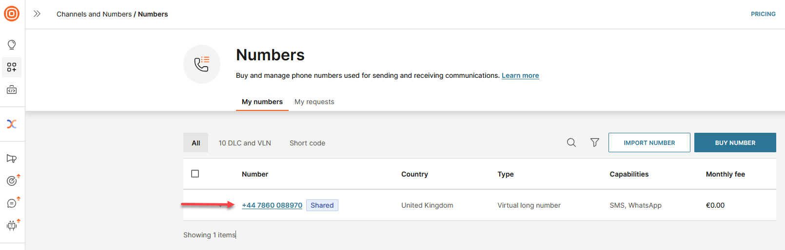
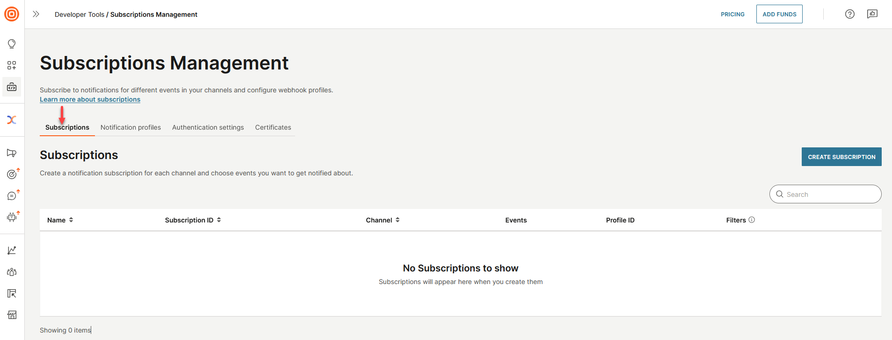
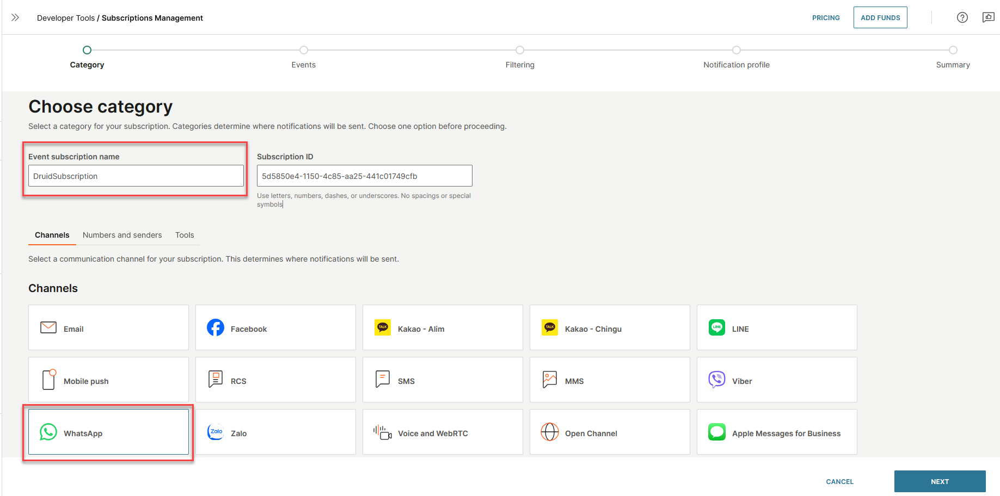
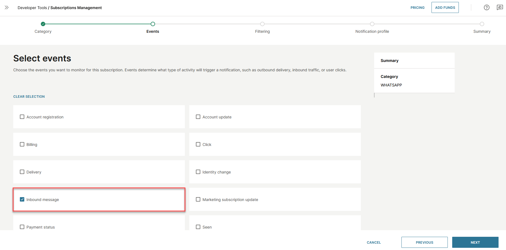

# Infobip

Connect your Druid AI Agent to WhatsApp via Infobip omnichannel communication platform. This integration enables automated messaging workflows, customer engagement, and cross-channel chat delivery managed through a single Druid Portal setup.

## Prerequisites

- You built and published an AI Agent.
- An active user account on the Infobip platform.

## Integration procedure

To connect your AI Agents with WhatsApp via Infobip, follow these steps:

### Step 1. Create Infobip API Key

1. Sign in to the [Infobip platform](https://portal.infobip.com/).
2. Go to **DEVELOPER TOOLS**, and then select **API Keys** from the drop-down.

3. In the API Keys page, click the **CREATE API KEY** button.

4. In the **Name** field, enter a name for the API key.
5. By default, the API key expires after one year. You can set a different **Expiration date** to match your security policies..
6. In the API Scopes section, click on **General**, and then select the two available general scopes.

7. In the API Scopes section, search for WhatsApp, and then select all the listed scopes.

8. Click **CREATE**. A new API key is created.
9. From the API Keys page, copy the **API base URL** and the **API Key**, you will need them to configure the channel in DRUID.

### Step 2. Get Infobip phone number

1. Go to **CHANNELS AND NUMBERS** and then select **Numbers** from the drop-down.
2. Copy the phone number you want to use. For more information about managing numbers, see the [Infobip documentation](https://www.infobip.com/docs/numbers).

Now configure the Infobip channel in the Druid Portal.

### Step 3. Configure the Infobip channel in Druid Portal

1. In the Druid Portal go to your AI Agent settings.
2. Click the **Channels** tab, then search for **Infobip** and click on the Infobip card.
3. In the modal, fill in the fields as follows:

| Field | Description |
| --- | --- |
| API Host | Enter the Infobip API URL in the following format:  https://<Infobip API base URL>.  **IMPORTANT!** The **API base URL** you copy from Infobip does not include *https://*. Make sure to add it; otherwise, the Infobip channel will not work. |
| API key | Enter the API key you copied from Infobip. |
| Phone number | Enter the phone number you copied from Infobip, **without** the **+** sign. |

4. Copy the **Druid url (webhook)** as you will need it to configure an Infobip notification profile.
5. Optionally, customize channel display settings as follows:

- **Alias**: Enter a clear, business-friendly display name (e.g., Interactive Messaging). This value is stored in**[[ChatUser]].ChannelDisplayName**, which appears in reporting tools like AI Agent Summary dashboard - Engagement KPIs and can also be referenced in flow business logic.
- **Description**: Enter a brief description. This is particularly helpful when using an alias, as it helps identify the channel's specific purpose within the Druid Portal.
- **Channel Icon**: Upload a custom icon to display on the channel card within the Druid Portal.

6. Click the **Publish** button and wait until the channel is activated.

When the channel is active, the following fields are available in Druid:

- **[[ChatUser]].ChannelId** = "infobip"
- **[[ChatUser]].ChannelDisplayName** - Stores the Alias which is used in AI Agent Summary Dashboard > Engagement KPIs > Channel chart
- **[[ChatUser]].UserId** - Stores the user's phone number as an unique identifier of the WhatsApp user account for authentication purposes.
- **[[ChatUser]].ChannelBotIdentifier** - Stores the AI Agent number through which a user message arrived.

### Step 4. Create Infobip notification profile

1. Go back to the Infobip platform.
2. Go to **DEVELOPER TOOLS**, and then select **Subscriptions Management** from the drop-down.

3. By default, the **Subscriptions** tab is selected. Click the **Notification profiles** tab.

4. Click the **CREATE NOTIFICATION PROFILE** button. The 'Create notification profile' page appears.
5. In the **Notification profile name** field, enter a profile name.
6. In the **Webhook URL** field, enter the **Druid url (webhook)** you copied from the you copied from the Druid Portal’s Infobip channel configuration.

> **NOTE:** Druid currently supports basic authentication for WhatsApp via Infobip.
>
> 

7. Click **SAVE**. The notification profile is created.

8. You can now create an Infobip subscription for WhatsApp.

### Step 5. Create WhatsApp notification subscription

To create a notification subscription for the WhatsApp channel:

1. Click on the **Subscriptions** tab.

2. Click the **CREATE SUBSCRIPTION** button. The subscription management wizard appears.
3. In the **Event subscription name** field, enter a name.
4. From the Channels area, select **WhatsApp**.

5. Click **NEXT**.
6. Select **Inbound message** as events to monitor for this subscription.

7. Click **NEXT**.
8. Optionally, you can filter event traffic based on various parameters.
9. Click **NEXT** to continue.
10. Select the Infobip notification profile you created at Step 4.

11. Click **NEXT**.
12. Review the subscription details.

13. Click **SAVE**.

Users can now interact with the AI Agent on WhatsApp using the configured phone number.
