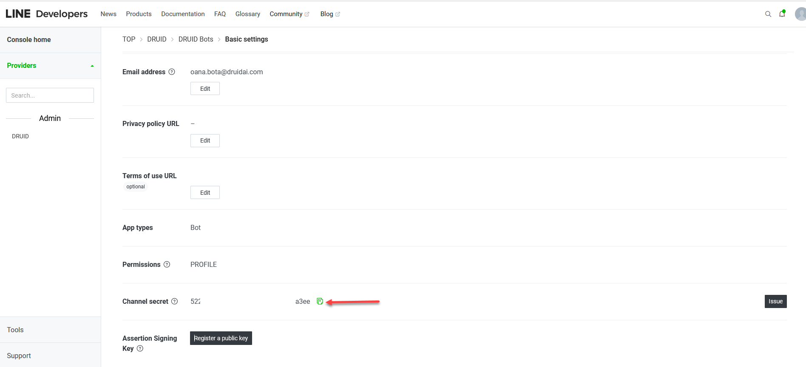

# LINE

Connect your Druid AI Agent directly to the LINE messaging ecosystem. This integration allows your AI Agent to operate as a native LINE Official Account, enabling automated conversational flows, customer support, and direct user engagement through LINE.

> **Info:** LINE is a messaging application that is especially used in Indonesia, Japan, Taiwan and Thailand.

## Prerequisites

- You built and published an AI Agent.

> **NOTE:** The LINE channel integration is not available in Druid on premise deployments; you cannot activate the channel.

## Integration procedure

To integrate an AI Agent with LINE, follow these steps:

### Step 1. Create a channel in the LINE Developers Console

To deploy an AI Agent in LINE, you need to create a channel in the LINE Developers Console. Follow the steps in the documentation below that is relevant to you:

- If you already have a LINE Official account: [Adding a channel to your existing LINE Official Account](https://developers.line.biz/en/docs/messaging-api/getting-started/#using-oa-manager).
- If you don't have a LINE account: [Creating a channel on the LINE Developers Console](https://developers.line.biz/en/docs/messaging-api/getting-started/#using-console).

### Step 2. Get values from your channel settings

After you confirm your channel settings in LINE Developers Console, the channel's configuration page opens on the **Basic settings** tab. From this page, you get the channel secret and the access token you need to configure your AI Agent.

1. Scroll down to the **Channel secret** field, copy the value and save it, field, you will need it for AI Agent configuration.

2. Scroll back up and click the **Messaging API** tab.
3. Scroll down at the bottom of the page to the Channel access token area.
4. To generate a channel access token, click on the **Issue** button. Copy the value of the **Channel access token (long-lived)** and save it, you will need it for AI Agent configuration.

The Channel access token does not expire; however, you can generate a new one by clicking the **Reissue** button.

### Step 3. Activate the LINE channel in Druid Portal

1. In the Druid Portal go to your AI Agent settings.
2. Click the **Channels** tab, then search for **Line** and click on the channel card.
3. In the modal, enter the **Channel access token** and the **Secret** (the **Channel access token (long-lived)** and **Channel secret** you copied from your LINE channel).
4. Optionally, customize channel display settings as follows:

- **Alias**: Enter a clear, business-friendly display name (e.g., Interactive Messaging). This value is stored in**[[ChatUser]].ChannelDisplayName**, which appears in reporting tools like AI Agent Summary dashboard - Engagement KPIs and can also be referenced in flow business logic.
- **Description**: Enter a brief description. This is particularly helpful when using an alias, as it helps identify the channel's specific purpose within the Druid Portal.
- **Channel Icon**: Upload a custom icon to display on the channel card within the Druid Portal.

5. Click **Publish** to activate the channel. The channel activation might take up to 1 minute.
6. When the channel is active, click on the channel card and copy the **Callback URL**. You will need it to configure the Line Webhook settings.

When the channel is active, the following fields are available in Druid:

- **[[ChatUser]].ChannelId** = "line"
- **[[ChatUser]].UserId** - Stores an unique identifier of the LINE user account.
- **[[ChatUser]].ChannelDisplayName** - Stores the Alias which is used in AI Agent Summary Dashboard > Engagement KPIs > Channel chart.

### Step 4. Configure LINE webhook settings

1. Go back to the [LINE Developers console](https://developers.line.biz/console/).
2. Select the channel you created earlier from **Recently visited channels**.
3. Select the **Messaging API** tab and scroll down to the Webhook settings section.
4. Click the **Edit** button, in the **Webhook URL** field enter the **Callback URL** you copied from Druid and click the **Update** button.

5. Click the **Verify** button under the Webhook URL. A success message will appear if the webhook URL is properly configured.

6. Tap on **Use webhook**.

> **NOTE:**  Set the Webhook URL before you tap on **Use webhook**. Enabling webhooks with an empty URL won't set the enabled status, even though the UI might say otherwise.

### Step 5. Set the LINE Official Account features

To prevent sending unexpected Auto-reply and Greeting messages to users, follow these steps:

1. In LINE Developers console, go your channel settings, **Messaging API** tab.
2. Scroll down to the LINE Official Account features section.

3. Click the **Edit** button corresponding to **Auto-reply messages**. The Response settings page opens.
4. Tap off **Greeting message** and **Auto-response messages**.

The changes are automatically saved.

Your AI Agent has been successfully configured to communicate with users on LINE.

### Step 6. Make the LINE QR Code public

After you successfully complete the LINE integration, make the LINE channel's QR code available for your customers (either on your website or printed on a paper in the shop).

Get QR code from the [LINE Developers console](https://developers.line.biz/console/). Go to your channel settings, click the **Messaging API** tab, right-click on the QR code image and either copy the image link or the image.

Your customers will open the LINE app on their mobile devices and scan the QR code to chat with your AI Agent.

> **NOTE:** When a user initiates a conversation with the AI Agent, the Welcome flow will be automatically triggered. Regardless of the user's subscription status to the AI Agent channel, the welcome message will be promptly sent to the user, ensuring a seamless and engaging interaction experience.
