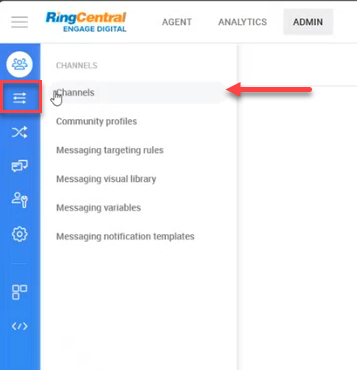
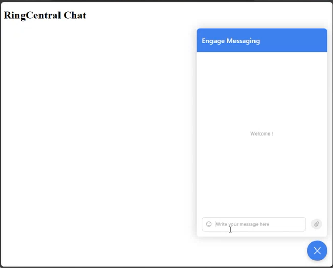

# RingCentral

RingCentral is a multi-channel integrator, which also offers live chat capabilities. DRUID enables you to create the AI Agent once, then integrate it with RingCentral to deploy it in your preferred channel.

DRUID integrates RingCentral as a channel only not as a live chat provider. The live chat sessions are covered by RingCentral. DRUID notifies RingCentral that the user needs to be taken by an agent, and then directs the conversation to the agent and will NOT pass the conversation through DRUID anymore.

**Prerequisites**:

- You built and published an AI Agent.
- You have a RingCentral environment and an admin account.
- For DRUID on premise deployments, make sure that you provide access to/from the necessary messaging endpoints as follows:

|  |  |
| --- | --- |
| Outbound | DRUID.BotApp |
| Inbound | DRUID.BotApp |

This section describes how to integrate a AI Agent with RingCentral.

## Step 1. Create RingCentral categories

Categories are labels assigned to messages that are handled on the RingCentral Engage Digital platform. You can use categories to identify message channels. They help identify where the messages are routed (either to the AI Agent or to an agent).

Log in your RingCentral environment using an admin account. On the toolbar click **ADMIN**, then on the main menu, click **Routing** and select **Categories**.

Add two categories under the same parent category (AI Agent management), as follows: Agent and AI Agent.

For each of the two categories, get the category ID by following these two steps:

1. Click to edit the category.
2. From the browser get the category ID and save it as you need the ID to configure the RingCentral channel in DRUID.

## Step 2. Create Ring Central agents

Log in your RingCentral environment using an admin account. On the toolbar click **ADMIN**, then on the main menu, click **Users** and select **Agents**.

Create an agent for routing the messages to the AI Agent. Provide the **First name**, **Last name**, **Email**, select the role **Administrator**, select the category **AI Agent**, and from the **Channels** field, select the channel where you will deploy the RingCentral bot.

Create as many agents with category **Agent** as helpdesk agents you have in your team.

## Step 3. Create a RingCentral bot / virtual agent

RingCentral offers two distinct functionalities: AI Agents and virtual agents. AI Agents are tailored tools designed to accomplish specific tasks, while virtual agents harness artificial intelligence to engage in more complex conversational interactions.

### Creating a RingCentral bot

This section outlines the steps for creating a RingCentral bot:

1. On the toolbar click **ADMIN**, then on the main menu, click **Dev tools** and select **API access tokens**.

2. At the top right corner of the API access tokens page, click **Add**. The bot configuration page appears.
3. Tick on **Enabled**.
4. Enter a name and from the **Agent** field, select the agent that has the category Bot (the one you created at step 1).

5. Click the **Save** button. The bot appears in the API access tokens page.
6. Copy the API access token generated for the bot and save it as you will need to configure the RingCentral channel in DRUID.

### Creating a RingCentral virtual agent

To create a RingCentral virtual agent, refer to the [RingCentral documentation](https://support.ringcentral.com/article-v2/Creating-a-new-virtual-agent-in-Engage-Digital.html?brand=RingCentral&product=ED&language=en_US).

## Step 4. Activate the RingCentral channel in Druid

1. Log in the Druid Portal and from the main menu, select your AI Agent. The AI Agent configuration page appears by default on the **Details** tab.
2. Click the **Channels** tab, then click **RingCentral**. The RingCentral section expands.
3. Enter the **RingCentral Api Host** in the following format: https://{account\_name}.api.{platform\_hostname}/1.0.
4. In the **RingCentral API access token** field, enter the access token you copied at [Step 3. Create a RingCentral bot / virtual agent](#Step_3._Create_a_RingCentral_Bot).
5. Click the **Generate** button to generate the **Webhook verification token**.
6. In the fields **RingCentral Bot category id** and **RingCentral Agent category id**, enter the IDs of the two categories (Bot and Agent) you copied at [Step 1. Create RingCentral categories](#Step_1._Create_RingCentral_categories).
7. If integrating with a RingCentral virtual agent, toggle the **Create webhook** option to off; otherwise, keep it toggled on.

8. Click the **Publish** button. The channel activation might take up to 1 minute.

After the channel’s activation, the following fields are available in DRUID:

- **[[ChatUser]].ChannelId** = "ringcentral"
- **[[ChatUser]].UserId** - Stores the unique identifier of the RingCentral user account.
- [[ChatUser]].RingCentralInterventionId - Stores the intervention ID from RingCentral. This field is available in DRUID 8.9 and higher.

After the channel's activation, a default webhook is created in RingCentral.

## Step 5. Configure DRUID Live Chat for RingCentral

To use RingCentral's live chat capabilities, in DRUID, go to the AI Agent details page and in the Live Chat section, from the **Live chat provider** field, select **RingCentral**.

## Step 5: Configure the RingCentral Webhook

To configure the RingCentral webhook, in your Engage Digital platform, click **ADMIN** on the navigation toolbar and on the main menu, click **Dev tools** and select **Webhooks**. Click to edit the webhook.

From the **Channels** field, select the channel on which the webhook will be listening (the channel where the RingCentral bot will be deployed).

The default webshook subscription is **content.imported** (for user-bot connection). For live chat, you need to add the following additional subscriptions:

- content.replied
- content.thread\_auto\_closed
- content.thread\_closed
- handoff\_notification
- intervention.assigned
- intervention.canceled
- intervention.closed
- intervention.opened
- intervention.recategorized
- intervention.reopened
- task.recategorized

For detailed description of these subscriptions, see [RingCentral documentation](https://developers.ringcentral.com/engage/digital/guide/webhooks/events).

## Step 6. Deploy the Ring Central bot

In your Engage Digital platform, click **ADMIN** on the navigation toolbar and on the main menu, click **Channels** and select **Channels**.

The list of channels where you can deploy your RingCentral bot appears.

Click on the desired channel.

We will deploy the AI Agent to a web channel, we select **Messaging Web Dev**.

From the Chat connection section, copy the code from the **Code to include** field and include it in a web page.

This is how our Ring Central AI Agent looks like.

## Step 7. Talk to your AI Agent

In the channel where you deployed the RingCentral bot, start talking to the AI Agent. Log in the RingCentral Engage platform as an agent.

When the agent is talking to the user, the **Agent** label displays to indicate that the user messages are routed to a helpdesk agent.

When the agent is no longer in a conservation with the user, the **AI Agent** label displays to indicate that the user messages are routed to the AI Agent.

## Receiving and Processing Voice Messages

> **NOTE:** Voice message support is available in DRUID 8.12 and higher.

DRUID supports audio messages only through Microsoft Cognitive Services and ElevenLabs. For Microsoft Cognitive Services, it supports all languages available in the Azure Speech Service. For a complete list of supported languages, refer to [Language and Voice Support for the Speech Service](https://learn.microsoft.com/en-us/azure/ai-services/speech-service/language-support?tabs=tts#supported-languages).

Here's how it works:

1. Receive audio messages. When a user sends an audio message via RingCentral, the AI Agent will:

- Process the audio recording using Azure Speech/ElevenLabs resources configured in the channel settings.
- Recognize the language for Speech-To-Text (STT) based on the user's language ([[ChatUser]].Language).
- Log in the Conversation History the user message type as 'Audio Recording'.

2. Process audio. The AI Agent:

- Converts the audio message to text using Microsoft Cognitive Services/ElevenLabs.
- Uses the converted text to predict the next conversational step.

3. Respond. By default, the AI Agent will respond to voice messages with text. You can choose the AI Agent to reply with voice.

To enable voice messages support, follow these steps:

1. In the channel configuration page, tap on **Support voice messages**.
2. Select the Speech provider (either **Azure** or **ElevenLabs**), then enter the required details:

- For **Azure**, enter your MS Azure Speech API key and select the region.
- For **ElevanLabs**, enter your API key.

> **NOTE:** ElevenLabs is available as speech provider in DRUID 9.0 and higher.

3. By default, the AI Agent replies with text. To have the AI Agent respond with voice, toggle on **Reply with voice messages**.
4. In the table, click the plus icon. A row is added to the table.
5. From the **Language** drop-down, select the AI Agent language (default or additional) and from the **Voice** drop-down, select the human-like neural or standard voice the AI Agent will use to respond to the user.
6. Click the **Save** icon displayed inline. You can add more languages and different voices per language as best suits your needs.

7. If the channel has not been published yet, click **Publish**.
8. Click the **Save** button at the bottom of the page to save the AI Agent configuration.
