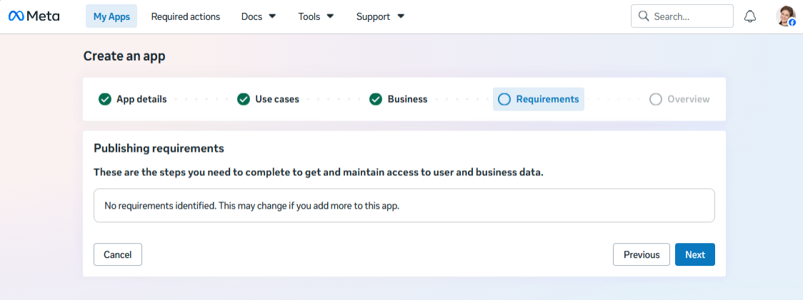
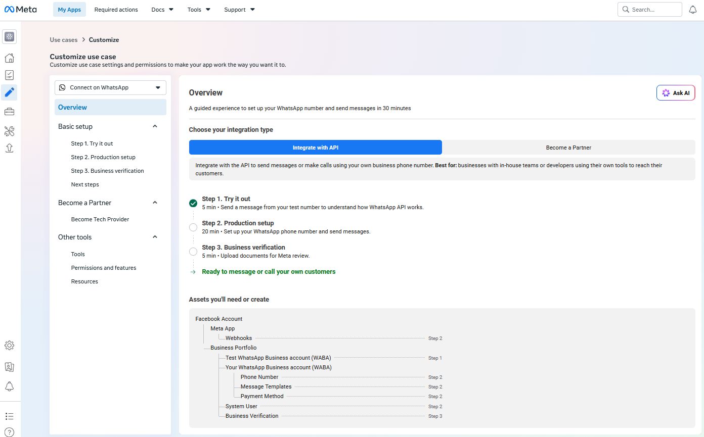
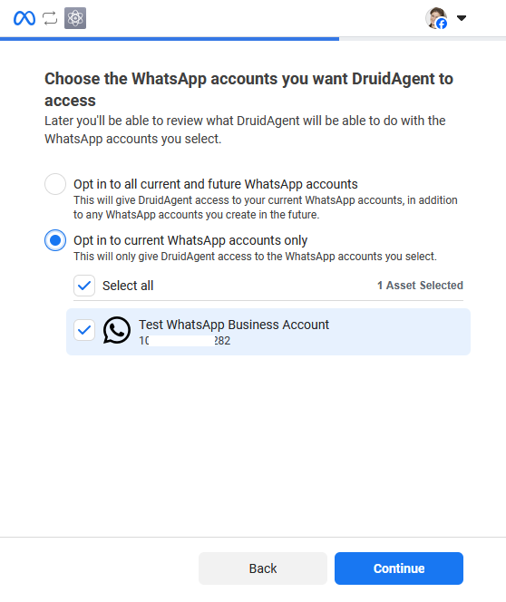

# WhatsApp Meta

To make it easy for your consumers to make purchases and get answers to questions using WhatsApp, the messaging channel they already use every day, Druid authors can integrate AI Agents with WhatsApp. This way, customers will be able to start a conversation with your AI Agent in WhatsApp.

The Druid AI Platform provides the WhatsApp channel via Meta integration (direct integration).

> **NOTE:** The Welcome flow will be triggered at the user's first conversation with the AI Agent; the predict with the initial "user says" is dropped.

> **IMPORTANT!** Effective October 1, 2026, Meta is updating its WhatsApp Business Platform billing model. Outbound non-template "service" messages sent by an AI Agent or live agent inside the 24-hour customer service window are subject to Meta's per-message utility rates after a monthly allowance of 1,000 free messages per business phone number. This affects Meta message delivery charges, while Druid platform functionality and licensing remain unchanged. For details, see [WhatsApp Pricing](https://developers.facebook.com/documentation/business-messaging/whatsapp/pricing).

## Prerequisites

- You built and published an AI Agent.
- You have a Meta Developer account.
- For Druid on premise deployments, make sure that you provide access to/from the necessary messaging endpoints as follows:

|  |  |
| --- | --- |
| Outbound | graph.facebook.com |
| Inbound | DRUID.BotApp |

## Integration procedure

To integrate an AI Agent with WhatsApp via Facebook, follow these steps:

### Step 1. Create a Facebook app

> **NOTE:** The Meta UI may appear slightly different depending on which version you are using.

1. In your browser, navigate to [Facebook for Developers](https://developers.facebook.com/) and log in.
2. On the toolbar, click **My Apps**. Your Apps page appears.
3. Click the **Create App** button.

The Create an app wizard appears.

4. Enter an **App name** and **App contact email**. Meta uses this email address to send important updates about your application. By default, this field pre-fills with the email address linked to your Meta developer account, but you can change it if needed.

5. Click **Next**.
6. Select **Connect with customers through WhatsApp**.

7. Click **Next**.
8. Select your business portfolio.

9. Click **Next**.
10. If no publishing requirements are identified, click **Next**; otherwise, follow the on screen instructions.

11. In the Overview step, click **Create app**.

12. For security reasons, re-enter your password and click **Submit**.

After the app creation process completes, the App Dashboard appears. You can now customize the app.

### Step 2. Customize your app

1. Click **Customize the Connect with customers through WhatsApp use case**.

The Customize use case overview appears. The **Integrate with API** option is selected by default.

2. On the **Basic setup** menu, click **Step 1. Try it out**.

3. In the **Claim a WhatsApp test number** section, click **Generate** to create a temporary token. You must generate this token to send messages from your test phone number.

4. In the pop-up window, click **Continue as [Your Name]** to authenticate your Meta account and complete the token generation.

5. In the account selection screen, choose an access option:

- Opt in to all current and future WhatsApp accounts to grant ongoing access.
- Opt in to current WhatsApp accounts only to select specific accounts (e.g., Test WhatsApp Business Account).

6. Click **Continue**.
7. Review the requested permissions and terms, then click **Save**.

8. In the confirmation pop-up, click **Got it**. The temporary token has been generated. You can now send a test message .
9. Select your test phone number in the **From** field. (Unless you have registered other phone numbers, this will be the only phone number in **From**).
> **NOTE:** When you’re ready to use your app for a production use case, you need to use your own phone number to send messages to your users.

10. Enter the phone number you would like to message in the **To** field. Ensure the number is correct, and that you want to add it to your list of 5 possible message recipients — as you add phone numbers, follow the prompts on the screen to verify you have access to them. Once this number has been added, it cannot be removed from your list.
> **NOTE:** This limitation is only for WhatsApp-provided test phone numbers. Real phone numbers that you register do not have a limit on the number of recipients.

11. Once you enter a recipient phone number, the code sample on the page will be updated to demonstrate an API call that sends a test message to that number.
12. Select the **Message** template you want to send as test and click **Send message** . Alternatively, copy the code sample provided and run it in a terminal or Postman.

13. Check the destination device to confirm message receipt.

> **Info:** If the message does not arrive, click **Check test webhooks** and check the log record for errors.
>
> 

### Step 3. Generate a permanent token for your app

> **NOTE:** To generate a permanent token for your app in Bussines Manager, you must create an admin user and grant full control to your app (asset). If you already have an admin account, you can skip steps 1 to 4.

Follow these steps to generate the permanent token:

1. Go to [Business Settings](https://www.facebook.com/micro_site/url/?click_from_context_menu=true&country=RO&destination=https%3A%2F%2Fbusiness.facebook.com%2Fsettings&event_type=click&last_nav_impression_id=09i4rk9TcbGM4guzO&max_percent_page_viewed=45&max_viewport_height_px=927&max_viewport_width_px=1920&orig_http_referrer=https%3A%2F%2Fwww.google.com%2F&orig_request_uri=https%3A%2F%2Fwww.facebook.com%2Fbusiness%2Fhelp%2F503306463479099&primary_cmsid=503306463479099&primary_content_locale=en_US&region=emea&scrolled=true&session_id=17LB8M8sKIqqm2lJQ&site=fb4b&extra_data[view_type]=v3_initial_view&extra_data[site_section]=help&extra_data[placement]=%2Fbusiness%2Fhelp%2F503306463479099).
2. On the **Users** menu, click **System users**.

3. In the System users page, click the **+ Add** button.
4. Enter a name for the system user, and from the **System user role** field, select **Admin**. click **Create system user**.

The admin user access page appears. Now you have to assign the admin user assets such as your app.

5. Click on the actions icon at the top right corner of the page and select **Assign assets**.

6. Select the app and grant the user full control to manage the app.

7. Click on **WhatsApp accounts**, select the WhatsApp business account, and grant the user Full Control to manage the WhatsApp account.

8. Click **Assign assets**.
9. Confirm if prompted to do so, then click **Done**.
10. Click the **Generate token** button at the top-right corner of the page.

The Generate token wizard appears.

11. Select your app and click **Next**.

12. Click **Next**.
13. Choose **Never** for the token expiration and click **Next**.

14. Select the three WhatsApp permissions from the list, then click **Continue**.

15. Copy the generated token and save it, as you'll need it to activate the channel in the Druid Portal, hen, click **Done**.

> **Info:** You can only share a token once. Each new system user requires a newly generated token.

### Step 4. Activate the WhatsApp channel in Druid Portal

1. In the Druid Portal go to your AI Agent settings.
2. Click the **Channels** tab, then search for **WhatsApp** and click on the WhatsApp by Meta card.

The channel configuration modal appears.

3. In the **WhatsApp Secret** field, enter the secret of you app. To get the app secret:

1. Log in [Meta for Developers](https://developers.facebook.com/), select your app and go to **App settings** > **Basic**.
2. Click the **Show** button next to the **App secret**.

3. Enter the password associated to your Facebook account and click **Confirm** twice. The App secret is showed in the field.
4. Copy the App secret.

4. In the **WhatsApp Number** field, enter the phone number associated with your WhatApp business account without the “+”. Go to [WhatsApp Manager](https://business.facebook.com/wa/manage/home/), and increase limits for your WhatsApp account by adding new phone numbers.
5. Select **Phone number validation** if you have a Meta account connected to multiple AI Agents to ensure the phone number uniqueness per AI Agent; otherwise, WhatsApp will send messages to all the AI Agents connected to the Meta account.
6. In the **WhatsApp Permanent Token** field, enter the token you generated at [Step 3](#Step_2).
7. Generate the **Webhook Verify Token** by clicking the **Generate** button. This is a one-time password used to enable the webhook. Copy the token, as you'll need it to configure the WhatsApp webhook.
8. In the **WhatsApp API Host** field, enter the following value: **graph.facebook.com**.
9. In the **WhatsApp API Version** field, enter the API version your Facebook app is using. Use the following format: vxx.x (e.g., **v26.0**).
> **Info:** To find out the API version of your app, go to [Meta for Developers](https://developers.facebook.com/), log in, select your app and go to the **App settings** > **Advanced**. Check what the API version is.
>
> 

10. Copy the **Druid Callback Url**, you will need it to configure the Meta app webhook.

11. Optionally, customize channel display settings as follows:

- **Alias**: Enter a clear, business-friendly display name (e.g., Interactive Messaging). This value is stored in**[[ChatUser]].ChannelDisplayName**, which appears in reporting tools like AI Agent Summary dashboard - Engagement KPIs and can also be referenced in flow business logic.
- **Description**: Enter a brief description. This is particularly helpful when using an alias, as it helps identify the channel's specific purpose within the Druid Portal.
- **Channel Icon**: Upload a custom icon to display on the channel card within the Druid Portal.

12. Click **Publish** to activate the channel.

When the channel is active, the following fields are available in Druid:

- **[[ChatUser]].ChannelId** = "meta-whatsapp"
- **[[ChatUser]].ChannelDisplayName** - Stores the Alias which is used in AI Agent Summary Dashboard > Engagement KPIs > Channel chart.
- **[[ChatUser]].UserId** - Stores the user's phone number as an unique identifier of the WhatsApp user account for authentication purposes.
- **[[ChatUser]].ChannelBotIdentifier** - Stores the AI Agent number through which a user message arrived.
- **[[HelpdeskClient]].PhoneNumber** - Stores the user's phone number if the user engages with a helpdesk agent in a live chat.

### Step 5. Enable Meta app webhooks

To send messages and other events from your AI Agent to WhatsApp, you must enable webhooks integration:

1. In [Meta for Developers](https://developers.facebook.com/), go to your app dashboard and click **Customize the Connect with customers through WhatsApp use case**.

2. On the **Basic setup** menu, click **Step 2. Production setup**, then click **Configure webhooks**.

3. In the Webhook section, enter the **Webhook Verify Token** and the **Druid Callback Url** you copied from the Druid Portal.
4. Click the **Verify and save** button.

5. Subscribe to **message\_template\_status\_update** and **messages** .

Once you configure the webhooks, the integration of the AI Agent and WhatApp via Meta is complete.

> **NOTE:** The Meta app is in **Development Mode** until you publish it. The plugin and API functionality will only work for admins, developers and testers.

Submit the Meta app for review and after the review is successful, make the app public.

> **NOTE:** When a user initiates a conversation with the AI Agent, the Welcome flow will be automatically triggered. Regardless of the user's subscription status to the AI Agent channel, the welcome message will be promptly sent to the user, ensuring a seamless and engaging interaction experience.

> **NOTE:** If the same chat user sends messages to multiple phone numbers associated to the same AI Agent, different conversation IDs will be generated for each phone number. This ensures that each ChannelBotIdentifier corresponds to a unique ConversationId.

## Associate multiple phone numbers to the same AI Agent (optional)

To associate multiple WhatsApp phone numbers to the same WhatsApp Meta application, go to [WhatsApp Manager](https://business.facebook.com/wa/manage/home/), and increase limits for your WhatsApp account by adding new phone numbers. For more information, see [Phone Number Limits](https://api.support.vonage.com/hc/en-us/articles/13159743458460-WhatsApp-Platform-Phone-Number-Limits).

## Receiving and processing voice messages

Druid supports audio messages only through Microsoft Cognitive Services and ElevenLabs. For Microsoft Cognitive Services, it supports all languages available in the Azure Speech Service. For a complete list of supported languages, refer to [Language and Voice Support for the Speech Service](https://learn.microsoft.com/en-us/azure/ai-services/speech-service/language-support?tabs=tts#supported-languages).

Here's how it works:

1. Receive audio messages. When a user sends an audio message via WhatsApp, the AI Agent will:

- Process the audio recording using Azure Speech/ElevenLabs resources configured in the channel settings.
- Recognize the language for Speech-To-Text (STT) based on the user's language ([[ChatUser]].Language).
- Log in the Conversation History the user message type as 'Audio Recording'.

2. Process audio. The AI Agent:

- Converts the audio message to text using Microsoft Cognitive Services/ElevenLabs.
- Uses the converted text to predict the next conversational step.

3. Respond. By default, the AI Agent will respond to voice messages with text. You can choose the AI Agent to reply with voice.

To enable voice messages support, follow these steps:

1. In the channel configuration page, tap on **Support voice messages**.
2. Select the Speech provider (either **Azure** or **ElevenLabs**), then enter the required details:

- For **Azure**, enter your MS Azure Speech API key and select the region.
- For **ElevanLabs**, enter your API key.

3. By default, the AI Agent replies with text. To have the AI Agent respond with voice, toggle on **Reply with voice messages**.
4. In the table, click the plus icon. A row is added to the table.
5. From the **Language** drop-down, select the AI Agent language (default or additional) and from the **Voice** drop-down, select the human-like neural or standard voice the AI Agent will use to respond to the user.
6. Click the **Save** icon displayed inline. You can add more languages and different voices per language as best suits your needs.
7. Save the channel configuration.

## Related Topics

- [Handling Authentication](../../How%20to/Handling%20Authentication.md)
