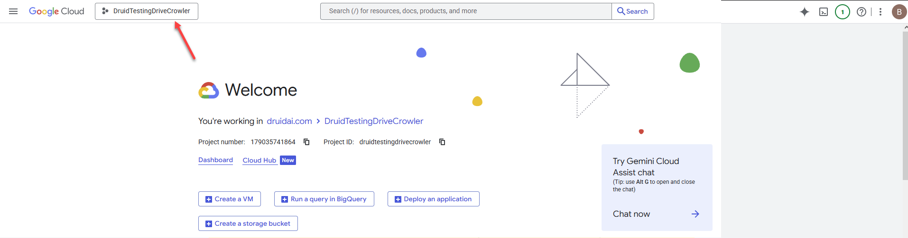
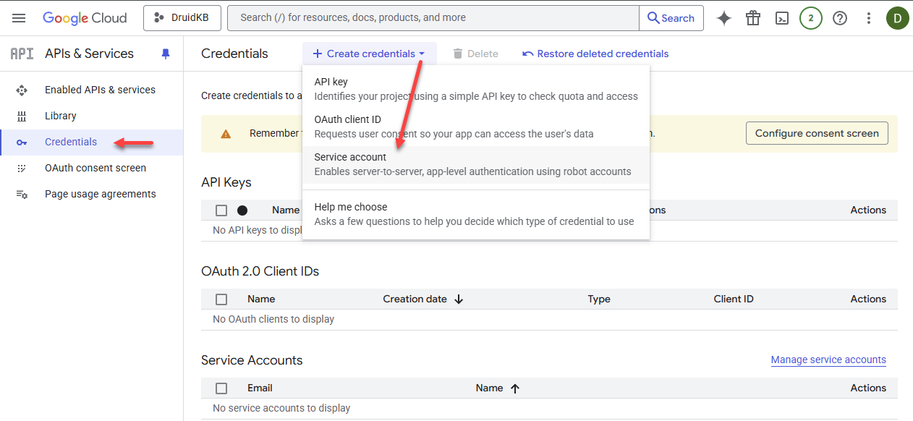
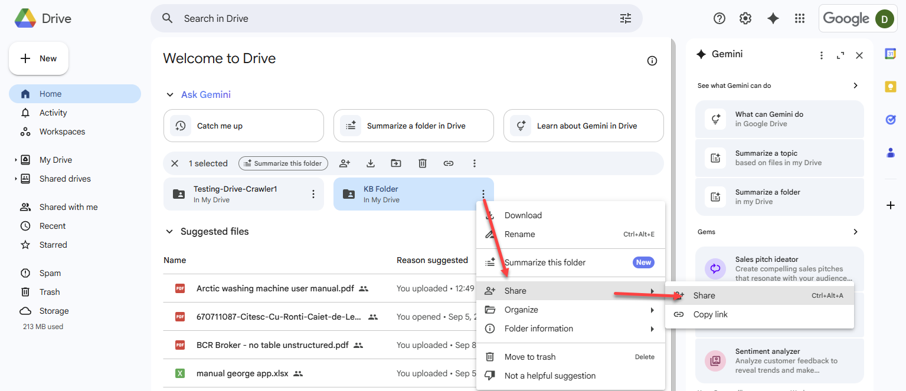

# Google Drive Data Sources

A Google Drive data source enables you to securely and efficiently integrate documents stored in your Google Workspace into your Knowledge Base (KB). By incorporating Google Drive data sources, you can ensure your AI Agent responses are accurate and comprehensive, utilizing internal files, policies, or FAQs located on your cloud storage.

This feature allows you to extract paragraphs from Excel, Word, and PDF files stored in your specified Google Drive folders.

## Prerequisites

- You have a Google Cloud account.

## Add data from Google Drive to the Knowledge Base

To add data from Google Drive storage to the KB, follow these steps:

### Step 1: Set up Google Cloud project and service account

1. Log into the [Google Cloud Console](https://console.cloud.google.com/).
2. Click on the project picker.

3. In the 'Select a resource' pop-up, click **New project**.

4. Enter a name for your project.

If you’re using a personal Google Cloud account instead of a business account, the New Project page looks slightly different.

5. Click **Create**.
6. Select the new project from the project picker.

7. In the Quick access area, click on **APIs & Services**.

8. Go to **Library**.

9. Search for **Google Drive API** or scroll down until you find it, then select it.

10. Click **Enable**.

11. Wait until the Google Drive API is enabled.
12. Click **Create credentials** on the menu.
13. From the **Create credentials** drop-down, select **Service account**.

14. Enter **Service Account name** and click **Create and continue**.

15. Select the **Viewer** role.

You can add additional roles if needed.

16. Click **Done**.

The service account is created.

### Step 2. Generate a private key

1. Click on the service account you created.

2. Click on the **Keys** tab.
3. From the **Add key** drop-down, select **Create new key**.

4. Leave **JSON** selected and click **Create**.

5. The private key file is automatically downloaded to your computer (default Downloads folder).

> **Info:** You will need this file content when creating the Google Drive data source in Druid.

### Step 3. Share the Google Drive folders you want to crawl

1. Open [Google Drive](https://drive.google.com/).
2. Locate the folder you want to crawl and click **Share**.

3. In the **Add people and groups** field, enter the service account email address you created in Step 1.

4. From the permissions list, select **Viewer** and click **Share**.

5. If prompted, confirm that you agree to share the folder with an external email address.

Once the Google Cloud setup is complete, you can create the data source in Druid.

### Step 4. Create the data source in Druid

To create a Google Drive data source, follow these steps:

1. Click the **Add New** button. The Add New Data Source page opens.
2. In the **Name** field, provide a name for the data source. This helps you identify and search for the data source easily.
3. From the **Language** drop-down, select the language of the data you upload. It must be one of the AI Agent languages.
4. From the **Type** drop-down, select **Google drive**.
5. In the **Key File Content** field, paste the entire content of the private key file you downloaded in Step 2. Open the file in a text editor, copy all of its raw JSON content (including the opening and closing braces), and paste it here.

6. From the **Shared folders** drop-down, select the root shared Google Drive folder or specific subfolder(s) to include in the Knowledge Base.

7. To verify the Key File Content, click the **Test** button. If the check fails, check you have properly entered the content of the private key file. You can also test it later by going to the **Details** tab of the data source and clicking the **Test** button at the bottom of the page.
8. Click **Create**. The new data source opens and you can start crawling.

### Step 5. Crawl the data source

On the Knowledge base page click the edit icon to edit the data source. The data source configuration page appears by default on the **Extracted Paragraphs** tab. Upon reaching the configuration page, you'll notice that the content of the root reflects the file structure from the Uri link you provided during data source creation. By default, all folders and files are excluded from scraping. To include files / folders for scrapping, click the three dots displayed at the right-side of the item and click **Include**.

Click the **Crawl** button. In the Start Crawling Parameters modal, define the crawling policy by setting the parameters described in the table below.

| Parameter | Description |
| --- | --- |
| Depth | The number of directory levels the crawler will explore from the URL.  **NOTE:** To improve crawling efficiency, crawl each node individually instead of the entire root, especially if the storage has a deep structure. Set the depth to '0' to achieve this. |

Click **Start**.

> **Info:** Based on the crawling policy set, it might take up to a few minutes for the crawling to complete. You might want to refresh from time to time to see when the action has completed.

By default all nodes are excluded from scrapping. To crawl specific nodes, hover the mouse over the desired node in the tree, click Actions menu (the dots) and select **Crawl Path**.

When the crawling completes, the extracted articles display under the **Extracted paragraphs** tab.

### Step 6. Train the data source

To ensure the KB Engine searches through the data source paragraphs, train your data source by clicking the **Train** button at the top-left corner of the data source or select **Train data source** from the actions menu. Alternatively, you can **Train all data sources**.

## Related Topics

- [Advanced Features and Optimization](Advanced%20Features%20and%20Optimization.md)
- [Data Management and Schedules](Data%20Management%20and%20Schedules.md)
