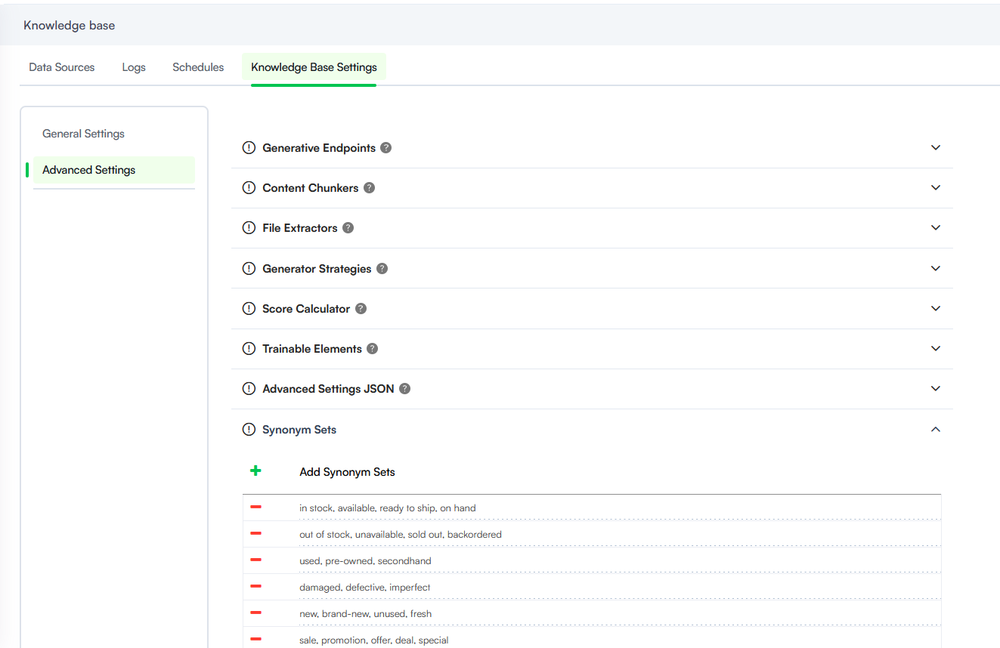
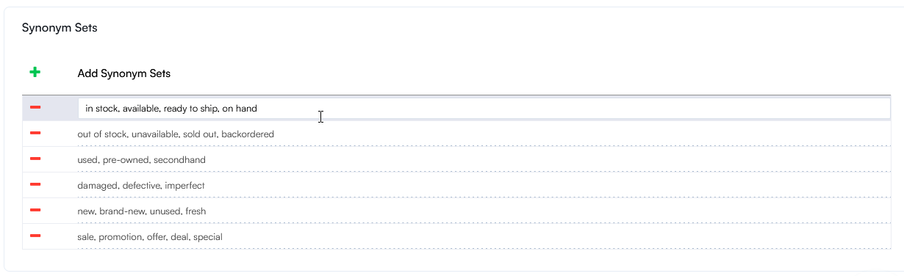

<a id="SynonymsDictionary"></a>

# Synonyms Dictionary

The Synonym Dictionary enables you to improve search results in the Knowledge Base by defining equivalent terms. It has effect across the entire retrieval pipeline, actively influencing both the initial BM25 search and the subsequent reranker stage.

The Synonyms Dictionary lets you group related words into synonym sets.

<a id="BM25SearchLogic"></a>

## BM25 Search Logic

When a user searches for a term, the system also considers its synonyms when retrieving results. When the search uses the Synonyms Dictionary, a specific scoring weight is applied to ensure the most accurate results are prioritized. The system distinguishes between the original term used in the query and its defined synonyms:

- **Original term match**: Sentences containing the exact word used in the user query receive a 100% matching score.
- **Synonym match**: Sentences containing a synonym from the dictionary (instead of the original word) receive an 80% matching score.

This scoring ensures that while synonyms help expand the search reach, the engine still favors documents containing the user's specific vocabulary.

<a id="AddSynonymSets"></a>

## Add Synonym Sets

To manage the dictionary, navigate to **NLU** > **Knowledge Base**, then follow these steps:

1. Click the **Knowledge Base Settings** tab.
2. Navigate to **Advanced** > **Embedding**.
3. In the Synonym Sets section, click the **+** (Add) icon to generate a new entry line.
4. Enter the terms you wish to group together, ensuring each word or phrase is separated by a comma followed by a space (e.g., in stock, available, ready to ship, on hand).
> **Info:** Ensure there are no trailing commas at the end of a set to maintain search index integrity.

5. To save the set, press **ENTER** on your keyboard or click the **+** icon again to add a subsequent set.



6. Save the settings.

<a id="EditandDeleteSynonymSets"></a>

## Edit and Delete Synonym Sets

To edit a set, click on the specific line and make the desired changes.



To remove a synonym set from the dictionary, click the **-** (Minus) icon next to the row.


<a id="BestPractices"></a>

## Best Practices

To maximize the effectiveness of the Synonyms Dictionary and ensure the search remains accurate, consider the following guidelines:

- Focus on grouping industry-specific jargon, abbreviations, or common interchangeable terms to bridge the gap between user intent and KB content.

**Retail examples**

```
//Acronyms
POS – Point of Sale
AOV – Average Order Value
ATV – Average Transaction Value
UPT – Units per Transaction

// Retail industry jargon
cheap, affordable, budget-friendly, low-cost, economical
expensive, premium, high-end, luxury, upscale
discount, markdown, price cut, reduction, deal
bargain, steal, value buy, great deal

sale, promotion, offer, deal, special
clearance, closeout, final sale, liquidation
limited-time, flash sale, short-term offer, exclusive deal
bundle, package deal, combo, set

in stock, available, ready to ship, on hand
out of stock, unavailable, sold out, backordered
limited stock, low inventory, almost gone
```

- Keep sets specific to avoid surfacing irrelevant documents. Because synonyms carry an 80% weight, adding too many broad terms to a single set can "dilute" search results.
- Standardize Formatting. Always use **the word, synonyms**, phrase format. Avoid adding special characters or extra spaces within the terms themselves, as this can interfere with the search engine tokenization.
- Monitor Search Performance. Periodically review the Knowledge Base Logs to identify "No Results Found" queries. Use these insights to expand your Synonym Sets with the terms your users actually use.
