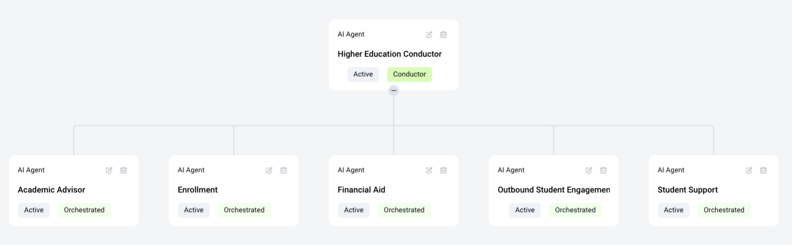

# Higher Education

The Higher Education AI Agents are designed for universities, colleges, and other academic institutions looking to improve student engagement and streamline administrative processes. They support students at every stage of their academic journey — from prospective enrollment through graduation — enabling institutions to scale support without scaling headcount.

