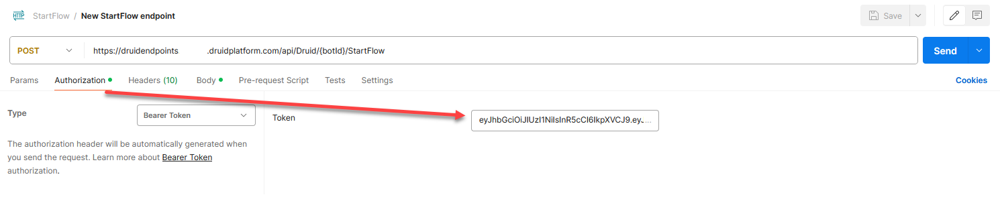

<a id="Webhooks"></a>

# Webhooks

> **NOTE:** This feature is available in DRUID 7.7 and higher.

Webhooks provide specifications for DRUID endpoints and enable you to generate a bearer token for authentication. To access webhooks, click **Webhooks** on the **Administration** menu. The **Endpoints** tab displays DRUID endpoints; click on an endpoint to view its structure.


To obtain the bearer token for authenticating requests to DRUID endpoints (MediatelAgentConnected, StartFlow, UiPathAttended), click the **Authentication** tab. You have two options: generate a permanent token or the authentication endpoint.

<a id="Generateapermanenttoken"></a>

## Generate a permanent token

Click on the 'Permanent bearer token' section and click the **Generate new token** button to generate a new token. Copy it from the Token column, and use it for requests authentication.


Include the bearer token in the Authorization area of your requests.



You can deactivate a permanent token at any time by clicking **Actions** > **Inactivate**.


<a id="UsetheAuthenticationendpoint"></a>

## Use the Authentication endpoint

The authentication endpoint returns an access token that allows you to access the API's endpoints. To see the endpoint specification and structure, on the **Authentication** tab, click on 'Authentication endpoint'.


<a id="Syntax"></a>

### Syntax

`POST *.druidplatform.com/api/services/app/WebAPIService/ExternalAuthenticate`

<a id="Requestbody"></a>

### Request body

```
{
    "userNameOrEmailAddress": "string",
    "password": "string",
    "tenant": "string"
}
```

| Parameter | Data type | Mandatory | Description |
| --- | --- | --- | --- |
| userNameOrEmailAddress | string | yes | The username or the email address associated to an existing DRUID service account who has the privileges to manage users. |
| password | string | yes | Password of the above user account. |
| tenant | string | yes | The name of your DRUID tenant. |

<a id="ResponseBody"></a>

### Response Body

```
{
    "result": {
        "accessToken": "<access_token>",
        "encryptedAccessToken": "<encrypted_access_token>"
    },
    "targetUrl": null,
    "success": true,
    "error": null,
    "unAuthorizedRequest": false,
    "__abp": true
}
```

| Parameter | Data type | Description |
| --- | --- | --- |
| accessToken | string | Access token required as a parameter when sending API requests. The access token is valid for 30 minutes (1800 seconds). When the access token expires, you need to get another one and use that in the next API calls. |
| encryptedAccessToken | string | The encrypted access token. |
| success | boolean | True if the access token has been successfully generated. |
| error | string | If the request was successful, it returns **null**. Otherwise, an error message is provided, indicating the reason for the request failure, such as non-existing tenant name or username, or incorrect password. |

Include the bearer token in the Authorization area of your requests.


<a id="Errorcodes"></a>

### Error codes

- 400 – Bad request
- 404 - The syntax of the call is incorrect.
- 500 — Internal server error

<a id="Example"></a>

### Example

In this example:

- DRUID service account user requests an access token. The user has privileges to manage users.
- The user's account credentials are **test-oana** (username) and **Oana123#** (password).
- The request is successful and assigns the user an access token.
- This access token will be valid for 30 minutes (1800 seconds).

#### Request

**{**

```
{
  "userNameOrEmailAddress": "test-oana",
  "password": "Oana123#",",
  "tenant": "Documentation"
}
```

#### Response body

```
{
    "result": {
        "accessToken": "eyJhbGciOiJkaXIiLCJlbmMiOiJBMTI4Q0JDLUhTMjU2IiwidHlwIjoiSldUIiwiY3R5IjoiSldUIn0..TosmqAIUgGilolh9JH2-gQ.1e74_60ElMbFgiHrSApGOR5WV1LH8LwFzkX4mNoDF0Hu06hs-gKqGjK1sf0hspi8vfC5mVR1X0Kw5VsWG9YeP6iWLYUhQ86O_GAVlcs6DsI3cUtrgl5L7-F-km95cv0nVSpcO8GBSxhpX3zZIzq7yOlDGmxwDDGvWsRzb2l5gx9eJOP-RXO5glApUXfuYAZHCHZCHdEez8WYUHHHKuMYyQd2yGXqSuq4MWsJ_Xp9seSkk8_YARsldHBNKpmmGgtUCD2FXs4fTX8Zay5UzGiNcyfAyJnjdgtMNWq6KtLa0zBr3Ea2cE8VVa8PIOEuNeEqQIW2G4Zs6jxqU3P-48oX58JpfW2PmWm05SIwRP8hhpND_wufZws9fBc3DhixF-1HxJGj6tPwGOTp4T4N0May6ETWL1OdsyHczMslG75ZF-j4su7IUYGvYbRAdhT5AoreDwOWPRbVNw2JEhNtIwDTjFyM31i4MJ16EVC3bEXAPCuLrkfgwdwhNrkMTHP0YeTwYlMNsDJXQoLyuiAZpxaH3k35ldQCbLykMmb2MzgLbDmJRX1onMV0hvqIho4VCCAm-92cem8_q_hFnOEx-KkHBAEGJNO3CkB0pfyRtsCdHSzaApTj1nkeP05QrbxBjJihOTKDMdPVFjCURvjGIy97r8u0ak9S2gaei7xcH7iz0RmwJHMoFZbWq7ilvJeOMB_bcE1sAliI-tH0i6CjcVcYAsU3Nr6YhjX8jGhn-Ddx1hZmM7WE1FUmi1wAYZSSaXaKVeyM9hgefbDOS2HNjhNC9m9tfECj57q-AxXAUbORV7XQ0TwvZJZnuoqd-ZIaPqL2hI__b3JGZzJ2Z4wvVF-_qMgEYKaZr1RdrBp5SOWliQ1AxzPPvgLRhNbGQhohFtC5AtZpP9smSYU5RPUlTHQT4cIUe5EuRGcg4DqTlYufdtxe-tMpVkzkz89MX-XwInRWWYnVo02kTLF17jiE0aMplhtwV81IFf569vPJAuLtTSYG-DQyIRIYUYk5_yOaDTm8YWt8QlKWBhQB2EckMuSf7jlSUKEGSE91YUe_7ouse00.3z6dSAGCUdYYL0boMfnNqw",
        "encryptedAccessToken": "jElQQ9r7lqOiF/W6RXC/t8tyY2jg+sUdW3xK94cyy1A9PbBMwCP87p5iR9/M+ZcP/QQWWndj0ervqBS8uBSlbbM3k7p1kN8MgYn7IY9MdZK3QJGGAfqBrniU9e0ABX13mOle/6fPOKDaGROsf3QfYOucsW0KMoEV+Ljwhgn1UahlQ+DdjNuLB7mrkvBz0DX23vep036tmZyrQtmhnoU+j0efbhFoLhymZFOyeY33ZjYM57lh+gNZ6MYxZSuM2oWuOaYYpC9q4n4hzm3z2r1OOvh06RsdPEjlRUkJcSDsC7Hagc2Kv/Z+fqOoUPp1OZhBV1UW5cvBtHyM8/FE2Ztlea2Bviq3Y6O8bIlN/ytbem+9FI+Q87X0/gkRk9uIikZJER/sY404B5Vp47FMLY+0+Z3V9fcxqs5qtsNXAIyPn2NEpvCLsyvrKzbjF4FFTFGZC4HCQpRT8WCYQIwDSWdu4J8Bb15l2JyIKbSa024py/rHKQ+GdEZ3XSi0fUX2wQ1LUmpVh9EWNAyq8QEDQ0m07JFhMOFCu0KfYfoX9elj59KVUg2qgSoVFLW8ldrKIxaLR+OFH7xhcySatWiRCoPfUkj3CZvlXZlg7AQYTDWFhEIl4gsMiEmf30K4KeH9D88b0WRW3Fij04t+hUpolgs9W53gZPdGPrbsB0jJI5I0Svubob4VojUJ2xdTEtwWjy2FbaosP4QDAvzEvOiHcusnKtKDPhfoqhviiK6EKWX8QluAhdzNbYZmT9DaUwo37bBUXy4Loouf4/LF71CuJVLdKF2rVNYOZHpgmkJPSqS4DiG6CFhpMiUqNGiB42chK6bCNoMLSfD+CvqHZValxqY434svNEn20wcagIsJd8bcrlprUJvwcU3LcOfU7zOowCBfb2/cutHYhPy8rcyjYguXjIg3J7HMwLa7AIVVhtFLjYuq6vS6htiPbRl0W+dyPWl9sFAcrgOn/VtZWY4IxEM2pSjcIyU36mvJDEgfeJDsb7OZHdCWXzD4vD/AvtKNy1T4Oy2PqmSrgHBJiFmDWoQGGK0YPbPgRA1IbqiAa/vpFPlySFkbC5DoeXL5T/Kjw54OjfYIXZP2opTlt2F01d3SVuMsdGxQIjo40lNP9ZGanoE5u4yGUbG2iC53O6bD1nHAA8EKnuPbPKPrvjMtdIwtCjVjHdTF6NEw7zp4Gl7RIW5RtMDzqitXAOd5wpxS5H7DlZ8KhiE56wvo6M7qrmyNh779MxbKyuyyXoLGhUex128dicVwqR2qWFia6jq6ys+yGfN5viwaDZPJc2Ggejdu7N/i/Y/DkeU7CMSPmPWGBLRgrC22ex8IA/9cOUubPNDmxXAWXNT+26na1mZRtkHxBbXZCUMzC9yjysdhn8ZMOS+ezSQBz6Yu2DupuQgtyG6TZRVlSQii2fSDMpqQS9yVfGuWiSYWOh1XOto5CkO4y4umKcQW6ATxmMjOpY8JLEesj6EnalDXYdQe4+h3Ri3E8yGQnhAp5cn098Vr5wK34pjNhREJ1gpRjVx6+qo8PyFYBxWsVnIyg0WXjCaD9coxOk9LOk2je5MfWqWouGhYZSaRssPJd6C91sVqNw7+HdV0"
    },
    "targetUrl": null,
    "success": true,
    "error": null,
    "unAuthorizedRequest": false,
    "__abp": true
}
```
