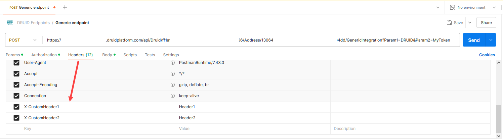

<a id="ExchangingDatawithExternalSystems"></a>

# Exchanging Data with External Systems

The `/GenericIntegration` endpoint allows external webhooks to send requests to DRUID, triggering a connector integration to process the data. When a webhook call is received, Druid extracts key request details—such as query parameters, headers, and the request body—and stores them in predefined entity fields. The system then executes the specified integration and returns a response.

This enables flexible automation by allowing developers to configure Custom Code integrations that process incoming data and generate tailored responses. By leveraging this feature, you can interact with external systems efficiently while maintaining structured data handling within the Druid AI Platform.

<a id="Limitations"></a>

## Limitations

- Supports only the POST method.
- Accepts only bearer tokens (permanent or short-lived) generated in the Webhooks > Authentication tab. For more information, see [Webhooks](../Webhooks.md).

<a id="Prerequisites"></a>

## Prerequisites

Before using this endpoint, ensure that the entity where the integration will be executed includes the following fields:

| Field Name | Data Type | Description |
| --- | --- | --- |
| RequestParams | String | Stores the query parameters as a string. |
| RequestBody | JObject | Stores the request body. |
| RequestHeaders | String | Stores request headers as a concatenated string in URL query format (headerKey1=value1&headerKey2=value2). |
| ResponseBody | JObject | Stores the response data returned to the external webhook. |

<a id="ExecuteSynchronousIntegrations"></a>

## Execute Synchronous Integrations

Synchronous integration is used for requests that are expected to complete quickly. The external webhook waits for the integration to finish and receive the final response in a single API call.

<a id="Syntax"></a>

### Syntax

`POST https://<tenant_name>.druidplatform.com/api/Druid/<BotId>/<entityName>/<integrationId>/GenericIntegration?<QueryParams>`

Where:

- `<tenant_name>` and `<BotId>` are automatically filled when you copy the URL from **Webhooks** > **Druid**.


- Replace `<entityName>` with the name of the entity where the integration was created.
- Replace `<integrationId>` with the ID of the connector action you want to execute in Druid.


> **NOTE:** By default, the response type is **application/json** in Druid 9.17 and higher. In previous versions, the default is text/plain. If the external service returns data in a format other than JSON (e.g., text/plain or xml), you must specify that format in the `responseContentType` parameter to ensure the integration processes the payload correctly.
>
> **Request syntax**:
>
> `POST https://<tenant_name>.druidplatform.com/api/Druid/<BotId>/<entityName>/<integrationId>/GenericIntegration?responseContentType=text/plain`

<a id="Request"></a>

### Request

You can send query parameters, additional headers, and a request body (in text or JSON format) with your request.

To include query parameters, add them to the request URL after the **?** symbol, using the following format:

`POST https://<tenant_name>.druidplatform.com/api/Druid/<BotId>/<entityName>/<integrationId>/GenericIntegration?Parameter1=value&Parameter2=value&...`




When DRUID receives a request through this endpoint, it processes the request as follows:

1. Extracts {entityName} from the URL path.
2. Performs the integration having the ID provided in the request URL.
3. Captures and stores request components in dedicated Druid entity fields:

- **RequestParams**: Stores query parameters.
- **RequestBody**: Stores the request body.
- **RequestHeaders**: Stores request headers as a concatenated string.

To use the received data in Druid, create a Custom Code integration and process the data as needed.

<a id="Response"></a>

### Response

By default, the API call response is stored in ResponseBody (JObject). The entire response payload is sent to the external webhook. You can modify the Custom Code integration to send specific text or data.

The following example updates the response entity with specific data before sending it back to the webhook.

**Example: Custom Code to Send Data Back to the External Webhook**

```
// Default Custom Code snippet
(function main() {
    // Retrieve the request entity
    let requestEntity = Context.GetRequestEntity();
    
    // Handle case where the request entity is not initialized
    if (requestEntity == null) {
        Context.RaiseError("No entity", "Request entity is null");
    }

    // Modify request entity fields as needed
    requestEntity.Name = JSON.stringify(requestEntity.RequestBody);
    requestEntity.ResponseBody = {
        "Street": "Costache Negri",
        "Town": "Bucuresti",
        "Building": "Opera Center"
    };

    // Set the response entity
    Context.SetResponseEntity(requestEntity);
})();
```

The following example sends an acknowledgment response instead of a data payload, providing the external webhook with confirmation that DRUID successfully processed the request.

**Example: Custom Code to Send an Acknowledgment Message**

```
// Custom Code to send an acknowledgment response
(function main() {
    // Retrieve the request entity
    let requestEntity = Context.GetRequestEntity();
    
    // Handle case where the request entity is not initialized
    if (requestEntity == null) {
        Context.RaiseError("No entity", "Request entity is null");
    }

    // Send an acknowledgment message
    requestEntity.ResponseBody = {
        "status": "success",
        "message": "The data was received successfully."
    };

    // Set the response entity
    Context.SetResponseEntity(requestEntity);
})();
```

<a id="ExecuteAsynchronousIntegrationsLongRunningRequests"></a>

## Execute Asynchronous Integrations (Long Running Requests)

Asynchronous integration is used for long running jobs that are expected to take more than 5 minutes to execute. An async integration is ideal for tasks like a bulk SMS campaign where the external SMS provider does not allow sending messages in a single bulk request, requiring Druid to process the list and make sequential API calls over an extended period.

> **NOTE:** Asynchronous Integrations are available in Druid 9.10 and higher.

Async integration uses a two-step process based on the long polling principle to prevent the webhook from timing out while waiting for the result: one to start the job and one or more to retrieve the final result.

<a id="Step1InitiatetheAsynchronousIntegration"></a>

### Step 1: Initiate the Asynchronous Integration

Send a POST request to the standard integration endpoint, including the `asyncResponse = true` request parameter.

#### Syntax

`POST https://<tenant_name>.druidplatform.com/api/Druid/<BotId>/<entityName>/<integrationId>/GenericIntegration?Parameter1=value&Parameter2=value&asyncResponse=true`

The API call will immediately return a response containing an invocationId, confirming that the long-running job has started.


> **NOTE:** By default, the response type is **application/json**. If the external service returns data in a format other than JSON (e.g., text/plain or xml), you must specify that format in the `responseContentType` parameter to ensure the integration processes the payload correctly.
>
> **Request syntax**:
>
> `POST https://<tenant_name>.druidplatform.com/api/Druid/<BotId>/<entityName>/<integrationId>/GenericIntegration?Parameter1=value&Parameter2=value&asyncResponse=true&responseContentType=text/plain`

<a id="Step2RetrievetheIntegrationResponse"></a>

### Step 2: Retrieve the Integration Response

Following the long polling principle, make API calls from time to time (e.g., every X minutes) to the separate `GetGenericIntegrationResponse` endpoint. You must provide the **invocationId** received in Step 1 as a request parameter.

#### Syntax

`GET https://<tenant_name>.druidplatform.com/api/Druid/<BotId>/GetGenericIntegrationResponse?invocationId=<invocationId>&responseContentType=text/plain`


If the integration is still running, the API will return a status indicating the job is not yet complete.

When the integration completes, the API will return the final response, which includes the data stored in the entity's ResponseBody field.
