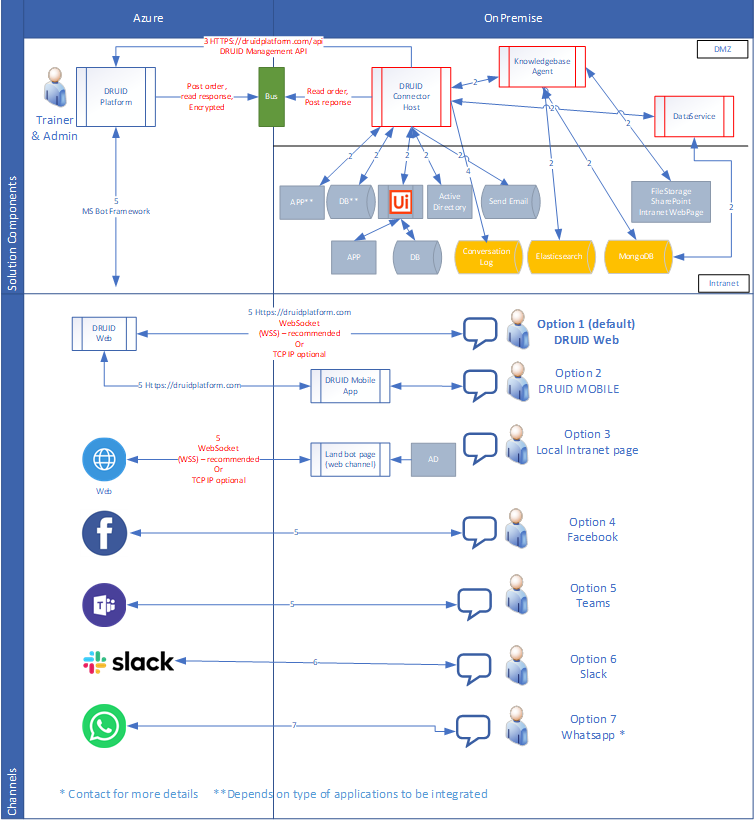
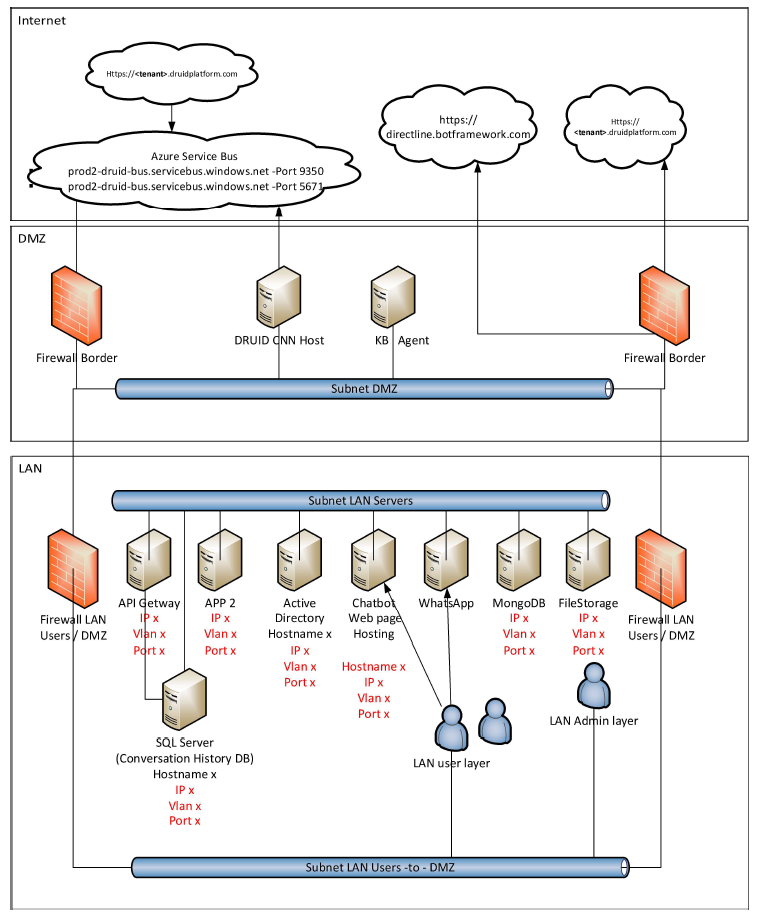

In a hybrid deployment, you harness the capabilities of our Cloud conversational engine while utilizing one or more Druid-specific components to store all conversational data within your infrastructure.


**Info:** The hybrid deployment detailed below applies to both client-side and Druid-hosted environments for the Druid Connector Host and Druid Data Service.



**IMPORTANT!** **Druid Hybrid Deployment Requirements & Upgrade Notice**

To provide clients with a smooth data migration experience, the hybrid deployment requirement originally planned for version 10.1 has been rescheduled.

* Starting with version 10.3 / 10.5, Druid hybrid deployment requires installation of both the Connector Host and the Data Service.
* Updating the Connector Host to version 10.3 / 10.5 or higher requires a simultaneous upgrade of the Data Service to a compatible version.

Please ensure your technical team plans for both components when scheduling future environment upgrades.


## Deployment Architecture

Below is a comprehensive recommended deployment architecture diagram, providing insight into the connections among various Druid components and services installed on your premises, as well as internal and external resources and systems.

**Druid Connector hybrid deployment**

**Druid Connector and Data Service hybrid deployment**

**Druid full hybrid deployment**

Each Druid environment is hosted in an Azure Cloud data center located in a specific region, as follows:

| Druid Environment         | Azure Cloud Region |
| ------------------------- | ------------------ |
| PROD EU                   | West Europe        |
| PROD US                   | East US            |
| Prod US - HIPAA compliant | East US 2          |
| PROD AU                   | Australia East     |

Druid provides SaaS from these Azure Cloud regions, with geo-redundant backup storage for added data protection.

For detailed low-level diagrams, please consult the specific ones provided below.

## High-level architecture diagram

The figure below illustrates the high-level architecture of the hybrid deployment.

## Druid components diagram

The figure below provides an overview of the main components of the Druid platform from a deployment perspective..

## Logical architecture

The figure below outlines the logical structure and interactions among the deployed Druid components.

## Physical Architecture

The figure below describes the physical setup and hardware configurations of the Druid deployment.

## Understanding Data Flows in a Druid Hybrid Deployment

Within a Druid hybrid deployment, data flows dynamically through interactions among different components. This section outlines the primary data flows to facilitate your understanding of how information traverses within your system. Acquiring insight into these data flows is essential for upholding the integrity and security of your Druid hybrid deployment.

**Data Requests and Responses via Azure Service Bus**

* Data exchanges happen between the conversation engine and internal systems.
* Druid platform and Connector Host place messages into Azure Service Bus.
* Messages are encrypted using AMQPS and/or HTTPS protocols to ensure secure transmission.
* Data from connected apps is also included in these messages.

**Interactions with Connected Apps**

* The system interacts with connected apps through ODBC or REST API calls.
* These interactions are tailored to your specific implementation. For instance, in a AI Agent HR scenario, actions like reading employee files (e.g., badge, job title, department, vacation days) or saving vacation requests are examples of such interactions.

**Utilization of Druid APIs**

Druid APIs are accessed for triggering conversation flows and reading metadata, among other functionality.

**Storage of Conversation History**

Conversation messages are saved into the Conversation History database, which is hosted on your premises. This database preserves a record of interactions for future reference.

**Chat Sessions Across Channels**

Messages flow between the AI Agent and end users across various communication channels.


**NOTE:** In instances where sensitive data should not be shared within the conversation, the "Send Email" connector offers a solution. This connector enables the direct delivery of emails to users, bypassing the conversation interface.


## Druid Components

**Druid AI Platform**

The Druid AI Platform is a cloud solution hosted on Microsoft Azure. It encompasses all the necessary components for setting up and operating AI Agents. The platform operates on a multi-tenant deployment model managed by Druid.

It uses the following frameworks:

* Data access: Microsoft Entity Framework Core v 2.1.4
* Web: Microsoft ASP .NET Core v.2.0

**Druid Connector Host**

The Druid Connector Host is a Windows service facilitating integration between AI Agents and on-premise applications, services, or databases. It becomes essential when AI Agents require access to internal systems inaccessible directly from the internet. Typically, the Druid Connector Host is deployed on a server within the demilitarized zone (DMZ).

**Druid Data Service**

The Druid DataService serves as Druid's data storage solution, preserving Druid entity records created and managed within the Druid Platform. This storage simplifies record authoring for authors, who can use these records for Named Entity Recognition (NER) training and various other contexts.

**Druid Knowledgebase**

The Druid Knowledgebase serves as the primary engine for managing knowledge base-related requests, such as web crawling, document extraction, embedding, training, and prediction.

**Web Channel**

The web channel, comprising the Druid Portal or local AI Agent web pages, along with the Druid Mobile app, communicates with the AI Agents using the TCP/IP protocol.

## Authentication

The Druid AI Platform provides a robust set of authentication methods to ensure secure access to its features:

* **Local Authentication**: You can connect to Druidplatform.com using user credentials (username and password) stored within the Druid AI Platform. Users can be provisioned directly into the Druid Portal, with security roles assigned to control access to specific functionality. For enhanced security, two-factor authentication can be enabled for provisioned users.
* **Single Sign-On (SSO)**: The platform supports integration with Active Directory for authentication and authorization purposes. You can host the AI Agent on a website or intranet configured with Windows Authentication. Integration with internal solutions allows automatic provisioning of users and their associated roles.
* **User Authentication during Chat**: Users interacting with the AI Agent can be authenticated by asking specific questions and verifying the provided information with Druid backend systems. Authentication can also be extended to other channels such as Teams, Facebook, or WhatsApp when users initiate a conversation for the first time.
* **Channel-specific Authentication**: AI Agents for internal use by employees typically utilize Active Directory integration, MS Teams, or Slack. For external users, including customers and partners, local Druid two-factor authentication is commonly employed.


**NOTE:** When employing Active Directory Integration with Teams, Slack, or Facebook, it's important to note that no passwords are stored within the Druid AI Platform. Instead, the authentication process is managed directly by the respective channels. The Druid AI Platform retains only the user ID (account name from AD, etc.) for identification and authorization purposes.


By storing only the necessary user information and delegating authentication responsibilities to trusted channels, the Druid platform ensures a secure and streamlined authentication experience for users across various communication channels.

## Integrations

Druid seamlessly integrates with a variety of systems, including Core Banking, CRM, ERP, BI, and HCM, through REST, SOAP, Web services, APIs, MQs, and SQL connections. If applications lack exposed interfaces, integration with RPA solutions like UiPath is also supported. For more information on Druid integrations, see [Integrations](https://druidai.gitbook.io/druid-ai-docs/ai-platform/integrations/enterprise-connectors).

In UiPath integration scenarios, the UiPath orchestrator necessitates initiating a callback to the Druid platform to trigger a AI Agent conversation. The method for this callback varies depending on your deployment of the UiPath orchestrator, whether it's cloud-based or on-premise:

* If your UiPath orchestrator is deployed in the cloud, the callback is directed to the Druid Platform API at https://druidplatform.com/api.
* For on-premise deployments of the UiPath orchestrator, the callback is directed to your local Druid Connector deployment at http://\<druid\_connector\_host>:12345/services.

By initiating these callbacks, the UiPath orchestrator seamlessly triggers AI Agent conversations within the Druid platform, facilitating efficient workflow automation.

## Credentials Security

The Druid platform manages two types of credentials to ensure secure access:

* User Passwords
* Integration Credentials (such as connection strings and API/SDK authentication credentials).

Within the Druid Platform, local users are designated for Administrators, AI Agent Configurators, and End Users engaging with AI Agents via the Druid Portal (https://.druidplatform.com).


**NOTE:** With Active Directory Integration, Teams, Slack, or Facebook, passwords are not stored within the Druid AI Platform. For instance, in scenarios like AI Agent HR, passwords are not retained.


For Local Users, the Druid AI Platform securely stores hashed passwords in its internal database. It's important to clarify that these passwords are specific to the Druid platform and are distinct from Active Directory passwords or passwords used in other channels.

By adhering to these security measures, the Druid AI Platform ensures the confidentiality and integrity of user credentials across various authentication scenarios.

## Channels

Druid supports multi-channel deployment, enabling communication through diverse digital channels in multiple languages to cater to customer preferences.

* External channels: Mobile App, Web, WhatsApp, Facebook Messenger etc.​
* Internal channels: Microsoft Teams, Intranet, Slack.​

Cross-channel interaction is also available, expanding communication capabilities beyond the standard channels mentioned above.

## Related Topics

* [Channels](https://druidai.gitbook.io/druid-ai-docs/channels/channels)
* [Enterprise Connectors](https://druidai.gitbook.io/druid-ai-docs/ai-platform/integrations/enterprise-connectors)
* [Handling Authentication](https://druidai.gitbook.io/druid-ai-docs/ai-platform/how-to/handling-authentication)
