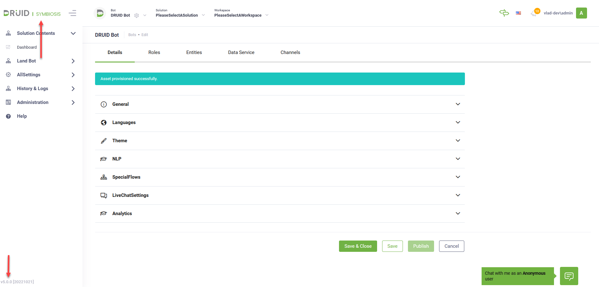

---
layout:
  title:
    visible: false
---

# DRUID 5.0

Deployment Dates

The table below lists the deployment date of DRUID v5.0 across Druid Clouds. To view the Druid Releases Calendar, see [Druid AI Releases](../Druid%20AI%20Releases.md).

| Druid Cloud Community  \*.community.Druidplatform.com | Druid Cloud US  \*.us.Druidplatform.com | Druid Cloud Australia  \*au.Druidplatform.com | Druid Cloud West-Europe (PROD)  \*.Druidplatform.com |
| --- | --- | --- | --- |
| October 27, 2022 | November 24, 2022 | November 24, 2022 | November 24, 2022 |

These release notes give you a brief, high-level description of the improvements implemented to existing features.

If you have questions about your Druid tenant, please contact [support@Druidai.com](mailto:support@druidai.com) or your local Druid partner for more information.

**Required!** This release includes features that require upgrade of your Druid Connector Host to the latest version:

- CNN Excel generator: Map parent and child properties on the same row level
- Bug fix: CNN child mapping

## What's New

- **DRUID Symbiosis and release versioning**. As DRUID has evolved from Conversational AI as a technology stack towards business value driven Conversational Business Applications, to highlight the platform maturity, we rebranded DRUID Oxygen to DRUID Symbiosis and we have changed the release versioning from **1.x** to **5.x**.

- **Adaptive cards and SDL machine translation**. authors can now prevent element properties from being translated by SDL machine translation at runtime. In this regards, a new property is available, **"**<propertyName>**#notranslate"** and when set to **true** will prevent the <propertyName> from being translated.

For more information, see [Adaptive Cards Steps](../../4_Flows/Adaptive%20Cards%20Steps.md).

## Improvements

- **Document Builder**

- Extended the CNN Excel generator to allow the excel template create a table that returns records from a cascaded collection by mapping parent and child fields of the same collection on the same level in the first row of the table.

Example:

- You can now use a set of arguments to customize your Excel template worksheet.

For more information, see [Defining Detailed information](../../7_Integrations/Document%20Builder/Defining%20Detailed%20information.md).

- VoiceText and Alexa channels now provide information about connection timeout. The following message is now logged in Conversation History when a channel timeout occurs (connection is dropped): "[Channel connection timed out]. The voice channel connection timeout threshold was reached. The previous AI Agent message may have also been dropped before reaching the client's conversation."
- **NER**. This release simplifies the NER usage with index entities by eliminating the need of creating an umbrella entity which references the indexed entity and using it on flows (in flow training phrases and in Input mapping on flow steps). Now you can use the indexed entity on flows. For more information, see [Using NER with Index Entities](../../Conversational%20AI/Using%20NER%20with%20Index%20Entities%20%28DRUID%20versions%20prior%20to%205.15%29.md).
- **Use date range in NER with intent recognition** - You can now add date range in training phrases using the following syntax: **[[**Entity**]].**<start date field> **- [[**Entity**]].**<end date field> and the NER Engine will properly extract the date range from user says.
> **NOTE:** When adding training phrases avoid using words that identity a range (e.g., until, between, this year, from today until tomorrow, etc.); otherwise, the NLP Engine will fail extracting the date range.

Example:

The figure below provides an example on how the NLP Engine extracts a date range from user says. NLP identifies range-related words and properly extracts the date range.

For more information, see [Defining the Intent](../../4_Flows/Defining%20the%20Intent.md) or [Using NER with Intent Recognition](../../Conversational%20AI/Using%20NER%20with%20Intent%20Recognition.md).

- **Flow Diagram**. You can now delete nodes in bulk by selecting multiple single nodes (flow steps with no child steps) from the Flow Diagram and pressing **Delete** on the keyboard.
- New AI Agent element available for translation in Translation Tool. You can now use the Translation tool to translate conditions set on flow steps. The statistics of conditions expressions are shown per AI Agent language in column **Link expressions**.

For information on how to translate AI Agent elements, see [Translation Tool](../../2_AI%20Agents/Translation%20Tool.md).

- On integrations, the field **Project Result To Entity Path** has been enhanced to be more user-friendly. Now the response entity is selected by default and its fields of type Entity List are displayed in a drop-down.

- A new webchat parameter is available, **customTimestampFormat** that allows authors to set the desired format of the timestamp shown for each message sent in the chat.

For more information, see [WebChat Common Styling and Behavior (Bot framework v4)](../../Channels/WebChat/WebChat_Common_Styling_and_Behavior_v4.md).

## Bug Fixes

- Machine translation - authoring time: translated flows were sometimes not updated (the AI Agent didn't answer with the new translated message configured by author).
- Choice steps without a message were not rendered in WhatsApp Meta channel.
- Fixed connector child mapping failed. Some of the field specified in the mapping table of a child mapping were not filled sometimes with values from the response task or from the request entity.
- Vision: On RO\_VehicleIdentityCard, the field "8. Masa reala" was missing from JSON response.
