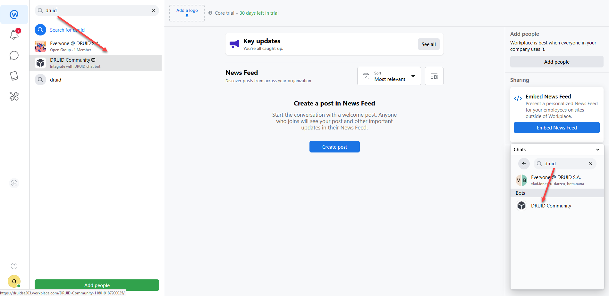

---
layout:
  title:
    visible: false
---

# DRUID 5.10

Deployment Dates

The table below lists the deployment date of DRUID v5.10 across DRUID Clouds. To view the DRUID Releases Calendar, see [Druid AI Releases](../Druid%20AI%20Releases.md).

| Druid Cloud Community  \*.community.Druidplatform.com | Druid Cloud US  \*.us.Druidplatform.com | Druid Cloud Australia  \*au.Druidplatform.com | Druid Cloud West-Europe (PROD)  \*.Druidplatform.com |
| --- | --- | --- | --- |
| March 16, 2023 | April 20, 2023 | April 20, 2023 | April 20, 2023 |

These release notes give you a brief, high-level description of the improvements implemented to existing features.

If you have questions about your DRUID tenant, please contact [support@Druidai.com](mailto:support@druidai.com) or your local DRUID partner for more information.

## What's New

- **Workplace by Meta Channel**. With this release, you can deploy AI Agents on Workplace by Meta enabling users to talk to your chat AI Agent using Workplace.

For information on how to integrate the Workplace channel, see [Workplace Integration](../../Channels/MetaWorkplace/MetaWorkplace%20Integration.md).

- **Freshchat integration**. With this release, you can integrate AI Agents with Freshchat functionality, for cases when chat clients need to be transferred to helpdesk agents who use Freshchat environment instead of the Druid built-in live agent.

For more information, see [Freshchat Integration](../../Live%20Chat/Freshchat%20Integration.md).

- **MultiChat** - **Max number of active sessions**. With this release, you can configure per queue the number of active sessions an agent can handle in parallel. By default, the maximum number of active sessions is **5**. You can set the parameter with a value between **1** and **5**.

> **NOTE:** This setting is available in DRUID version 5.10 and higher.

> **IMPORTANT!** For agent pages installed on your infrastructure, you need to upgrade the agent page to version 5.10 or higher.

- **NLU.NER.SpellingCorrection.SentenceLevel**. You can set new NLP parameter to "true" to perform spelling correction at a sentence level instead of word level, improving the spelling correction when predicting an intent. The parameter default value is "false".

## Improvements

- **Voice AudioCodes Channel** - This release introduces the following improvements to the Voice AudioCodes Channel:

- The **transfer** backchannel step allows the AI Agent to escalate the call to a live (human) agent when it cannot handle the call by itself. On that backchannel step, in the **SetVariables** section, you have to provide the **transferTarget** that is the URI to where the call should be transferred call to. You can further configure the backchannel step so that upon transfer the AI Agent provides additional transfer event parameters and/or SIP headers.
- The **transfer** Backchannel Flow Step allows the AI Agent to escalate the call to a call center agent when it cannot handle the call by itself. On that Backchannel Flow Step, you can provide all required metadata for a client to be transferred to a contact center live agent. You can further configure the Backchannel Flow Step to provide additional transfer event parameters, to be further transmitted by VoiceAI Connect as SIP header information.
- Flexibility when sending events (playUrl, transfer, hangup, etc.) from DRUID to VoiceAI Connect by using DRUID Backchannel Flow Steps to generate any supported VoiceAi Connect event.

In **Input mapping** on the backchannel step, provide the entity that stores activity parameters of that event.

For more information, see [../../Live%20Chat/Freshchat%20Integration.md](../../Live%20Chat/Freshchat%20Integration.md)[Voice Audio Codes Channel](../../Channels/Voice%20Audio%20Codes/Voice%20Audio%20Codes%20Channel.md).

- A new field is available in system entity [[ChatUser]], **[[ChatUser]].BlockFileUpload** that you can set to "true" to block the file upload at conversation level,  by simply manipulating the conversation context, even for a limited duration (e.g., only during live chat session).

Use cases for blocking file upload:

- Block file upload on a specific conversation area.
- Prevent users from sending files during a live chat session. Block file upload when placing the user in a queue and unlock when user goes to user-AI Agent chat.
- Block file upload for specific users based on conversation parameters.

> **IMPORTANT!** If **Hide Upload Button** (hideUploadButton) is set on the AI Agent (BF4 parameters, **Hide Upload Button** is checked), that overwrites the value of **[[ChatUser]].BlockFileUpload**, which means that file upload is not available on the entire AI Agent.

- **NER Parameters - NLU.NER.CrfFlowStepInputMappingAlgorithmImplementation**. For input mapping training phrases defined on a step level DRUID creates a smaller NLP model. If you define a larger number of training phrases on steps, for better results, we recommend settings this parameter to "Crf++".
> **NOTE:** This parameter applies on a AI Agent level, input mapping training phrases on all steps. You cannot set it per step.

## Bug Fixes

- The **Holds multi-language records** option was not working in Adaptive Cards.
- OAuth CNN Actions were not linked automatically in the solution.
- References: elements referred by entities (entities with views and/or forms configured) were loading integrations from other AI Agents.
