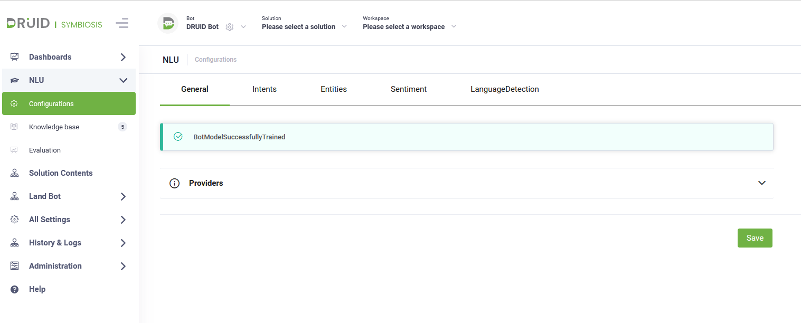

---
layout:
  title:
    visible: false
---

# DRUID 5.15

Deployment Dates

The table below lists the deployment date of DRUID v5.15 across DRUID Clouds. To view the DRUID Releases Calendar, see [Druid AI Releases](../Druid%20AI%20Releases.md).

| Druid Cloud Community  \*.community.Druidplatform.com | Druid Cloud US  \*.us.Druidplatform.com | Druid Cloud Australia  \*au.Druidplatform.com | Druid Cloud West-Europe (PROD)  \*.Druidplatform.com |
| --- | --- | --- | --- |
| May 25, 2023 | June 08, 2023 | June 08, 2023 | June 08, 2023 |

These release notes give you a brief, high-level description of the improvements implemented to existing features.

If you have questions about your DRUID tenant, please contact [support@Druidai.com](mailto:support@druidai.com) or your local DRUID partner for more information.

## What's New

- **NLU Configurations**. To provide authors with a seamless user experience, the NLU configurations have been reorganized.

For more information, see the following sections: [Setting Up the AI Agent Conversational AI](../../Conversational%20AI/Setting%20Up%20the%20Conversational%20AI.md), [Using Lexicon](../../Conversational%20AI/Using%20Lexicon.md) , [Using NER with Intent Recognition](../../Conversational%20AI/Using%20NER%20with%20Intent%20Recognition.md) and Natural Language Understanding.

- **AI Agent settings included in the solution export package**. This release provides authors with increased efficiency when exporting / importing solutions on different AI Agents and accommodating the initial AI Agent settings on the destination AI Agent. Including the AI Agent settings in the solution export package eliminates the additional effort required on the destination AI Agent. To include the AI Agent settings in the solution export package, on the solution details page, click on the **General** section header and tap on **Include AI Agent settings**.

On solution export, the following AI Agent-related settings will be included in the export package:

- Enable Web Socket
- Block File Upload
- Is out of band upload
- Bot framework version
- Authentication expiration minutes
- Additional languages (including machine translation setup, but without credentials)
- Theme and webchat custom parameters
- NLU settings (without credentials to external NLU providers)
- Dialog management (special flows)
- Live Chat configurations (without Queues and Agents)
- Analytics
- Roles

> **IMPORTANT!** Including the AI Agent-related settings in the solution export package is fully secure as it does not contain any credentials. After the solution import on the destination AI Agent, you have to manually enter the credentials if specific AI Agent settings require credentials (e.g. machine translation).

> **NOTE:** Importing the solution package on the destination AI Agent will overwrite that AI Agent settings except for the AI Agent languages. The import will add new languages from solution to the destination AI Agent without removing the existing languages from the destination AI Agent.

- **Twillio SMS channel**. Now you can create AI Agents once and deploy them to Twillio SMS.

For more information, see [Twillio SMS Channel](../../Channels/Twillio/TwilioSMS_Channel.md).

- **Workspace Logs**. With this release, DRUID logs all integration errors from workspaces allowing you to easily troubleshoot them.

For more information, see [Workspace Logs](../../CBA/Workspace%20Logs.md).

## Improvements

- **Druid Data Service - Query Related Entity integration task**. The **Map All Fields** option is now available on the Response tab of the Query Related Entity integration task that allows you to map in the response all entity fields existing on the request entity.

- **Additional error is raised when deleting an entity**. When trying to delete an entity that is referenced by another entity / other entity fields or is used in web views and forms, an error message displays providing detailed information on where the entity is used. Scroll-down the error message to find out more details.

- **Set default landing workspace for business users**. With this release you can choose the workspace a business user will see by default for a specific AI Agent.

For more information, see [Set default landing workspace for business users](../../CBA/Set%20default%20landing%20workspace%20for%20business%20users.md).

## Bug Fixes

- NER for INVARIANT\_DATE - the value extracted in conversation was one day before.
- On the DownloadFileWithRestRequest integration with Child Mapping, the Request Entity disappeared.
