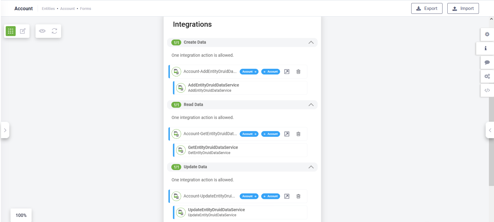

---
layout:
  title:
    visible: false
---

# DRUID 5.24

Deployment Dates

The table below lists the deployment date of DRUID v5.24 across DRUID Clouds. To view the DRUID Releases Calendar, see [Druid AI Releases](../Druid%20AI%20Releases.md).

| Druid Cloud Community  \*.community.Druidplatform.com | Druid Cloud US  \*.us.Druidplatform.com | Druid Cloud Australia  \*au.Druidplatform.com | Druid Cloud West-Europe (PROD)  \*.Druidplatform.com |
| --- | --- | --- | --- |
| September 28, 2023 | October 26, 2023 | October 26, 2023 | October 26, 2023 |

These release notes give you a brief, high-level description of the improvements implemented to existing features.

If you have questions about your DRUID tenant, please contact [support@Druidai.com](mailto:support@druidai.com) or your local DRUID partner for more information.

## What's New

- **CRUD Template**. DRUID introduces the CRUD Template feature to provide you with an enhanced authoring experience for consuming data from the DRUID Data Services in conversational business applications. The CRUD Template available on entity integrations allows you to create a web view and a form with minimum configuration:

- They come pre-configured with the mandatory integrations (DRUID Data Services integrations).

- They come pre-configured with the “Name” field.

For more information, see [The CRUD Template](../../CBA/Entity%20Data%20Integration.md).

## Improvements

- **Password management policy change for Druid Portal Users**.With this release, you can set the password management policy to comply with your organization security requirements (**Administration** menu > **Settings**, **User management** tab):

- Prevent the user's new password from being the same as any of the last x passwords. The default value is **5**.
- Set the password to expire after a specific number of days. The default value is **90 days**.

- **LiveChat automatic client allocation**. To ensure that all your helpdesk agents get a fair amount of work, if no agent is free, DRUID allocates the client to an agent who has not reach out the concurrent chat limit following these new criteria:

- Allocate client to the agent who has the least number of connected clients.
- Allocate client to an agent based on the time of the last connection with a client in ascending order.

- **DRUID Data Service tasks with filter for null**. On the Query Entity and Query Related Entity integration tasks you can now filter fields of type entity that are null / not null by using the **exists** / **not exists** operators. Use these two operators to validate whether a field of type entity is instanced or not within the actual entity object.

For example: [[Account[[.Contact.Id **not exists** means that [[Account]].Contact has not been instanced (the property Contacts does not exist in the actual [[Account]] entity object.

- **NLP Special Parameters**. The parameter **NLU.NER.Classification.UseSVO** is now obsolete.

## Bug Fixes

- **Code Extension editor on flow steps**. Saving the code changes and closing the Code Extension editor now saves the code changes.
- The **date picker** is now properly displayed when accessed from the right-side editor; it no longer goes outside the screen.

- **Knowledge base**. When crawling websites, non-existent links are excluded from the crawl.
- **Knowledge base timeout**. When accessing a Knowledge base with many data sources or deleting all data sources from a knowledge base, DRUID no longer throws a timeout error.
- **Evaluation tool**. You can now delete phrases from the Test Set; phrases are no longer multiplied on delete.
