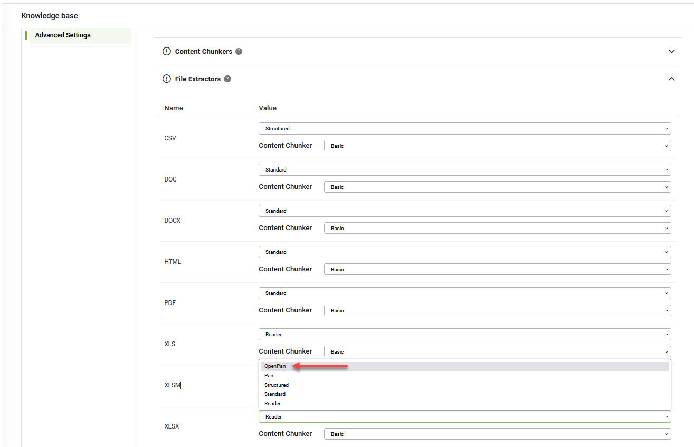

# DRUID 8.15

Deployment Dates

The table below lists the deployment date of DRUID v8.15 across DRUID Clouds. To view the DRUID Releases Calendar, see [Druid AI Releases](<../Druid AI Releases.md>).

| Druid Cloud Community \*.community.Druidplatform.com | Druid Cloud US \*.us.Druidplatform.com | Druid Cloud Australia \*au.Druidplatform.com | Druid Cloud West-Europe (PROD) \*.Druidplatform.com |
| ---------------------------------------------------- | -------------------------------------- | -------------------------------------------- | --------------------------------------------------- |
| April 24, 2025                                       | May 8, 2025                            | May 8, 2025                                  | May 8, 2025                                         |

These release notes give you a brief, high-level description of the improvements implemented to existing features.

If you have questions about your DRUID tenant, please contact [support@Druidai.com](mailto:support@druidai.com) or your local DRUID partner for more information.

**Recommended!** This release includes features that require upgrade of your DRUID Connector Host and DRUID Data Service:

* REST Integrations – DRUID Services app for simplified setup
* \[\[PageInfo]] – New SelectedFields field

### What's New

* **Flows - Proactive AI Agent messages for long-running integrations**. You can now configure localized proactive messages at the flow-step level to keep users engaged during long-running integrations. If a step takes longer than expected, the AI Agent will send messages based on the trigger intervals you define.
* If one message is set, it will be sent only once after the specified time interval (e.g., after 3 seconds).
* If multiple messages are set, each one will be sent once at its configured time (e.g., message 1 after 2 seconds, message 2 after 5 seconds).

This feature supports both pre-actions and post-actions.

For more information, see [Proactive AI Agent Messages](<../../4_Flows/Proactive AI Agent messages.md>).

*   **REST Integrations – DRUID Services app for simplified setup**. This release introduces support for DRUID Services apps, which streamline the setup of REST integrations using DRUID-specific resources such as DRUID LLM and DRUID Vision. Instead of manually entering the Base URL and token for each resource, you can now use predefined variables pulled from your tenant’s Druid Services settings.

    

    

    For more information, see [Druid Services](../../7_Integrations/DruidServices.md).
* **Knowledge Base – A faster extractor for XLSX and XLSM files**. A new file extractor, OpenPan, is now available for .xlsx and .xlsm files, offering significantly reduced data extraction times, especially for large spreadsheets.

* **Workspace – PDF viewer support in forms**. Forms now support in-app PDF preview using the **Preview in form (image/video)** option on \[\[File]]-type fields. When this option is enabled and a PDF is uploaded, the file is displayed directly in the form using a built-in PDF viewer with full functionality — zoom, text search, maximize, print and more.

### Improvements

*   **Knowledge Base – Retrain option for KB and data sources**. This release adds a Retrain option at both the Knowledge Base and data source levels.

    * When updating general KB settings — such as the embeddings model, embeddings provider, or the Search inside answers option—you can now retrain the entire KB by clicking **Retrain**. Unlike the **Train** button, which only processes data sources that require training, **Retrain** retrains all already-trained data sources and trains once any that require training.

    

    * At the data source level, you can now retrain a data source after modifying its Trainable Elements. This is especially useful since changes to Trainable Elements in the Advanced Settings don’t automatically update the training status. You also have the option to Retrain all data sources directly from the data source.

    
* **Knowledge Base – UI support for LLM rerankers**. You can now configure LLM rerankers directly from the KB Advanced Settings > Score Calculator section in the UI. This update removes the need to manually edit the Advanced Settings JSON file, making it easier for authors to add and manage rerankers.

For more information, see [Score Calculator](<../../Knowledgebase/KB Settings/Score Calculator.md>).

* **\[\[PageInfo]] – New SelectedFields field**. A new field, SelectedFields, is now available in the \[\[PageInfo]] system entity. It captures only the columns visible in the table views, helping reduce payload size and improve performance in DRUID Data Service query entity integrations — only when using the **Map all** fields option.

This list of columns is also accessible in SQL integrations via the \[\[]].PageInfo.SelectedFields array.


**NOTE:** This feature requires DRUID Connector Host and DRUID Data Service version 8.15 for hybrid and on-premise deployments.


* **Debug messages – Improved visibility**. To help authors easily identify debug messages added to flow steps, two key improvements have been made:
* In the **Conversation History** > **Conversation Trace** tool, debug messages are now marked with a dedicated icon.

* In the flow **Debugging** tool, you can now highlight all debug messages, and each message is also marked with a specific icon for quick recognition.

* **SSO Authentication – Improved Sign-In.** The OAuth 2.0 Sign In flow step has been enhanced to improve the user authentication experience:
* Authors can now block user input, preventing users from typing in the chat instead of clicking the **Sign In** button.
* The step is now rendered as a hero card, where users can click **Sign In** to open the authentication page in a new browser tab.
* This update is backwards compatible. Existing **OAuth 2.0 Sign In** that display the sign-in link (\[\[ChatUser]].OauthAccessURL) directly in the message will continue to work as expected.

For more information, see [Authenticating user within the conversation using OAuth v2](<../../7_Integrations/OAuth2/Authenticating user within.md>).

### Bug Fixes

**Agent Assist – Voice call termination flow triggered on conversation end**. Fixed an issue where the VoiceCallTerminateFlowId was not executed when an assist conversation ended. The termination flow now runs correctly at the end of the session.
