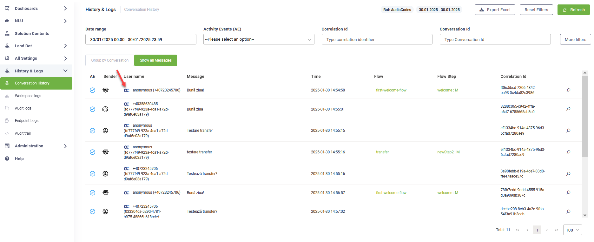
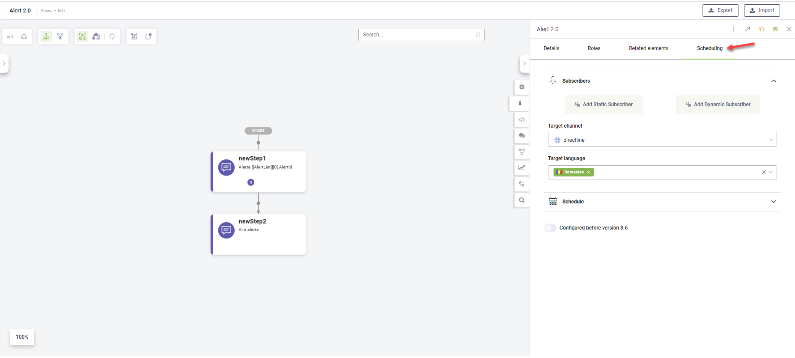
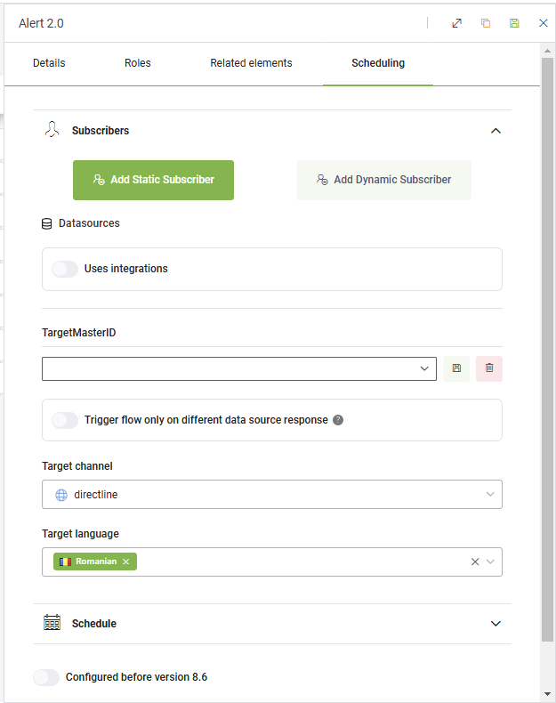
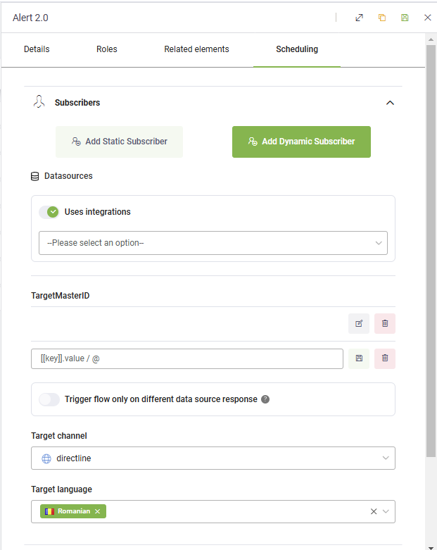

# DRUID 8.9

Deployment Dates

The table below lists the deployment date of DRUID v8.9 across DRUID Clouds. To view the DRUID Releases Calendar, see [Druid AI Releases](<../Druid AI Releases.md>).

| Druid Cloud Community \*.community.Druidplatform.com | Druid Cloud US \*.us.Druidplatform.com | Druid Cloud Australia \*au.Druidplatform.com | Druid Cloud West-Europe (PROD) \*.Druidplatform.com |
| ---------------------------------------------------- | -------------------------------------- | -------------------------------------------- | --------------------------------------------------- |
| January 30, 2025                                     | February 13, 2025                      | February 13, 2025                            | February 13, 2025                                   |

These release notes give you a brief, high-level description of the improvements implemented to existing features.

If you have questions about your DRUID tenant, please contact [support@Druidai.com](mailto:support@druidai.com) or your local DRUID partner for more information.

**Recommended!** This release includes features that require upgrade of your DRUID Connector Host:

* DRUID Data Service Connector – New Operators in custom queries

### What's New

* **AudioCodes channel - added support for Agent Assist AI Agents**. With this release, you can now view conversations between AudioCodes helpdesk agents and users directly in the Conversation History.

To enable this feature, set up Agent Assist. For more information, see [Voice Audio Codes Channel](<../../Channels/Voice Audio Codes/Voice Audio Codes Channel.md>).

* **Zendesk Channel and Contact Center**. This release introduces the ability to deploy AI Agents across multiple Zendesk Sunshine-supported channels, providing enhanced flexibility and expanded communication options. For more details, see [Zendesk Sunshine](../../Channels/Sunshine/Sunshine_Channel.md).

Additionally, you can now use Zendesk as a live chat provider. For further information, see [Zendesk Live Chat](<../../Live Chat/Zendesk Contact Center.md>).

### Improvements

* **Alert Flows - UI improvements and logging**. This release introduces two improvements to Alert Flows:
* Alert messages are now logged as different Activity Events in the Conversation history.

* **Alerts Flows authoring improvements** - This release introduces an enhanced UI for a smoother and more seamless alerts authoring experience.

For more information, see [Alert Flows](<../../4_Flows/Alert Flows.md>).

* **RingCentral channel – Close Interventions.** A new system entity field, **\[\[ChatUser]].RingCentralInterventionId**, is now available. This field stores the intervention ID from RingCentral, enabling you to track agent engagements within a thread. You can use this field in authoring flows in conjunction with the RingCentral bot complete event (via REST integration) to automatically close an intervention once the conversation is resolved.
* **NLU Configurations – Cancel entity index training**. You now have the option to cancel entity index training in your NLU configurations. This provides greater control over the training process and allows you to stop training if necessary.

* **DRUID Data Service Connector – New Operators in custom queries**. This release introduces the `UNION`, `UNION ALL`, `INTERSECT`, and `EXCEPT` operators in custom queries. You can now use these operators to filter request data for Query entities and Query-related entity integration tasks, enabling more flexible and powerful data manipulation. For more information, see [Filter Data using DRUID Custom Query](<../../7_Integrations/Druid Data Service Connector/Filter using DRUID custom query.md>).
* **KB – improvements**. This release introduces new improvements to website data sources:
* **Website data sources UI**. The Website Data Sources UI now provides improved tooltips for website pages. The tooltip now displays both the page name and its URL on separate lines. This enhancement helps users differentiate between pages with the same name and makes it easier to decide whether to exclude a page after crawling.

* **Data extraction from structured JSON files**. Data extraction from structured JSON files is now supported for unstructured and Custom data sources. This allows users to integrate content from third-party systems (e.g., Salesforce, Confluence) into the Knowledge Base. For more information, see [File Extractors](<../../Knowledgebase/KB Settings/File Extractors.md>), JSON.
* **AI Agent Summary – Export dashboard pages to PDF**. You can now export the current page of the AI Agent Summary Dashboard as a PDF. To export, simply navigate to the desired dashboard page and click the **Export to PDF** icon at the top-right corner. This feature is especially useful for incorporating AI Agent KPIs, performance metrics, and usage statistics into regular reports.

* **SQL Apps – Field renaming for clarity**. Three fields in the SQL App configuration page have been renamed to improve clarity, helping users better understand the required details they need to provide.

* **Workspaces – Auto-Refresh for views**. You can now enable data auto-refresh for certain web views that receive data from external sources. This ensures real-time updates without requiring a manual refresh. Available refresh intervals:
* 15 seconds
* 30 seconds
* 1 minute
* 5 minutes

* **DRUID Vision - new endpoints for structured electronic invoices**. DRUID Vision now includes three new endpoints: **read-zugferd-xml**, **generate-zugferd-xml**, and **generate-xrechnung-xml**. These endpoints enable you to process and generate structured electronic invoices in compliance with the ZUGFeRD and XRechnung standards. With [read-zugferd-xml](<../../Druid AI Services/Read ZUGFeRD XML.md>), you can extract invoice data from ZUGFeRD-compliant XML files, while [generate-zugferd-xml](<../../Druid AI Services/Generate ZUGFeRD XML.md>) allows you to create invoices in the ZUGFeRD format. The [generate-xrechnung-xml](<../../Druid AI Services/Generate XRechnung XML.md>) endpoint lets you generate XRechnung-compliant invoices, ensuring seamless compatibility with European e-invoicing regulations.

### Bug Fixes 

* **Extracting multiple website pages**. A bug has been fixed where selecting multiple website pages to extract would result in no pages being extracted, as all pages had already been processed. Now, when extracting multiple pages, a pop-up will appear, giving you the option to choose whether to extract all pages or only the unprocessed pages.
* **Solution Import** – Fixed an issue that occurred during solution import, displaying the error: "_Could not identify the new primary key for the object: of type: Flow_". To resolve this, reference names associated with IDs are now included during solution export.
