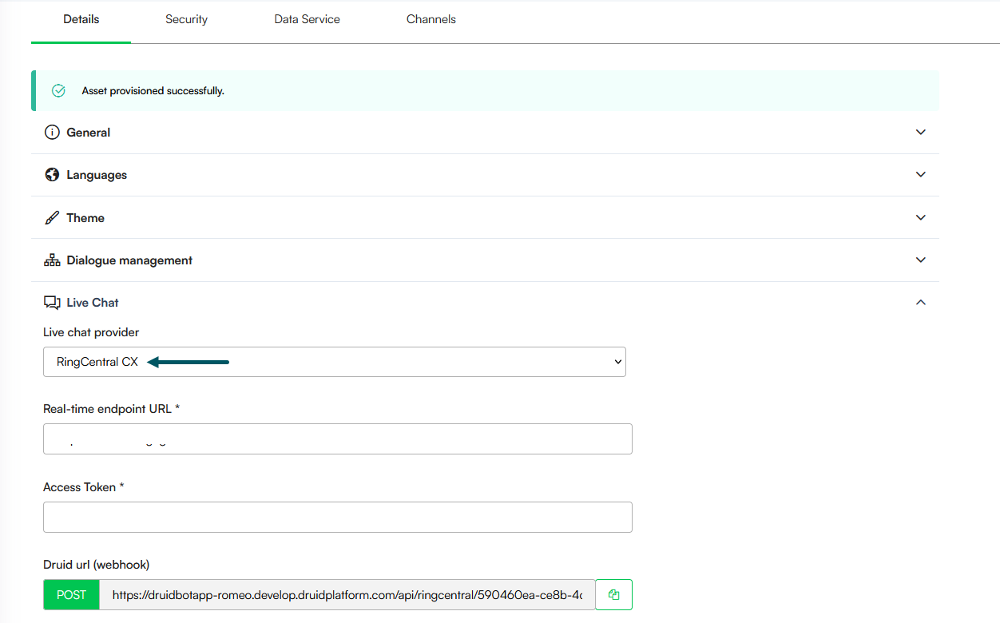

# Druid 9.15

Deployment Dates

The table below lists the deployment date of DRUID v9.15 across DRUID Clouds. To view the DRUID Releases Calendar, see [Druid Releases](<../Druid AI Releases.md>).

| Druid Cloud Community \*.community.Druidplatform.com | Druid Cloud US \*.us.Druidplatform.com | Druid Cloud Australia \*au.Druidplatform.com | Druid Cloud West-Europe (PROD) \*.Druidplatform.com |
| ---------------------------------------------------- | -------------------------------------- | -------------------------------------------- | --------------------------------------------------- |
| January 29, 2025                                     | February 12, 2026                      | February 12, 2026                            | February 12, 2026                                   |

These release notes give you a brief, high-level description of the improvements implemented to existing features.

If you have questions about your Druid tenant, please contact [support@Druidai.com](mailto:support@druidai.com) or your local Druid partner for more information.

**Recommended!** This release includes features that require upgrade of your Druid Connector Host:

* Web Views and Forms: Native File Access (Hybrid & On-Premise)

### What's New

* **WebChat Channel- ElevenLabs Speech provider**. Druid now supports ElevenLabs as a Text-to-Speech (TTS) provider for the Webchat channel. This integration allows you to leverage ElevenLabs' library of synthetic voices and custom voice clones to create more natural and engaging voice interactions within your web-based conversational AI Agents. For more information, see .
* **New Live Chat Provider - RingCentral CX**. Druid now integrates with RingCentral CX, enabling AI Agents to hand off conversations to live agents with full chat history included.

For more information, see [RingCentral CX](<../../Live Chat/RingCentral CX.md>).

### Improvements

* **AI Agent Interaction with Web Forms**. AI Agents can now interact with web forms in real time using backchannel events. When chat is enabled on a form, the AI Agent can update and save form data, load different records, and refresh the form during a conversation. For more information, see [AI Agent Interaction With Web Forms](<../../CBA/AI Agent Interaction With Web Forms.md>).
* **Web Views and Forms: Native File Access (Hybrid & On-Premise)**. We have optimized file access on web views and forms for Druid Connector hybrid and on-premise deployments. This update allows the AI Agent to serve files directly from local infrastructure, removing the requirement for external cloud storage (like Azure Blob Storage) to download/preview documents in web views and forms:
* **Automated ConnectorPath Mapping**: When the AI Agent executes "Read file" or "Save file" integration tasks to a local disk and subsequently stores that data in the Data Service, the system automatically populates the **ConnectorPath** field.
* **Dynamic Internal Links**: Once the record is in the Data Service, Druid uses the **ConnectorPath** to generate secure, internal download and preview links. These are served via the internal backend, making them instantly accessible in web views and forms.
* **Storage Independence**: This enables a self-contained file lifecycle within the client's own network, provided the file metadata is registered in the Data Service.
* **Knowledge Base- Enhanced Citations**. We have introduced a more flexible way for AI Agent authors to manage source references. You can now use "friendly" names instead of technical URLs or file paths to build user trust and keep the conversation professional. Key highlights:
* A new field, **\[\[KBQnA]].UrlName** that captures a human-readable title (e.g., the Website Page Name or the File Name) for every Knowledge Base record. At runtime the value is set in **\[Intent]].KbQnAItems\[i].UrlName**.
* Authors can use this field to provide clean citations, such as "Source: 2026 Benefits Guide" instead of a long web link.
* KPI charts and analytics now display these friendly names, making it easier to identify which documents or pages are most useful.
* **Flow Steps - Enhanced Visual Indicators**. We have improved the flow step UI to provide authors with immediate visibility into the configuration and logic of their conversation flows. Each step now features a set of intuitive icons that highlight active settings and integrations, reducing the need to click into each step to verify configurations.

* **Flow Diagram Interaction Improvements**. We have refined how the Flow Diagram handles selection and visibility to ensure a more predictable user experience when managing flow logic:
* **Persistent View**: When viewing the flow logic within a Trigger flow step, expanding or selecting steps no longer triggers an automatic minimization of the referred diagram. This allows uninterrupted navigation and deeper inspection of nested diagram details.
* **Selection Reset**: To ensure a clean workspace, the step selection is now automatically cleared if the referred diagram is manually minimized. Re-expanding the diagram will present a fresh state rather than a previous selection.

### Bug Fixes

* **Language-Specific Metadata Gaps During Import Fix**: We have improved the metadata saving process at authoring time to ensure all configuration data is captured across the multilanguage context, regardless of which language is set as the default. This ensures a consistent and accurate flow logic transfer across environments with different default language settings. Specifically, exception handler settings and agentic step configurations are now properly imported between environments, even when the source and destination utilize a language swap (for example, moving a flow from a tenant with English default/Romanian secondary to one with Romanian default/English secondary).
* **Multi-language Media Transcript Fix**. We have resolved an issue where media transcript extraction failed for languages other than US English. The KB agent now correctly formats language codes to meet the requirements of the transcription service. This fix eliminates "Bad Request" errors and ensures consistent speech-to-text performance across all supported languages.
* **Agentic AI Flow Fix**. Resolved an issue where Agentic AI flow execution would fail if a function name in the Instructions step did not contain an underscore.
* **Agent AI Step Fix**. Fixed a bug in the Agent AI Step where deleting a function parameter failed to remove it from the "required" collection, ensuring accurate schema validation.
