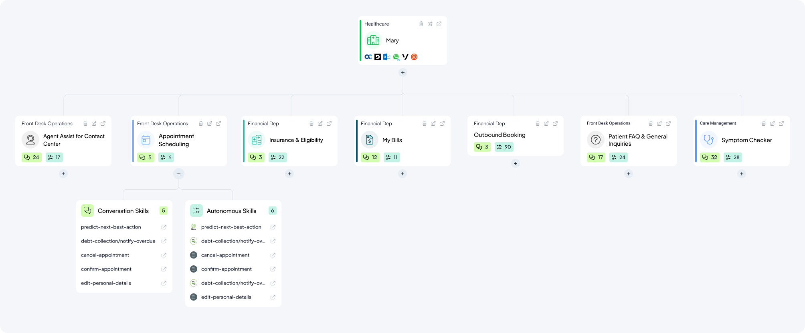

---
layout:
  title:
    visible: false
---

# Druid 9.17

Deployment Dates

The table below lists the deployment date of Druid v9.17 across Druid Clouds. To view the DRUID Releases Calendar, see [Druid Releases](../Druid%20AI%20Releases.md).

| Druid Cloud Community  \*.community.Druidplatform.com | Druid Cloud US  \*.us.Druidplatform.com | Druid Cloud Australia  \*au.Druidplatform.com | Druid Cloud West-Europe (PROD)  \*.Druidplatform.com |
| --- | --- | --- | --- |
| February 26, 2026 | March 12, 2026 | March 12, 2026 | March 12, 2026 |

These release notes give you a brief, high-level description of the improvements implemented to existing features.

If you have questions about your Druid tenant, please contact [support@Druidai.com](mailto:support@druidai.com) or your local Druid partner for more information.

**Recommended!** This release includes features that require upgrade of your Druid Connector Host:

- Druid Data Service Connector - integration improvements
- Druid Webhook - Flexible Response Handling
- Custom Code - Set() object support

## What's New

### The Terminology Shift to AI Agents

At Druid, we are constantly pushing the boundaries of what conversational AI can achieve. To better reflect the advanced reasoning, autonomy, and integration capabilities of our platform, we are officially transitioning our terminology — from AI Agents to AI Agents, and from Druid Conductor to Druid Conductor.

#### Why the Change?

Druid AI Agents don't just respond to user inputs. They reason, retrieve knowledge, execute multi-step workflows, and operate autonomously — all within the governance and security framework your enterprise requires. Two types of AI Agents are now formally recognized on the platform:

- **Conversational AI Agents** — Engage users in natural dialogue, execute complex workflows (from IT requests to CRM updates), and enforce policy guardrails at every step.
- **Autonomous AI Agents** — Digital workers that plan and act independently, trigger on events, and perform actions in external systems — no user interaction required.

Druid Conductor is the intelligent multi-AI Agent orchestration layer that serves as the single, primary interface users always talk to. It works silently behind the scenes: routing requests to the right specialized AI Agent, preserving full context across every AI Agent interaction— delivering seamless experiences even in the most complex deployments.

This terminology shift aligns our language with the true power of the Druid AI Platform.

#### What to Expect

- **Interface update**. The AI Agent is now live across the Druid Portal.
- **Documentation in progress**. We are actively updating the Druid Help. You may still encounter references to "AI Agents" or "AI Agents" in some topics as we finalize the documentation. Thank you for your patience as we finalize these resources.
- **No disruption to your work**. This is a terminology update that reflects the platform current capabilities — your existing configurations and workflows remain fully intact.

## Improvements

- **Webchat - Multiple file upload support**. While in the previous release multiple file upload via drag-and-drop was introduced in the web chat, with this release, users can upload multiple files by using the **Upload** icon and selecting multiple files. To enable this feature, authors must configure the File Upload steps by entering in Input Mapping an entity list field that references the [[File]] entity.

- **Custom Dashboards improvements**. This release introduces two improvements:

- **Export to PDF Capability**. To facilitate reporting and management updates, you can now export your custom dashboards to PDF. Whether you need a snapshot of your current tab or a comprehensive report of all dashboard tabs, this new feature generates a formatted PDF with one page per tab. This feature is useful for business users who need to provide regular, professional-grade analytics reports to higher management.

- **Seamless Time Filtering for Dynamic Chart Drill-downs**. This release enhances the data analysis experience by ensuring that drill-down views in dynamic charts automatically display records within the time interval selected on the dashboard — provided the **Filter By** field is set on the chart. Previously, drill-down views displayed all records and required additional integrations or custom filtering to match the dashboard view. Now, simply configuring the **Filter By** field on a dynamic chart is enough to align drill-down results with the dashboard time interval, delivering faster, more relevant insights with no extra configuration required.
> **NOTE:** This improvement applies exclusively to dynamic charts. For non-dynamic charts, you must still manually update the chart Advanced Editor or Custom Code to apply drill-down view grouping, filtering, or time interval synchronization.

- **Knowledge Base improvements**. This release introduces various improvements:

- **Website Data Sources - Web Crawler Support for .php Pages**. The web crawler now indexes .php pages when crawling website data sources. Previously, pages with .php extensions (including legacy or dynamically generated pages) were skipped, leaving gaps in the knowledge base. Now, website data sources are more complete, allowing the AI Agent to draw from the full content of a site and deliver more accurate, comprehensive answers — with no extra configuration needed.

- **Website Data Sources - Custom Pattern Link Exclusion**. Gain greater control over your website crawling results and reduce irrelevant data. Starting with this release, you can specify external link patterns to ignore directly in the UI at the data source level — eliminating the need to configure this manually via the Knowledge Base Advanced Settings JSON. To save time, common social media domains and phone numbers are now automatically excluded. This prevents these links from appearing in the identified external links list, ensuring your data remains clean and focused on relevant content.

- **File Repository Data Sources - Replace Files Without Losing Metadata**. Previously, replacing a file in the File Repository required deleting it and re-uploading it. Deleting a file also removed its metadata, which meant you had to manually re-enter it. This increased effort and the risk of errors.

With this release, you can replace a file by uploading a new version using the same file name. The system automatically updates the file and preserves all associated metadata, including the KBWebsitePageId.

- **File Repository Data Sources - Delete Selected Files**. A new **Delete Selected** button now appears in the File Repository data sources when multiple files are selected in the tree explorer, replacing the standard **Delete** button. This makes it easier to identify and perform bulk deletions without ambiguity.

- **Druid Webhook - Flexible Response Handling**. The external Webhook integration now supports more flexible response content type handling, improving compatibility with modern APIs and external services:
  - The default response content type has been updated from `text/plain` to `application/json`.
  - A new optional query parameter, **responseContentType**, is now available on the **/GenericIntegration** and **/GetGenericIntegrationResponse** endpoints. Use it to specify the expected response format directly in your request, without any additional configuration.

These changes ensure broader compatibility with external services and reduce the need for custom workarounds when integrating with APIs that return non-standard content types.  For more information, see [External Webhook Call Handling in Druid](../../Webhooks/Exchanging%20Data%20with%20External%20Systems.md).

- **Druid Data Service Connector - integration improvements**. This release introduces improvements to the Update entity and Upsert integrations:
  - **Update Entity — Fallback to Upsert Mode**. The Update Entity integration task now includes a **Use Upsert mode** option for updates performed on given records. When enabled, each record in the request payload is individually checked against the database: if the record exists, it is updated; if it does not, it is inserted.
  - **Upsert Entity — Single Record Support**. The Upsert Entity integration task now supports upsert at the single record level, in addition to the existing batch method. When no **Batch execution entity list** is selected, Druid checks the database against the individual records in the request entity using the defined common key (Common entity field), updating existing records or inserting new ones as needed.
- **Custom Code and Code Extension - Set() object support**. We’ve introduced support for the `Set()` object in Custom Code and Code Extension. This allows developers and authors to easily create new data sets and remove duplicate data, ensuring your Flow Variables and entity collections are clean and free of redundant entries.
  For more information, see [Set Object](../../7_Integrations/Custom%20Code.md#Set) (Custom Code) and [Set Object](../../4_Flows/Code%20Extension.md#Set) (Code Extension).
- **Workspaces - Minimize Form During Automation**. You can now minimize active forms while an automation is running in the chat. By clicking the new **Minimize form** icon, the form stays active but minimizes, allowing you to view live updates and data in the background view without interrupting the process. This is particularly useful for long-running automations where business users need to monitor background changes or verify information in the workspace while the AI Agent completes its task.

- **Outlook Channel – Conversation Management Enhancement**. Added a new configuration option to control how email threads are handled. A **Treat emails as separate conversations** toggle is now available in the Outlook channel settings. When enabled, each incoming email is processed as a new conversation, even if it belongs to an existing thread. This is useful for service desk scenarios where every email must be handled as an independent request or ticket.

## Bug Fixes

- **Zendesk Live Chat - File transfer failure**. When a helpdesk agent attempted to send a file to an end user during a Zendesk Live Chat session, the end user received an error instead of the file. Files are now successfully sent to the user.
- **Live Chat - Inactivity flow triggered during paused chat**. When a helpdesk agent paused an active live chat session, the Inactivity flow was incorrectly triggered, ignoring both the paused state and the configured inactivity threshold. The Inactivity flow is now correctly suppressed while a chat session is paused.
- **Live Chat - New line break in sent messages issue (Single Chat & Multi Chat)**. When a user or agent composed a message containing line breaks (via Shift+Enter), each line break was duplicated upon sending, causing messages to display with extra blank lines. Messages containing line breaks now render correctly in both the single chat snippet and the multi chat agent interface.
- **File Upload - Re-uploading the same file in a loop has no effect**. In flows configured with a loop returning to a file upload step, attempting to re-upload the same file had no effect — no error message was shown, no warning was displayed, and no backend call was triggered. The user was silently left on the upload step. Users are now shown a message when attempting to re-upload a previously submitted file.
- **Connector Audit Log - Request task URL missing**. After executing an integration, the corresponding entry in the Connector Audit Log was missing the Request Task URL. The URL is now correctly recorded and displayed in the audit log for all executed integrations.
- **Knowledge Base – Excel file extraction returns empty content with the Standard extractor**. When extracting content from Excel files using the Standard (OpenPan) file extractor, no content was extracted and all rows except the first were cleared in the logs. Excel file extraction now works correctly with the Standard file extractor regardless of whether LLM content chunker is enabled.
- **Druid Vision – DateOfBirth validation not skipped for new Identity Card document validation**. When DateOfBirth was included in the **skipValidations** parameter of the New Identity Card Document Validation endpoint, the validation was still executed and returned in the response, causing the document to be incorrectly marked as InvalidDocument. This was inconsistent with the behavior of the legacy identity card endpoint, where DateOfBirth is correctly skipped when specified. The DateOfBirth validation is now properly skipped for New Identity Card validation when included in skipValidations, and the document status is returned correctly.
- **LLM Translator – System messages displayed in agent's language instead of client's**. System messages generated during agent connection and client transfers were displayed in the agent's language rather than the client's. All system messages triggered during these events are now correctly displayed in the client's language.
- **Viber Proactive Messaging**. Resolved a bug in the Viber Channel where proactive messages were not sent during long-running integration steps. Proactive messages now correctly trigger across all communication channels while integrations are processing.
