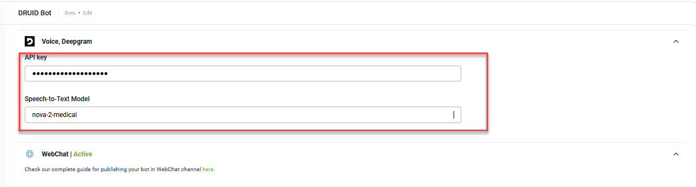

# Druid 9.6

Deployment Dates

The table below lists the deployment date of DRUID v9.6 across DRUID Clouds. To view the DRUID Releases Calendar, see [Druid Releases](<../Druid AI Releases.md>).

| Druid Cloud Community \*.community.Druidplatform.com | Druid Cloud US \*.us.Druidplatform.com | Druid Cloud Australia \*au.Druidplatform.com | Druid Cloud West-Europe (PROD) \*.Druidplatform.com |
| ---------------------------------------------------- | -------------------------------------- | -------------------------------------------- | --------------------------------------------------- |
| September 25, 2025                                   | October 23, 2025                       | October 23, 2025                             | October 23, 2025                                    |

These release notes give you a brief, high-level description of the improvements implemented to existing features.

If you have questions about your DRUID tenant, please contact [support@Druidai.com](mailto:support@druidai.com) or your local DRUID partner for more information.

### What's New

* **Infobip channel**. The Infobip channel is now available, enabling you to deploy AI Agents on WhatsApp and deliver conversational experiences through Infobip.


For more information, see the [Infobip channel](../../Channels/Infobip.md).

* **Knowledge Base - Email files supported in unstructured data sources**. You can now extract data from email MIME-type files in unstructured data sources. The KB engine processes each .eml file as a dedicated folder that contains the email body, attachments, and other elements. These files appear in the data source tree with an email icon for easy identification.


The email files are also supported in the [KB at conversation time](../../Knowledgebase/KBConversationTime.md) and in the [KB Extraction Tools](../../Knowledgebase/KBExtractionTools.md).

### Improvements

* **Knowledge Base**. This release introduces several improvements:
* **Data source extraction status** – When extracting a data source, you can now track the extraction progress as a percentage.


* **Content chunker LLM instructions** – The default instructions for LLM content chunkers have been updated to ensure that, when using the gpt-4.0-mini model, article titles are always extracted in the same language as the source document. Updates to #1. General Rules for Chapters include:

```
- Detect the main language of the document once at the beginning.
- All chapter titles MUST be written strictly in the same language as the document text.
- Do not translate, do not switch languages, and do not mix languages in chapter titles.
- If the document is entirely in English, every chapter title must also be in English.
- If the document is entirely in another language, every chapter title must also be in that same language.
- You are strictly forbidden to generate titles in a language different from the text.
```


If you are using a custom LLM prompt for content chunking, you can add these rules manually. You can apply the new default LLM prompt by clicking the **Reset Advanced Settings** button; however, this will remove any custom changes.

* **Machine translation**. Proactive AI Agent messages are now translated when machine translation is enabled. For more information about these messages, see [Proactive AI Agent Messages](<../../4_Flows/Proactive AI Agent messages.md>).
* **Sprinklr integration**. Users are now connected directly to a helpdesk agent without being placed in a waiting queue, improving the live chat experience.
* **Voice channel**. The Deepgram speech settings have been refactored for easier configuration and improved model selection. For more information, see the Voice channel.

_New settings_


_Old settings_



* **Portal User Management**: Druid Portal admins can now inactivate users more easily, either individually from the **Action** menu or in bulk.

.png>)


* **Conversation History**. The user experience has been improved:
* Applied filters now appear below the filter section.


* Clear filters is next to the applied filters.


* **Next** and **Previous** buttons added in conversation transcripts for easier navigation.


* **DRUID Vision – MRZ OCR**. The DRUID API performs OCR and data extraction from documents with a Machine Readable Zone (MRZ), including Romanian ID cards (old and new), living permits, passports, and residence cards. Extracted MRZ data is available in the response’s Data section.

### Bug Fixes

* **Flow analytics**: Metadata is now correctly transported during export/import.
* **Live Chat wait event**: The LiveChatWaitForAvailableAgent event is correctly triggered when a client responds before the waiting queue message appears. Clients are no longer automatically disconnected from the queue.
* **Telegram AI Agent messages**: Markdown-formatted messages with special characters (e.g., !, @, $, \*, \_) now render correctly in Telegram chats. Messages previously failing to display will now appear as expected, consistent with DRUID Conversation History.
* **File upload in Idle flow**: The special flow **File upload in Idle flow** now triggers correctly when a file is uploaded in idle mode.
* **Live Chat UI**: Minimized Agent burger menu no longer breaks when agents send long messages.
* **Data Source Upsert**: Upsert now correctly handle multiple primary key columns (e.g., ConversationId + ActivityId) without errors.
