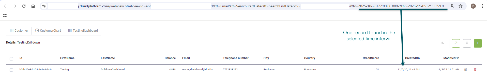

# Druid 9.9

Deployment Dates

The table below lists the deployment date of DRUID v9.9 across DRUID Clouds. To view the DRUID Releases Calendar, see [Druid Releases](<../Druid AI Releases.md>).

| Druid Cloud Community \*.community.Druidplatform.com | Druid Cloud US \*.us.Druidplatform.com | Druid Cloud Australia \*au.Druidplatform.com | Druid Cloud West-Europe (PROD) \*.Druidplatform.com |
| ---------------------------------------------------- | -------------------------------------- | -------------------------------------------- | --------------------------------------------------- |
| November 07, 2025                                    | November 20, 2025                      | November 20, 2025                            | November 20, 2025                                   |

These release notes give you a brief, high-level description of the improvements implemented to existing features.

If you have questions about your DRUID tenant, please contact [support@Druidai.com](mailto:support@druidai.com) or your local DRUID partner for more information.

**Recommended!** This release includes features that require upgrade of your DRUID Connector Host:

* Druid Data Service and REST Connectors - Enhanced Integration Log Detail

### Improvements

* **Druid Data Service and REST Connectors - Enhanced Integration Log Detail**. Debugging integrations is now faster and more intuitive. The **Request task** section in **Integration log detail** now displays the API call request body in a clean, formatted JSON view. You can immediately review and validate your integration mappings—no need to copy and decode an escaped stringified JSON in external tools—making your debugging workflow smoother and more efficient. For more information on how to debug integrations, see [Debugging Integrations](<../../7_Integrations/Debugging Integrations.md>).

* **Knowledge Base – open documents from Citations**. With this release, conversational Citations can now include clickable links to documents from data sources:
* **\[\[KBQnA]].URL** – Provides clickable links to documents stored in File repository data sources. Previously, links worked only for documents from Website data sources. This field now supports both Website and File repository sources.
* **\[\[KBQnA]].publicUrl** – Provides clickable links to documents stored in private data sources that require authentication (for example, SharePoint or Google Drive). Users can open these documents directly from the conversation without signing in to the source system.
* **Voice AudioCodes channel - Agent Assist improvement**. Agent Assist now supports outbound calls initiated from AudioCodes, enabling real-time response suggestions when AI Agent-initiated calls are transferred to helpdesk agents. For more information, see [Voice AudioCodes](<../../Channels/Voice Audio Codes/Voice Audio Codes Channel.md>).
* **DeepLinks support for Viber and Telegram channels**. We've introduced DeepLink support for the Viber and Telegram channels, enabling targeted campaigns that bypass the Welcome flow and immediately trigger a specific Druid flow. For more information, see [Viber](<../../Channels/Viber/Viber Integration.md>) and [Telegram](../../Channels/Telegram/Telegram_Integration.md).
* **AI Agent Audit Trail – App Change Tracking**. The AI Agent Audit Trail now logs changes made to apps. These updates appear as Connector Action entries under the Integration type. This enhancement improves visibility and accountability, helping you track and review all app-related modifications alongside flow and integration changes.

* **Improved error message in Predict function**. The system now provides clearer message when the Predict function is used on an untrained AI Agent model. The message “Model not found” is displayed, complementing the existing toolbar icon that indicates an untrained model.

* **Dashboards - Enhanced chart drilldown filtering in dashboards**. When viewing charts within a dashboard, drilldowns now automatically apply the dashboard’s active filters. This ensures consistent and context-aware data exploration across all dashboard views.

* **Web Views and Forms – Automation dropdown improvement**. A scroll bar has been added to the **Automations** dropdown, allowing you to view more than 12 items. This enhancement applies to both web views and forms, improving navigation and selection in long lists.

.png>)

* **DRUID – New Language Support**. This release adds support for the following languages: Bengali, Gujarati, Nepali, Farsi, Urdu, Pashto, and Mirpuri (a Punjabi dialect). For details on all languages supported across DRUID NLP features, see [DRUID Supported Languages](https://docs.druidai.com/docs/Content/Conversational%20AI/DRUID%20Supported%20Languages.htm).

### Bug Fixes

* **External Contact Center Messaging (WhatsApp)**. Fixed an issue that prevented agent messages from being delivered to end users after a conversation was transferred to an external contact center system through the WhatsApp channel. This fix ensures seamless two-way communication after transfer.
* **Enhanced Flow Data Extraction**. We've resolved an issue to ensure the Flow Engine now reliably and correctly extracts percentage values when provided in a user prompt and time entities when provided in the intent utterance, guaranteeing accurate flow execution.
