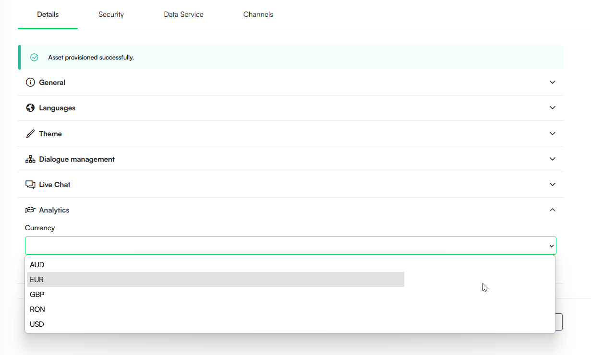

# Configuring AI Agent Advanced Settings

This section provides guidance on configuring advanced settings for your AI Agent to customize its behavior and functionality. All advanced settings are located on the AI Agent Details page.

### General Settings 

To set up the general details of your AI Agent, click the General section header and configure the following parameters:

| Parameter                 | Description                                                                                                                                                                                                                                                                                                                                                                                                                                                                                                          |
| ------------------------- | -------------------------------------------------------------------------------------------------------------------------------------------------------------------------------------------------------------------------------------------------------------------------------------------------------------------------------------------------------------------------------------------------------------------------------------------------------------------------------------------------------------------- |
| Name                      | The AI Agent name. This field is mandatory and is automatically filled during AI Agent creation.                                                                                                                                                                                                                                                                                                                                                                                                                     |
| Deployment State          | Select a state (Live, Pre-Prod, Dev, Trial, POC, Demo, etc.) to indicate the environment or stage of deployment for this AI Agent. When viewing all AI Agents (**All Settings** > AI Agents), this selection is displayed as a label below the AI Agent name for easy identification.                                                                                                                                                                               |
| Description               | Provide a brief description of your AI Agent.                                                                                                                                                                                                                                                                                                                                                                                                                                                                        |
| Enable web socket         | Select the checkbox to enable communication over the WebSocket Protocol.                                                                                                                                                                                                                                                                                                                                                                                                                                             |
| Block file upload         | Select this option to restrict users from uploading files within chats. Users receive a notification that can be customized under **Dialogue management** > **Special messages**.                                                                                                                                                                                                                                                                       |
| Allow file upload in idle | Select this option to permit a user to upload a file while the conversation is in Idle mode. If this setting is not selected, the AI Agent responds with the **FileUploadedInIdle** special message, informing the user that file uploads are only permitted when actively requested within a flow.                                                                                                                                                                                                                  |
| Is out of band upload     | By default, users can upload files of maximum 4 MB in the chat. **NOTE:** For **exceptional situations only**, select **Is out of band upload** to allow users uploading files of maximum 20 MB in the chat.                                                                                                                                                                                                                                                                                                         |
| Allowed file types        | Defines the default file type list permitted for upload across the entire AI Agent. This setting serves as the global fallback if no specific restrictions are defined at the flow step or conversation level. Select one or more file extensions from the dropdown to restrict uploads to those specific formats. If no file types are selected, the system allows all supported file extensions by default. **NOTE:** This parameter is available starting with Druid version 9.22.                                |
| Bot Framework Version     | Bot Framework version 4 is selected by default and it offers enhanced customization options and features such as adaptive cards in conversational flows.                                                                                                                                                                                                                                                                                                                                                             |
| Allowed Origins           | Enhance AI Agent security by defining specific domains authorized to host or access your AI Agent. This configuration ensures that only requests from trusted sources are processed. **NOTE:** Enter the allowed origins in the format https://domain.tld and use a semicolon (;) to separate multiple entries. **Example** `https://mydomain.com; https://subdomain.mydomain.com; https://www.weather.com` **NOTE:** Wildcards (e.g., \*.domain.com) are not supported; each subdomain must be listed individually. |
| BotId                     | This unique AI Agent identifier is automatically filled by the system.                                                                                                                                                                                                                                                                                                                                                                                                                                               |
| SourceId                  | This unique identifier is used for element identification during the import-export process and is automatically filled by the system.                                                                                                                                                                                                                                                                                                                                                                                |

### Special Flows & Predefined Responses

The AI Agent Designer allows you to define specific responses triggered by special events during a conversation.

#### Define Special Flows

Special flows are automatically triggered when certain events occur (e.g., when an intent is not recognized). To configure these flows:

1. Select the desired flows from the appropriate dropdown fields (e.g., Welcome flow, Intent not found).

For more information about special flows, see [Special Flows](<../4_Flows/Special Flows.md>).

2. Click **Save** at the bottom of the page.

#### Manage Predefined Responses

The system uses predefined keys (special messages) for responses triggered by events like cancellation or inactivity. Druid special messages are customizable per AI Agent to suit your specific requirements.

There are two types of special messages:

* **Default system messages**: These messages are automatically included in all AI Agents.
* **New special messages**: These are not automatically propagated and are highlighted in orange for easy identification. The Flow Engine does not use these messages during conversation time.

**Actions for Custom Messages**

* To add a system message to your AI Agent for customization, click the **Add message to AI Agent** icon associated with the desired message(s).
* To delete a custom message from the AI Agent, click the **Remove from AI Agent special messages** icon in front of that message.

To localize or customize these responses:

1. Scroll down to the Keys table.

2. For each predefined response, provide the default and localized keys for any additional languages.
3. Click **Save**.

**Customizable Special Messages Reference**

The table below lists all customizable special messages and describes when each message is sent to the user.

| Special Message                | Description                                                                                                                                                                                                                                                                                                                                                                                       |
| ------------------------------ | ------------------------------------------------------------------------------------------------------------------------------------------------------------------------------------------------------------------------------------------------------------------------------------------------------------------------------------------------------------------------------------------------- |
| AdaptiveCardNotSubmitted       | Notifies the user to submit their response using the adaptive card options after they attempt to type something else in the chat.                                                                                                                                                                                                                                                                 |
| CancelReplyMessage             | Acknowledges the user's "cancel" request and confirms that the current process has been stopped.                                                                                                                                                                                                                                                                                                  |
| CantDiscloseInformation        | Alerts the user that they lack permission to access the matched intent because their role does not match the flow's configured roles.                                                                                                                                                                                                                                                             |
| CantInvokeAlertFlow            | Informs the user that the alert flow cannot be triggered due to technical reasons.                                                                                                                                                                                                                                                                                                                |
| ChooseVariant                  | Appears when the user's input does not match any available options at a step requiring a choice (e.g., hero, choice cards) and intent switching is disabled. This message will be displayed until a valid choice is made.                                                                                                                                                                         |
| DoNotSeeMore                   |                                                                                                                                                                                                                                                                                                                                                                                                   |
| DoSeeMore                      |                                                                                                                                                                                                                                                                                                                                                                                                   |
| DoYouWantToSeeMore             | Prompts the user to indicate if they wish to continue viewing a list of results or options.                                                                                                                                                                                                                                                                                                       |
| FileUploadedInIdle             | Informs the user that file uploads are only allowed when actively requested, as the conversation is currently in Idle mode.                                                                                                                                                                                                                                                                       |
| InactivityCancelConversation   | Displays when a conversation is automatically canceled due to user inactivity. If no specific flow is configured for handling inactivity (Inactivity Cancel Conversation Flow), the AI Agent responds with this message before ending the conversation. If the inactivity threshold is reached while an inactivity flow is running, this message is also sent before the conversation is dropped. |
| InputValueInterpretationError  | Prompts the user to clarify their response when the Flow Engine extracts some entity fields but not the specific entity field required by the flow step's input mapping.                                                                                                                                                                                                                          |
| InsertDateAlso                 | The default message sent during input mapping for a DateTime field when the user's response only includes the time component.                                                                                                                                                                                                                                                                     |
| InsertHourAlso                 | The default message sent during input mapping for a DateTime field when the user's response only includes the date component.                                                                                                                                                                                                                                                                     |
| LoadingExistingConversation    | Displays while the AI Agent is retrieving and loading the data or context from a previous, existing conversation session.                                                                                                                                                                                                                                                                         |
| NoBotAccess                    | The default message sent when the user's roles do not match any roles configured on the AI Agent.                                                                                                                                                                                                                                                                                                 |
| NoIntentIdentified             | The default fallback message used when the AI Agent does not recognize the user's intent and no specific **Intent not recognized flow** is configured.                                                                                                                                                                                                                                            |
| NoPermissionsForTargetIntent   | Alerts the user that their current security role does not have permission to trigger the requested target intent.                                                                                                                                                                                                                                                                                 |
| NothingImplemented             | Displays a generic response when a requested action or a newly added system key has not yet had a corresponding flow or response configured.                                                                                                                                                                                                                                                      |
| OAuthLink                      | Delivers a secure authentication link in the chat when a user attempts to access restricted features. Following this link allows the user to verify their identity and gain the necessary authorization.                                                                                                                                                                                          |
| ReleaseErrorMessage            | Notifies the user that an error occurred during the conversation and prompts further action if needed.                                                                                                                                                                                                                                                                                            |
| ResetReplyMessage              | Confirms that the conversation reset request (the user typed "reset" in the chat) has been acknowledged.                                                                                                                                                                                                                                                                                          |
| SensitiveDataInputWarning      | Displays during Prompt steps that involve sensitive data handling.                                                                                                                                                                                                                                                                                                                                |
| UploadFileBlocked              | Displays when a user attempts to upload a file on an AI Agent that has the **Block file upload setting** enabled. The AI Agent will prevent file uploads, ensuring that no files can be shared through the chat.                                                                                                                                                                                  |
| UploadFileFailed               | Displays when a user attempts to upload a file that does not meet the defined file restrictions (e.g., unsupported file type or maximum allowed size exceeded). When a file upload fails validation, Druid raises an exception that can be handled in the flow to guide the user accordingly. For more information, see [File Upload](<../4_Flows/File Upload Steps Configuration.md>).           |
| WaitForConnectorActionComplete | Displays when a user sends a message while the AI Agent is processing a delay on a flow step. The delay, set between 1 and 10 seconds, occurs between the pre-action and the step message. If the user interacts with the AI Agent during this waiting period, the AI Agent responds with this special message to inform them that it is still processing their request.                          |

### Configure Analytics

Configure the **Currency** metric used for Dashboard FTEs (Full-Time Equivalents) in the Analytics section.

To set the currency metric name for Dashboard FTEs:

1. Click the **Analytics** section header.
2. Select the desired currency from the **Currency** dropdown. If no currency is selected, Druid uses the default value, **EUR**.

### Related Topics

* [Creating AI Agents](<Creating AI Agents.md>)
