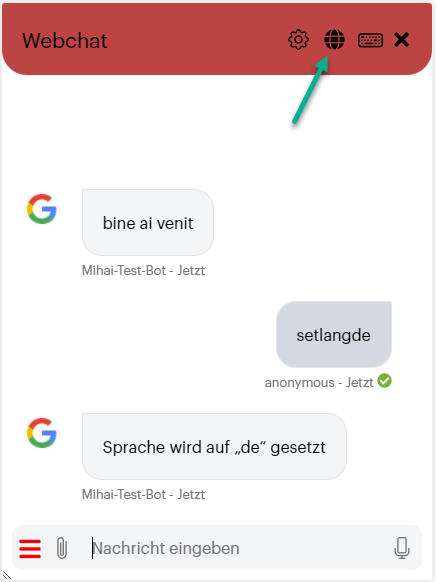

# Conversation Time Translation

Conversation Time Translation facilitates seamless communication in multiple languages during a chat session. When a language change occurs, all inbound and outbound messages are automatically translated between the AI Agent default language and the newly selected language. This ensures effective communication regardless of the user's preferred language.

### How Conversation Time Translation Works

This feature operates by using a machine translation service to translate the user's message into the AI Agent default language for processing, and then translating the response back to the user's language.

The procedure is as follows:

1. **User Input**: The user sends a message in Language A.
2. **Inbound Translation**: A Machine Translation service translates the text into the AI Agent default language.
3. **Processing**: Natural Language Processing (NLP) and other logic are executed in the AI Agent default language.
4. **Response Generation**: A response is generated in the AI Agent default language.
5. **Outbound Translation**: The Machine Translation service translates the response back into Language A.
6. **AI Agent Output**: The AI Agent sends the translated text to the user in Language A.

### Key Feature Points

* **Machine Translation Trigger**: Machine translation is only used when the user's language (ChatUser.Language) differs from the languages explicitly set on the AI Agent.
* **Manual Translation**: If you have manually configured additional languages on the AI Agent, you are responsible for authoring the translations for those specific languages.
* **Voice AI Agents**: You can develop multi-language voice AI Agents using machine translation for voice channel interactions. For more information, see Voice Channel.
* **Webchat Language Selector**: When Conversation Time Translation is enabled:
* The standard language selector on the webchat is replaced with a World icon. This icon is non-selectable because users can freely communicate in any language, not just those set for the AI Agent.

* The webchat snippet automatically adapts the language code for voice messages, sending them to the STT (Speech-to-Text) service in the language the user is speaking.
* **Adaptive Card Control**: You can prevent specific element properties on adaptive cards from being translated. For more information, see [Adaptive Cards Steps](<../4_Flows/Adaptive Cards Steps.md>).

### Using Multiple Translation Services

Using multiple translation service providers (e.g., SDL, Azure Translator, and LLM) simultaneously can be useful for addressing languages not supported by a single provider.

#### Configuration Rules

1. **Specific languages field**: To use multiple providers, specify the desired language codes for each provider in the **Specific languages** field.
2. **Unique codes**: Ensure all language codes are unique per provider to prevent configuration errors.
3. **Handling unspecified languages**: A provider can be designated to handle all languages not specifically assigned to another service by leaving its Specific languages field empty. _Example_: To use Azure Translator for Maori (mri) and SDL for all others, specify "mri" for Azure Translator and leave the **Specific languages** field empty for SDL.

4. **The "one empty field" constraint**: Only one active machine translation services provider can have the **Specific languages** field empty. Attempting to leave the field empty for multiple providers will result in an error and prevent the AI Agent settings from being saved.
