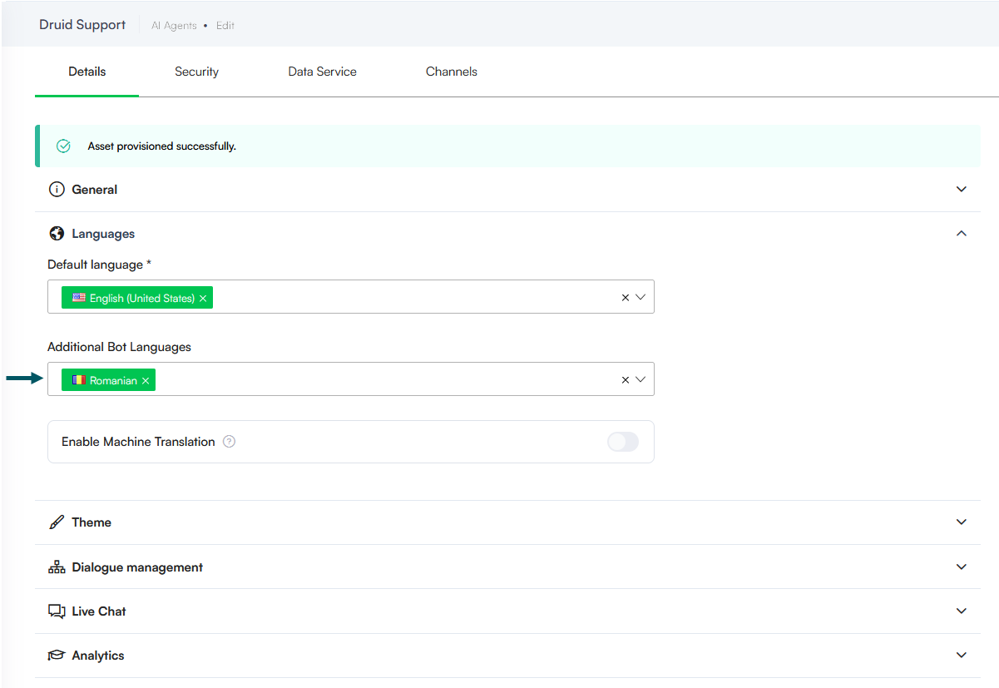

---
layout:
  title:
    visible: false
---

# Multilingual AI Agents

Create AI Agents that communicate effectively with users in multiple languages by using either manual translations or real-time machine translation.

Druid supports two approaches to building multilingual AI Agents:

- **Manual authoring**: Add multiple languages to your AI Agent and translate all flow content and linguistic elements manually.
- **Machine translation**: Enable real-time machine translation (SDL, Azure Translator or eTranslation) to automatically translate messages and interactions on the fly.

## Manually author the AI Agent in multiple languages

If you require full control and precise localization for each language, follow these steps to manually author your AI Agent:

1. Navigate to your AI Agent Details page.
2. Click the **Languages** section header.
3. Add the additional languages you want to support.

4. Click **Save** to apply the language settings.
5. For each added language, translate all relevant content, including:

- Flow messages
- Buttons
- Variables
- Intents
- Entity values

> **Info:** This option requires more effort but provides greater localization accuracy.

## Use real-time machine translation

To reduce manual effort, you can rely on machine translation. This strategy allows you to author your AI Agent in a single language (typically English), and the translation service will handle multilingual conversations in real time.

For information on how machine translation works and how to enable and configure it on your AI Agent, see [Using Machine Translation](Using%20Machine%20Translation.md).
