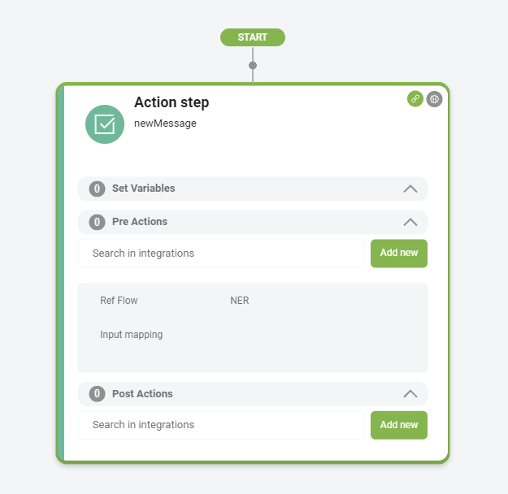

# Action

The Action step is a key component, allowing your AI Agent to execute actions in external applications or perform system integrations (referred to as Internal Actions).

To add and configure an Action step in a DRUID flow:

1. Open the desired flow in Flow Diagram view.
2. Expand the Flow Palette, then drag the **Action** step from the Dialog category into the main flow window and drop it onto the step you want to link it to.
3. Select the step on the diagram, then click the **Settings** icon from the Actions menu.
4. Set the General parameters:

* **Step name**: Enter a descriptive name for the step (e.g., RunAddContact) to clarify its purpose.
* **Step message**: (Optional) Enter the message the AI Agent will display when it reaches this step before executing the action. Often, no message is necessary for Action Steps.

5. If you need to put information into a specific context, use [Set Variable](<Set Variables.md>).
6. Click **Save**.
7. Double-click the Action step on the flow window to expand it.

8. Configure Druid integrations in either the Pre Action or Post Action sections. Select or create an integration:

* Choose an existing integration by searching in the integrations field.
* Create a new integration directly from the step by clicking the **Add new** button and configure the integration.

9. To delay the step message (if any) or run integrations defined in the step in parallel, configure [Metadata](Metadata.md).
10. Click **Save** to save the settings.

By following these steps, you can effectively use the Action Step to execute various integrations, enhancing the functionality of your Druid AI Agent.

### Related Topics

* [Code Extension](<Code Extension.md>)
* [Common Flow Settings](<Common Flow Settings.md>)
* [Enterprise Connectors](<../7_Integrations/Enterprise Connectors.md>)
