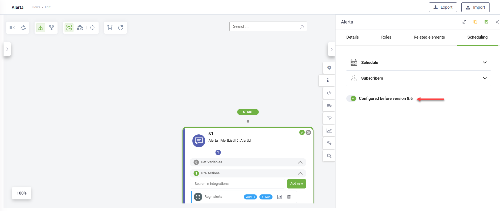
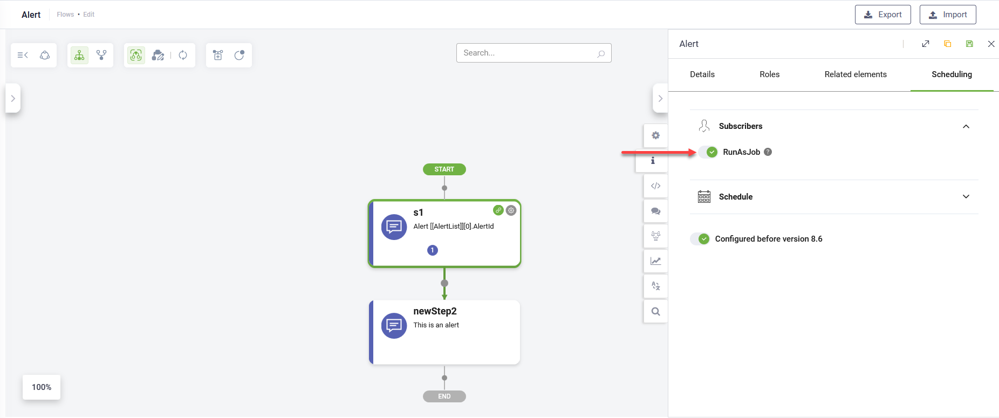
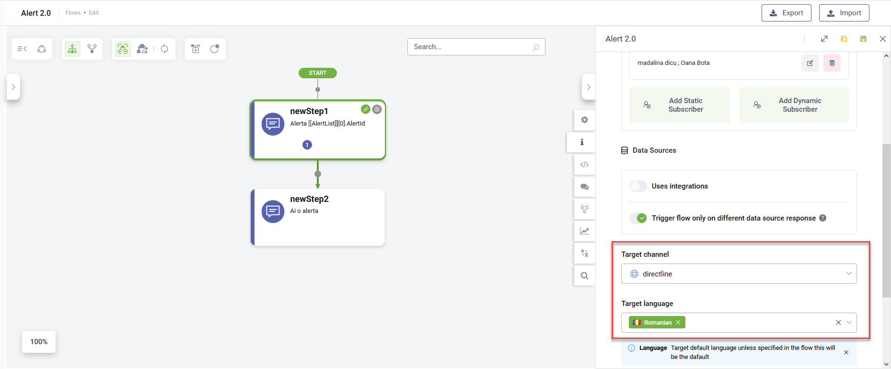
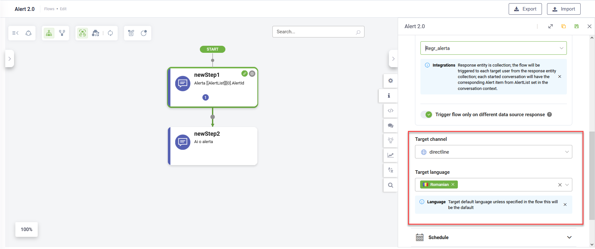

# Alert Flows

Alert Flows enable you to trigger dialogues (flows) for specific users or conversations on a scheduled basis. Unlike external events sent to DRUID endpoints, alert flows are initiated directly by the DRUID conversational engine.


**NOTE:** For backwards compatibility, alerts configured before version 8.6, have the “Configured before version 8.6” option enabled by default.

To use the new Alert functionality, disable this option and configure the schedule via the **Scheduling** tab on the flow configuration page.


### Create an Alert flow

To create an alert flow, follow these steps:

1. Add a new flow.
2. Select the flow type **Alert** and click **Save**.

3. Assign security roles (**Admin** and **User**) and click **Save**.

4. Add the necessary steps to the flow.

### Configure Alert flow scheduling

Navigate to the **Scheduling** tab to set the recipients and timing for the alert.

The way you configure the alert scheduling depends on the type of alert you want to send:

* Send alerts to specific, static users without evaluating an external data source. Examples include:
  * Sending a "Good Morning" message to specific employees.
  * Triggering automation at specific times for specific users.
* Send alerts to users identified through an external data source, dynamically filtered based on conditions. E.g., sending a "Happy Birthday" message to employees whose birthdays are today.


**NOTE:** Alerts are only sent to authenticated users who have interacted with the AI Agent at least once.


#### Sending alerts in automated workflows


**NOTE:** This feature is available in DRUID 9.5 and higher.


To deliver alerts as part of an automated workflow, use the **Run As Job** option in the Subscribers section.

When this option is enabled:

* Alerts are sent through a dedicated static Portal user (created automatically if it doesn’t already exist) instead of a live subscriber.
* The system generates a conversation ID (if one doesn’t exist) and sends an initial message to activate the conversation.
* The same conversation is then used to deliver the alert flow.

#### Sending alerts to static users

To send alerts to statics users, follow these steps:

1. Click on the Subscribers section.
2. Click the **Add Static Subscriber** button.
3. Select the desired authenticated user(s) (users who have chatted with the AI Agent at least once) from the list and click the **Save** icon displayed inline.

4. What you do next depends on your alert use case:

* To send a simple message to selected users, skip **Uses integrations**.
* To alert static users only when a change occurs in a database or third-party tool (e.g., an account balance update), tap **Uses integrations** under Data sources, select the relevant integration, and enable **Trigger flow only on different data source response**.

* To alert static users with information from a third-party tool (e.g., their current account balance), tap **Uses integrations** under Data Sources and select the integration that retrieves the account balance.

5. Specify the **Target channel** and **Target language** in which the flow will be executed.

6. Click on the Schedule section and select **Is scheduler enabled**.
7. Set the schedule based on your requirements.

8. Save the flow.

#### Sending alerts to dynamic users

To send alerts to dynamic users identified through an external data source, follow these steps:

1. Click on the Subscribers section.
2. Click the **Add Dynamic Subscriber** button.
3. In the **New Dynamic Subscriber** field, enter the entity field that returns the unique identifier for each user (e.g., Email) and save it.

4. Under Data sources, select the integration configured to identify users through your external data source.

If the integration response is not a collection, choose the field containing the list of target users.

If the integration response is a collection, the flow will be triggered to each target user from the response entity collection.

5. To send alerts only when the data source response changes, select **Trigger flow only on different data source response**. If this is disabled, alerts will be sent regardless of changes in the data source.
6. Specify the **Target channel** and **Target language** in which the flow will be executed.

7. Click on the Schedule section and select **Is scheduler enabled**.
8. Set the schedule based on your requirements.

9. Save the flow.

### Updating the Schedule

To modify an alert schedule:

1. Disable **Is scheduler enabled** and save the flow to temporarily deactivate the alert.
2. Make the necessary schedule updates.
3. Re-enable **Is scheduler enabled** and save the flow.


**NOTE:** Changes made while the scheduler is active will not take effect.


### Alert flows runtime considerations

* **Execution of Flows**: In the new Alerts implementation, the entire flow is executed, unlike earlier versions where only the first step was run.
* **Response Entity Context**: The response entity transferred to the conversation context for each user depends on the data source configuration. If the response entity is a collection (\[\[MyEntityList]]), each triggered conversation will have the corresponding item (\[\[MyEntity]]) from the collection set in the context.
* **Setting Variables**: Variables are not available in the first step of the flow. The flow initializes without context since it determines the target users only after executing the connector action. Connector actions should have fixed or hardcoded request parameters, or better yet, no request parameters.
