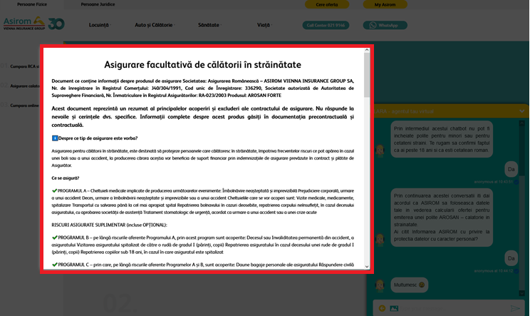

# Backchannel Event (Bot Framework v3)

Backchannel Event steps can trigger events in the web page that hosts the AI Agent.

You can use the Backchannel Event step in processes such as:

* Display additional information such as Customer 360, Medical Records, etc.
* Load iFrames directly in DRUID. The iFrames can contain: URLs, videos, images UiPath Apps, or load custom applications (e.g. CRM, Live Id).

This section describes how to use a backchannel event step to trigger a JavaScript function defined in the web page hosting the AI Agent.

### Prerequisites

In the source code of the web page hosting your AI Agent:

* Define the JavaScript function you want to trigger. It can be a function that loads a modal window, opens a link, etc.
* If you want to continue the conversation in DRUID after the backchannel event is executed, you need to have in place a **sendmessage** function that will trigger an utterance matching a corresponding flow already created in the AI Agent.

### Configuring Backchannel Event steps to trigger JavaScript functions

To configure a backchannel event step that triggers a JavaScript function defined in the web page hosting your AI Agent, follow these steps:

1. In the EditFlowStep page, click on the **General** section header. The section expands.
2. In the **Step name** field, enter the name of the JavaScript function defined in the source code of the web page hosting the AI Agent.


**IMPORTANT!** The step name should contain the exact name of the function; otherwise, the step will not trigger the JS function.


3. From the **Step message** remove the default message, leave it empty. We use Backchannel Event steps to trigger functions, and not to show messages in the chat.
4.  If you want to pass information to the backchannel event, in the **Input mapping** field, select the desired entity from which you will want to display information.

    > **IMPORTANT!** This not related also to receiving back information in the same entity.


**NOTE:** Filling in this field is mandatory, because the AI Agent will not be able to load the function. If you don’t pass information to the backchannel event step, just select any entity.


5. Save the step.

If you want to fill in DRUID entities after one backchannel event execution, you can use to train your flows using entities; this means that every time a condition is fulfilled in the JavaScript function, in the back end, the corresponding conversations will always be triggered.

#### Financial Use case: Handling the loan request calculator

Take for example one financial use case, when handling the loan request calculator. Every time the slicers are moved from a point to another, in the back corresponding conversations are triggered via DRUID NLP.

#### Authentication Flows Use case: After identifying users change their name in the AI Agent snippet

Another use case to handle the backchannel events is the one used in authentication flows when after you have identified a user you might want to change their name in the AI Agent snippet. You can do so by adding a step of type Backchannel Event on the flow. Name the step **userAuthenticated** and in the **Input mapping** field, add **\[\[ChatUser]]**.

### Related Topics

* [Common Flow Settings](<Common Flow Settings.md>)
* [Conversation Lifecycle](<Conversation Lifecycle.md>)
