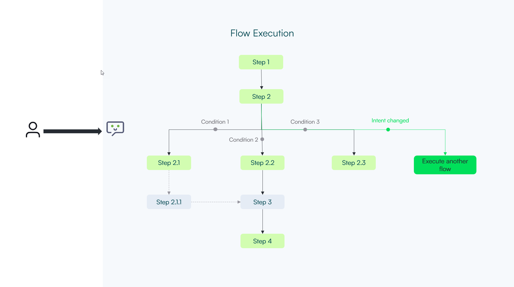

The lifecycle of a conversation within the Druid AI Platform consists of two primary states: "in flow" and "idle". An AI Agent transitions between these states based on user interactions and flow execution.

High-performance AI Agents aim to swiftly execute flows and transition to idle mode promptly. When an AI Agent enters idle mode, it indicates that it has effectively responded to the user and fulfilled the user's request. It's essential to prioritize efficient flow execution to minimize response time and optimize user experience.

The direction of the conversation is primarily dictated by user input. Although the AI Agent can guide the conversation, the user's input determines the conversational path. The AI Agent ensures a response to each user input, following a first-in, first-out (FIFO) order.

The diagram below describes an example of a flow execution.

Flow Execution Process:

- **Within Flow** status: The conversation is in "within flow" status when an active flow is running. In this state, the AI Agent executes the defined steps within the flow, sending messages to the user and gathering information as necessary. Once the flow concludes, the conversation transitions to "idle" status.
- **Idle** status: In "idle" status, no active flow is running, and the AI Agent awaits a new user intent to initiate a conversation.

User Input Processing Logic:

1. The user provides an input, referred to as an "utterance".
2. If the conversation status is "idle":

1. The AI Agent utilizes Natural Language Processing (NLP) to identify the user's intent.
2. If a confident intent is recognized (confidence above the defined threshold), the flow engine triggers the corresponding flow.
3. If no flow matches, the Intent Not Recognized flow is triggered.

3. If the conversation status is "within flow":

1. The AI Agent processes the utterance based on the **Input Mapping** expression in the current flow step.
2. If the expression type is text, the AI Agent sets the context and progresses to the next step.
3. If the expression type is typed (e.g., decimal, date, email), Named Entity Recognition (NER) is applied to map the input.

1. If the evaluation fails, the AI Agent attempts to identify a new intent before responding with an acknowledgment or requesting clarification.

1. Before responding with “I don’t understand” and asking the user for a new input, try to change the intent. Do the same steps as in (1.), looking for a new intent. If new intent is found, the AI Agent cancels the current flow and triggers the new one.
   Example:
   *U: I want to register a vacation leave
   B: Sure, I’ll register for you an vacation leave. Starting when? (expecting an date input)
   U: How man vacation days I have left? (not an date input)
   B: you have 12 vacation days left for this year (the AI Agent changed the flow)*
2. If no other intent is found, the AI Agent responds with “I don’t understand, please say again”.

2. If the evaluation is successful, the AI Agent proceeds to the next step based on the defined conditions.

1. Evaluates all conditions from the defined next steps excluding the empty ones.
2. The first true condition triggers the execution of the respective step.
3. If no true condition is found, looks for an empty condition.
4. If one empty condition is found, executes the step.
5. If no next steps are found, before raising event “No next step found”, does Predict, searches for an intent change. Like in step 1.b. If intent change found, cancels the current flow and triggers the new one. If intent change is not found, moves to step 6.
6. If no next steps found, the AI Agent raises the error event “No next step found”.


**NOTE:** All flow steps inherit the roles associated with the flow.


By adhering to this processing logic, the AI Agent efficiently handles user inputs and guides conversations seamlessly.

## Related Topics

- [Defining the Dialog](Defining%20the%20Dialog.md)
